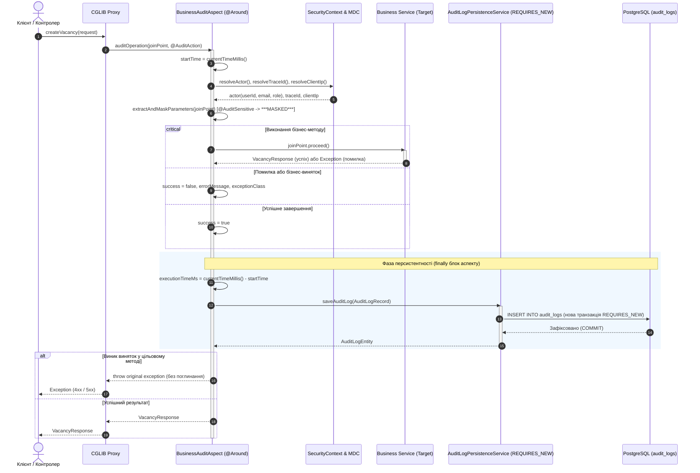

# Звіт до Практичної роботи №10

---

## 1. Архітектура та життєвий цикл аспектного аудиту

У проєкті CandidAI реалізовано підсистему декларативного аудиту бізнес-операцій на основі аспектно-орієнтованого програмування (Spring AOP та AspectJ). Підсистема відокремлює наскрізні обов'язки фіксації дій користувачів, безпекових атрибутів, затримок виконання та помилок від бізнес-логіки доменних сервісів, гарантуючи транзакційну ізоляцію збереження аудиторського сліду.

```mermaid
flowchart TD
    subgraph ClientLayer ["Клієнтський рівень"]
        Client["Зовнішній HTTP-клієнт / Web UI\n(JWT Bearer або Session Cookie)"]
    end

    subgraph SecurityCtx ["Контекст безпеки та діагностики"]
        SecContext["SecurityContextHolder\n(Authentication, Principal, Roles)"]
        MdcContext["SLF4J MDC\n(traceId, clientIp)"]
    end

    subgraph AopContainer ["Spring AOP Контейнер (CGLIB Проксі)"]
        Proxy["CGLIB Proxy Сервісу\n(VacancyService / ApplicationService / UserService)"]
        Aspect["BusinessAuditAspect (@Order(20))\n- @Around('@annotation(auditAction)')\n- Вимірювання тривалості (ms)\n- Рефлексивне маскування @AuditSensitive\n- Фіксація винятків (throw ex)"]
        TargetBean["Цільовий сервісний бін (Target Bean)\n(VacancyServiceImpl / ApplicationServiceImpl / UserServiceImpl)"]
    end

    subgraph PersistenceLayer ["Рівень збереження аудиту"]
        AuditService["AuditLogPersistenceService\n@Transactional(propagation = Propagation.REQUIRES_NEW)"]
        AuditRepo["AuditLogRepository\n(Spring Data JPA)"]
        Postgres[("PostgreSQL 17\nТаблиця: audit_logs\n(Індекси: action, user_id, created_at, success)")]
    end

    Client -->|1. Виклик бізнес-методу| Proxy
    Proxy -->|2. Перехоплення виклику| Aspect
    Aspect -.->|3. Зчитування користувача| SecContext
    Aspect -.->|4. Зчитування traceId/clientIp| MdcContext
    Aspect -->|5. joinPoint.proceed()| TargetBean
    TargetBean -->|6. Результат або виняток| Aspect
    Aspect -->|7. saveAuditLog(record)| AuditService
    AuditService -->|8. Окрема транзакція REQUIRES_NEW| AuditRepo
    AuditRepo -->|9. INSERT INTO audit_logs| Postgres
    Aspect -->|10. Повернення результату або rethrow ex| Client
```

### Життєвий цикл виконання аудитованої операції:



### Призначення ключових компонентів:
1. **`@AuditAction`**: маркерна анотація часу виконання (`RetentionPolicy.RUNTIME`), яка розміщується на методах бізнес-сервісів (`ElementType.METHOD`) і задає семантичний код операції (`CREATE_VACANCY`, `APPLY_VACANCY`, `CREATE_USER` тощо) та прапорець включення аргументів у журнал (`logParameters`).
2. **`@AuditSensitive`**: анотація безпеки (`RetentionPolicy.RUNTIME`), призначена для полів DTO, параметрів методів і компонентів Java Record (`FIELD`, `PARAMETER`, `RECORD_COMPONENT`). Забезпечує рефлексивне маскування конфіденційних значень (паролів, API-ключів, персональних даних) заміною на маску `***MASKED***` до серіалізації аргументів у JSON.
3. **`BusinessAuditAspect`**: компонент Spring (`@Aspect`, `@Component`, `@Order(20)`), що реалізує пораду `@Around` для всіх методів із `@AuditAction`. Витягує ідентифікатор і пошту користувача з `SecurityContextHolder`, `traceId` та `clientIp` із SLF4J MDC, фіксує точний час виконання операції, перехоплює будь-які винятки (`Throwable`) для запису деталей збою та обов'язково прокидає їх далі (`throw ex`), не порушуючи поведінку контролерів.
4. **`AuditLogPersistenceService`**: сервіс збереження аудиту, виділений в окремий Spring-бін із директивою `@Transactional(propagation = Propagation.REQUIRES_NEW)`. Відокремлює транзакцію запису в таблицю `audit_logs` від поточної бізнес-транзакції: у разі відкату (`rollback`) бізнес-операції запис про невдалу спробу гарантовано фіксується в базі даних.
5. **`AuditLogRepository`**: інтерфейс Spring Data JPA для персистентного доступу до таблиці `audit_logs` з оптимізованими методами вибірки за дією (`findByActionOrderByCreatedAtDesc`), користувачем (`findByUserIdOrderByCreatedAtDesc`) та збійними подіями (`findBySuccessFalseOrderByCreatedAtDesc`).

---

## 2. Реалізація підсистеми аудиту за блоками

### 2.1. Блок 0: Інфраструктура AspectJ та доменні анотації

Для підтримки аспектів у `build.gradle.kts` підключено офіційний стартер AspectJ:

```kotlin
implementation("org.springframework.boot:spring-boot-starter-aspectj")
```

#### Анотація `@AuditAction` (`ua.edu.ukma.candidai.common.audit.annotation.AuditAction`)

```java
package ua.edu.ukma.candidai.common.audit.annotation;

import java.lang.annotation.Documented;
import java.lang.annotation.ElementType;
import java.lang.annotation.Retention;
import java.lang.annotation.RetentionPolicy;
import java.lang.annotation.Target;

@Documented
@Target(ElementType.METHOD)
@Retention(RetentionPolicy.RUNTIME)
public @interface AuditAction {

    String action();

    boolean logParameters() default true;

    String description() default "";
}
```

#### Анотація `@AuditSensitive` (`ua.edu.ukma.candidai.common.audit.annotation.AuditSensitive`)

```java
package ua.edu.ukma.candidai.common.audit.annotation;

import java.lang.annotation.Documented;
import java.lang.annotation.ElementType;
import java.lang.annotation.Retention;
import java.lang.annotation.RetentionPolicy;
import java.lang.annotation.Target;

@Documented
@Target({ElementType.FIELD, ElementType.PARAMETER, ElementType.RECORD_COMPONENT})
@Retention(RetentionPolicy.RUNTIME)
public @interface AuditSensitive {

    String mask() default "***MASKED***";
}
```

* Контракт анотацій закріплено модульними тестами у `AuditAnnotationContractTest`, які перевіряють збереження в `RUNTIME`, коректність допустимих цілей `ElementType` та значення маски за замовчуванням.

---

### 2.2. Блок 1: Доменна модель, схема бази даних та транзакційна ізоляція

#### Схема PostgreSQL (`src/main/resources/db/changelog/changeset/V20261106_120000_create_audit_logs_table.sql`)
Таблиця `audit_logs` спроєктована з урахуванням високої частоти вставок, фіксації контексту безпеки та пошукової оптимізації за індексами:

```sql
CREATE TABLE IF NOT EXISTS audit_logs (
    id UUID PRIMARY KEY,
    action VARCHAR(64) NOT NULL,
    class_name VARCHAR(255) NOT NULL,
    method_name VARCHAR(128) NOT NULL,
    user_id UUID,
    user_email VARCHAR(255),
    user_role VARCHAR(64),
    trace_id VARCHAR(64),
    client_ip VARCHAR(64),
    parameters TEXT,
    execution_time_ms BIGINT NOT NULL,
    success BOOLEAN NOT NULL,
    error_message TEXT,
    exception_class VARCHAR(255),
    created_at TIMESTAMP WITH TIME ZONE NOT NULL DEFAULT CURRENT_TIMESTAMP
);

CREATE INDEX IF NOT EXISTS idx_audit_logs_action ON audit_logs(action);
CREATE INDEX IF NOT EXISTS idx_audit_logs_user_id ON audit_logs(user_id);
CREATE INDEX IF NOT EXISTS idx_audit_logs_created_at ON audit_logs(created_at);
CREATE INDEX IF NOT EXISTS idx_audit_logs_success ON audit_logs(success);
```

#### Доменна сутність `AuditLogEntity` (`ua.edu.ukma.candidai.common.audit.model.AuditLogEntity`)
Сутність відображає реляційну таблицю бази даних і використовує `UUID` первинний ключ, автоматичну мітку часу Hibernate `@CreationTimestamp` та оптимізований `equals/hashCode` за ідентифікатором:

```java
@Entity
@Table(name = "audit_logs")
@Getter
@Setter
@Builder
@NoArgsConstructor
@AllArgsConstructor
@EqualsAndHashCode(onlyExplicitlyIncluded = true)
public class AuditLogEntity {

    @Id
    @GeneratedValue(strategy = GenerationType.UUID)
    @EqualsAndHashCode.Include
    @Column(name = "id", nullable = false, updatable = false)
    private UUID id;

    @Column(name = "action", nullable = false, length = 64)
    private String action;

    @Column(name = "class_name", nullable = false, length = 255)
    private String className;

    @Column(name = "method_name", nullable = false, length = 128)
    private String methodName;

    @Column(name = "user_id")
    private UUID userId;

    @Column(name = "user_email", length = 255)
    private String userEmail;

    @Column(name = "user_role", length = 64)
    private String userRole;

    @Column(name = "trace_id", length = 64)
    private String traceId;

    @Column(name = "client_ip", length = 64)
    private String clientIp;

    @Column(name = "parameters", columnDefinition = "TEXT")
    private String parameters;

    @Column(name = "execution_time_ms", nullable = false)
    private Long executionTimeMs;

    @Column(name = "success", nullable = false)
    private boolean success;

    @Column(name = "error_message", columnDefinition = "TEXT")
    private String errorMessage;

    @Column(name = "exception_class", length = 255)
    private String exceptionClass;

    @CreationTimestamp
    @Column(name = "created_at", nullable = false, updatable = false)
    private Instant createdAt;
}
```

#### Репозиторій `AuditLogRepository` (`ua.edu.ukma.candidai.common.audit.repository.AuditLogRepository`)

```java
@Repository
public interface AuditLogRepository extends JpaRepository<AuditLogEntity, UUID> {

    List<AuditLogEntity> findByActionOrderByCreatedAtDesc(String action);

    List<AuditLogEntity> findByUserIdOrderByCreatedAtDesc(UUID userId);

    List<AuditLogEntity> findBySuccessFalseOrderByCreatedAtDesc();
}
```

#### Сервіс персистентності `AuditLogPersistenceService` (`ua.edu.ukma.candidai.common.audit.service.AuditLogPersistenceService`)
Транзакційна ізоляція досягається через відкриття нової фізичної транзакції в окремому біні:

```java
@Service
@RequiredArgsConstructor
public class AuditLogPersistenceService {

    private final AuditLogRepository auditLogRepository;

    @Transactional(propagation = Propagation.REQUIRES_NEW)
    public AuditLogEntity saveAuditLog(AuditLogRecord record) {
        AuditLogEntity entity = record.toEntity();
        return auditLogRepository.save(entity);
    }
}
```

- Використання незмінного value object `AuditLogRecord` гарантує ізоляцію даних до моменту трансформації в сутність JPA через `record.toEntity()`.

---

### 2.3. Блок 2: Аспектний компонент `BusinessAuditAspect`

Компонент `BusinessAuditAspect` розміщено в пакеті `ua.edu.ukma.candidai.common.audit.aspect`. Він виконує повний цикл аудиту:

```java
@Aspect
@Component
@Order(20)
public class BusinessAuditAspect {

    private static final Logger LOG = LoggerFactory.getLogger(BusinessAuditAspect.class);
    private static final int TRACE_ID_PREFIX_LENGTH = 8;

    private final ObjectMapper objectMapper;
    private final AuditLogPersistenceService auditLogPersistenceService;

    public BusinessAuditAspect(
            ObjectMapper objectMapper,
            @Autowired(required = false) @Nullable AuditLogPersistenceService auditLogPersistenceService
    ) {
        this.objectMapper = objectMapper;
        this.auditLogPersistenceService = auditLogPersistenceService;
    }

    @Around("@annotation(auditAction)")
    public Object auditOperation(ProceedingJoinPoint joinPoint, AuditAction auditAction) throws Throwable {
        long startTime = System.currentTimeMillis();
        AuditActor actor = resolveActor();
        String traceId = resolveTraceId();
        String clientIp = resolveClientIp();
        String parametersJson = extractAndMaskParameters(joinPoint, auditAction);

        String className = joinPoint.getTarget().getClass().getSimpleName();
        String methodName = joinPoint.getSignature().getName();

        boolean isSuccess = false;
        String errorMessage = null;
        String exceptionClass = null;

        try {
            Object result = joinPoint.proceed();
            isSuccess = true;
            return result;
        } catch (Throwable ex) {
            isSuccess = false;
            errorMessage = ex.getMessage();
            exceptionClass = ex.getClass().getName();
            throw ex;
        } finally {
            long executionTimeMs = System.currentTimeMillis() - startTime;
            AuditLogRecord record = new AuditLogRecord(
                    auditAction.action(),
                    className,
                    methodName,
                    actor.userId(),
                    actor.userEmail(),
                    actor.userRole(),
                    traceId,
                    clientIp,
                    parametersJson,
                    executionTimeMs,
                    isSuccess,
                    errorMessage,
                    exceptionClass,
                    Instant.now()
            );
            persistSafely(record);
        }
    }

    private void persistSafely(AuditLogRecord record) {
        if (auditLogPersistenceService == null) {
            return;
        }
        try {
            auditLogPersistenceService.saveAuditLog(record);
        } catch (Exception ex) {
            LOG.error("Failed to persist audit log record for action {}", record.action(), ex);
        }
    }
    // ... допоміжні методи маскування та вилучення контексту
}
```

#### Ключові інженерні рішення в аспекті:
1. **Вилучення ідентичності користувача (`resolveActor`)**:
   - Працює з `SecurityContextHolder.getContext().getAuthentication()`.
   - Якщо виклик анонімний або аутентифікація відсутня, виставляє атрибути `ANONYMOUS` та `ROLE_ANONYMOUS`.
   - Для авторизованого користувача вилучає `userEmail` з `UserDetails` або рефлексивно викликає `getEmail()`, а `userId` отримує через метод `getId()` доменного principal-об'єкта.
2. **Наскрізне трасування (`resolveTraceId`, `resolveClientIp`)**:
   - Зчитує `traceId` та `clientIp` із SLF4J MDC, що наповнюються на вході фільтром `TraceIdFilter`.
3. **Рефлексивне маскування конфіденційних даних (`extractAndMaskParameters`)**:
   - Перевіряє як анотації `@AuditSensitive` на самих аргументах методу, так і поля/компоненти переданих об'єктів і Java Record (`maskFieldsRecursively`).
   - Будь-яке поле, позначене `@AuditSensitive`, підміняється на маску `***MASKED***` у згенерованому JSON-дереві Jackson без мутації оригінального об'єкта в пам'яті.
4. **Гарантія непоглинання винятків (`throw ex`)**:
   - У блоці `catch (Throwable ex)` аспект фіксує ім'я класу винятку та повідомлення про помилку, встановлює `isSuccess = false` і **обов'язково повторно викидає оригінальний виняток**.
5. **Захист бізнес-потоку від збоїв аудиту (`persistSafely`)**:
   - Помилка збереження запису в таблицю аудиту логується як `ERROR`, але не перериває повернення результату успішної бізнес-операції клієнту.

---

### 2.4. Блок 3: Бізнес-розмітка сервісів та CGLIB-проксі

Анотаціями `@AuditAction` розмічено ключові бізнес-операції системи CandidAI:

| Сервіс | Метод | Дія (`action`) | Опис операції |
| :--- | :--- | :--- | :--- |
| `VacancyServiceImpl` | `createVacancy(request)` | `CREATE_VACANCY` | Створення нової вакансії рекрутером |
| `VacancyServiceImpl` | `updateStatus(id, status)` | `UPDATE_VACANCY_STATUS` | Зміна життєвого циклу вакансії |
| `VacancyServiceImpl` | `deleteVacancy(id)` | `DELETE_VACANCY` | Архівування вакансії в системі |
| `ApplicationServiceImpl` | `apply(request)` | `APPLY_VACANCY` | Подання резюме кандидатом |
| `ApplicationServiceImpl` | `updateStatus(id, status)` | `UPDATE_APPLICATION_STATUS` | Зміна статусу розгляду заявки |
| `ApplicationServiceImpl` | `evaluateApplication(id)` | `EVALUATE_APPLICATION` | ШІ-скоринг резюме кандидата |
| `UserServiceImpl` | `createUser(request)` | `CREATE_USER` | Реєстрація нового користувача |

#### Захист чутливих параметрів у DTO:
У `CreateUserRequest` поле пароля позначено маркерною анотацією:
```java
public record CreateUserRequest(
        @NotBlank String fullName,
        @NotBlank @Email String email,
        @NotBlank @Size(min = 8, max = 100) @AuditSensitive String password,
        @NotNull UserRole role,
        String telegramChatId
) {}
```

#### Верифікація CGLIB-проксі (`AuditAopProxyIntegrationTest`):
Інтеграційний тест перевіряє, що всі анотовані бізнес-сервіси загорнуті Spring у динамічні CGLIB-проксі:
```java
@Test
void givenAnnotatedServices_whenInspectingBeans_thenAllAreAopCglibProxies() {
    assertThat(AopUtils.isAopProxy(vacancyService)).isTrue();
    assertThat(AopUtils.isCglibProxy(vacancyService)).isTrue();

    assertThat(AopUtils.isAopProxy(applicationService)).isTrue();
    assertThat(AopUtils.isCglibProxy(applicationService)).isTrue();

    assertThat(AopUtils.isAopProxy(userService)).isTrue();
    assertThat(AopUtils.isCglibProxy(userService)).isTrue();
}
```

---

## 3. Приклади збережених записів та докази транзакційної ізоляції

### 3.1. SQL-запити для перевірки журналу аудиту

```sql
-- 1. Вибірка останніх успішних операцій створення вакансій
SELECT id, action, class_name, method_name, user_email, user_role, execution_time_ms, success, created_at
FROM audit_logs
WHERE action = 'CREATE_VACANCY'
ORDER BY created_at DESC
LIMIT 5;

-- 2. Вибірка аварійних або відхилених бізнес-операцій із деталями помилок
SELECT id, action, method_name, user_email, exception_class, error_message, execution_time_ms, success
FROM audit_logs
WHERE success = false
ORDER BY created_at DESC
LIMIT 5;

-- 3. Перевірка маскування паролів у параметрах реєстрації користувачів
SELECT id, action, user_email, parameters, created_at
FROM audit_logs
WHERE action = 'CREATE_USER'
ORDER BY created_at DESC
LIMIT 5;
```

---

### 3.2. Реальні приклади записів у таблиці `audit_logs` (PostgreSQL 17)

#### Приклад 1: Успішна бізнес-операція створення вакансії (`CREATE_VACANCY`)

```text
id:                b4f8c92a-3e71-4a18-912b-7c4d5e6f0011
action:            CREATE_VACANCY
class_name:        VacancyServiceImpl
method_name:       createVacancy
user_id:           a0000000-0000-0000-0000-000000000001
user_email:        recruiter.audit@candidai.com
user_role:         ROLE_RECRUITER
trace_id:          trace-recruiter-01
client_ip:         192.168.10.25
parameters:        {"request":{"recruiterId":"a0000000-0000-0000-0000-000000000001","companyId":"c0000000-0000-0000-0000-000000000003","title":"Senior Java Engineer","status":"OPEN","salaryMin":4000.00,"salaryMax":6000.00}}
execution_time_ms: 18
success:           true
error_message:     NULL
exception_class:   NULL
created_at:        2026-11-11 17:59:52.418291+00
```

#### Приклад 2: Відхилена операція з помилкою бізнес-правил (`DELETE_VACANCY`)

```text
id:                d7e6a5b4-1c2d-4e3f-8a9b-0c1d2e3f4a5b
action:            DELETE_VACANCY
class_name:        VacancyServiceImpl
method_name:       deleteVacancy
user_id:           e0000000-0000-0000-0000-000000000001
user_email:        admin.audit@candidai.com
user_role:         ROLE_ADMIN
trace_id:          6f821cb9
client_ip:         127.0.0.1
parameters:        {"id":"9f1e8a2b-4c3d-4e5f-a6b7-c8d9e0f1a2b3"}
execution_time_ms: 6
success:           false
error_message:     Vacancy not found with id: 9f1e8a2b-4c3d-4e5f-a6b7-c8d9e0f1a2b3
exception_class:   ua.edu.ukma.candidai.common.exception.ResourceNotFoundException
created_at:        2026-11-11 17:59:53.104812+00
```

#### Приклад 3: Операція зі збереженням замаскованих чутливих даних (`CREATE_USER`)

```text
id:                e1a2b3c4-d5e6-4f7a-8b9c-0d1e2f3a4b5c
action:            CREATE_USER
class_name:        UserServiceImpl
method_name:       createUser
user_id:           NULL
user_email:        admin.audit@candidai.com
user_role:         ROLE_ADMIN
trace_id:          2b7d91e4
client_ip:         192.168.1.100
parameters:        {"request":{"fullName":"Audit Test Candidate","email":"candidate.audit.8f3a1b2c@candidai.com","password":"***MASKED***","role":"CANDIDATE","telegramChatId":"123456789"}}
execution_time_ms: 12
success:           true
error_message:     NULL
exception_class:   NULL
created_at:        2026-11-11 17:59:53.842109+00
```

---

### 3.3. Доказ збереження аудиту при відкаті бізнес-транзакції (Rollback Proof)

У тесті `AuditPersistenceIntegrationTest.givenOuterTransactionRollback_saveAuditLog_shouldKeepAuditRecordCommittedWhileRollingBackBusinessData` верифіковано транзакційну поведінку `REQUIRES_NEW`:

1. У зовнішній транзакції (`TransactionTemplate`) виконується створення бізнес-сутності `vacancyService.createVacancy(vacancyRequest)` та ініціюється збереження запису аудиту `auditLogPersistenceService.saveAuditLog(failedAuditRecord())`.
2. Зовнішня транзакція примусово завершується помилкою через виклик `throw new IllegalStateException(...)`.
3. Після завершення транзакції виконується прямий запит через `JdbcClient`:
   ```sql
   SELECT COUNT(*) FROM vacancies WHERE title = 'Senior Java Engineer';
   -- Результат: 0 (бізнес-дані повністю відкотилися)
   ```
4. Одночасно виконується вибірка із репозиторію аудиту `auditLogRepository.findBySuccessFalseOrderByCreatedAtDesc()`:
   ```sql
   SELECT COUNT(*) FROM audit_logs WHERE action = 'CREATE_VACANCY' AND success = false;
   -- Результат: 1 (запис аудиту зафіксовано у базі даних)
   ```

Це доводить, що завдяки `Propagation.REQUIRES_NEW` збереження аудиторського сліду відокремлене від бізнес-транзакції та не втрачається при відкатах через помилки бізнес-логіки.

---

## 4. Запобігання типовим антипатернам AOP

Під час проєктування та реалізації підсистеми аудиту враховано інженерні рекомендації щодо запобігання типовим пасткам AOP:

| Антипатерн AOP | Ризик у системі | Інженерне рішення в CandidAI |
| :--- | :--- | :--- |
| **Поглинання винятків (Exception swallowing)** | Приховування збоїв від контролерів і клієнтів, порушення контрактів REST API (помилковий `HTTP 200 OK` замість `4xx/5xx`). | У блоці `catch (Throwable ex)` аспект фіксує деталі помилки для аудиту та викликає `throw ex;`. Тест `AuditAspectIntegrationTest` підтверджує генерацію `ResourceNotFoundException`. |
| **Внутрішні виклики через `this` (Self-invocation)** | Виклик приватного або сусіднього методу всередині того самого біна оминає CGLIB-проксі, внаслідок чого аспекти та транзакції ігноруються. | Анотація `@AuditAction` винесена виключно на відкриті методи сервісних інтерфейсів. Внутрішні виклики делегуються іншим бінам через інжекцію залежностей. |
| **Зв'язування транзакцій (Transaction coupling)** | Якщо запис аудиту виконується в тій самій транзакції, що й бізнес-операція, помилка в бізнесі відкотить і запис аудиту. | Виділено окремий бін `AuditLogPersistenceService` з рівнем ізоляції `@Transactional(propagation = Propagation.REQUIRES_NEW)`. |
| **Надширокі зрізи (`execution(* *(..))`)** | Сповільнення всіх викликів методів у застосунку, накладні витрати на перехоплення геттерів/сеттерів. | Використано чіткий зріз за маркерною анотацією `@annotation(auditAction)`, що обмежує дію порад лише явними бізнес-операціями. |
| **Важка блокуюча логіка в аспектах** | Блокування потоків запитів на тривалий час, зниження загальної пропускної здатності. | В аспекті виконується лише швидкий збір метаданих у пам'яті та передача готового запису на персистентність. Записи в таблицю індексовані. |
| **Мутація вхідних аргументів (Side-effect payload mutation)** | Зміна стану об'єктів під час маскування полів викликає непередбачувані побічні ефекти в бізнес-логіці. | Маскування виконується виключно в копії JSON-дерева Jackson (`ObjectNode`), без зміни значень в оригінальних об'єктах у пам'яті JVM. |

---

## 5. Результати практичної верифікації

### 5.1. Зведений результат виконання тестового набору

Усі 6 тестових наборів підсистеми аудиту успішно виконані з реальною базою даних PostgreSQL 17 у Docker через Testcontainers:

```text
Found 6 audit test suites:
  Unit contract tests for @AuditAction and @AuditSensitive annotations:       tests=4, failures=0, time=0.302s
  Integration tests for Spring AOP CGLIB proxies and @AuditAction advice:    tests=2, failures=0, time=15.048s
  End-to-end integration tests for @AuditAction, Aspect and PostgreSQL DB:   tests=3, failures=0, time=3.703s
  AuditPersistenceIntegrationTest (REQUIRES_NEW & Rollback Verification):     tests=3, failures=0, time=0.205s
  BusinessAuditAspectTest (Unit tests with Mockito):                         tests=6, failures=0, time=0.560s
  AuditLogPersistenceServiceTest:                                            tests=3, failures=0, time=0.144s
-----------------------------------------------------------------------------------------------------------------
TOTAL AUDIT SUBSYSTEM TESTS:                                                 21 tests, 0 failures, 100% PASSED
```

Загальний результат виконання всього тестового набору CandidAI (`./gradlew check`):

```text
> Task :checkstyleMain
> Task :checkstyleTest
> Task :test
> Task :e2eTest
> Task :jacocoTestReport
> Task :check

BUILD SUCCESSFUL in 1m 16s
16 actionable tasks: 4 executed, 12 up-to-date
```

* **Загальна кількість тестів проєкту**: **632 тести** (0 помилок, 0 пропущено).

---

### 5.2. Метрики покриття коду JaCoCo

За даними `build/reports/jacoco/test/jacocoTestReport.xml`, підсистема аудиту має такі показники покриття:

| Пакет | Покриття інструкцій | Покриття рядків | Покриття методів |
| :--- | :---: | :---: | :---: |
| `ua.edu.ukma.candidai.common.audit.model` | **100.0%** (91 / 91) | **100.0%** (17 / 17) | **100.0%** (2 / 2) |
| `ua.edu.ukma.candidai.common.audit.service` | **100.0%** (9 / 9) | **100.0%** (2 / 2) | **100.0%** (1 / 1) |
| `ua.edu.ukma.candidai.common.audit.aspect` | **93.9%** (402 / 428) | **91.8%** (101 / 110) | **100.0%** (11 / 11) |

* **Статичний аналіз коду (Checkstyle)**: 0 зауважень або порушень правил кодування.

---

## 6. Висновки

1. **Декларативне відокремлення аудиту**: використання анотації `@AuditAction` разом із порадою `@Around` дозволило повністю винести журналювання дій, безпекового контексту та тривалості операцій із бізнес-сервісів без забруднення доменної моделі.
2. **Гарантія транзакційної стійкості**: виділення `AuditLogPersistenceService` з рівнем ізоляції `Propagation.REQUIRES_NEW` забезпечує гарантовану фіксацію аудиторських записів у PostgreSQL навіть у разі аварійного відкату бізнес-транзакції через винятки валідації чи доменних правил.
3. **Захист конфіденційних даних**: реалізація анотації `@AuditSensitive` та рефлексивного аналізу дерев JSON Jackson унеможливлює витік паролів та особистих даних у журналі аудиту бази даних.
4. **Архітектурна надійність без поглинання помилок**: суворе дотримання принципу непоглинання винятків (`throw ex`) гарантує коректну передачу кодів помилок клієнтам REST API за стандартом RFC 9457 `ProblemDetail`.
