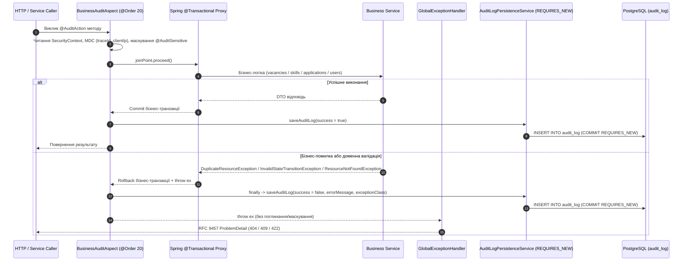

# Практична робота №10. Аспектно-орієнтований аудит бізнес-операцій

**Мета:** реалізувати наскрізну підсистему бізнес-аудиту сервісних операцій на базі Spring AOP (`@AuditAction`, `@AuditSensitive`) зі збереженням записів у таблицю `audit_log` PostgreSQL в ізольованій транзакції `REQUIRES_NEW`, без поглинання чи маскування винятків, та підтвердити поведінку інтеграційними тестами.

---

## 1. Архітектура та життєвий цикл перехоплення



### Основні компоненти підсистеми (`ua.edu.ukma.candidai.common.audit`)

| Компонент | Шлях / Призначення |
| :--- | :--- |
| `@AuditAction` | [`AuditAction.java`](../src/main/java/ua/edu/ukma/candidai/common/audit/annotation/AuditAction.java) - маркер методу з параметрами `action`, `logParameters`, `description`. |
| `@AuditSensitive` | [`AuditSensitive.java`](../src/main/java/ua/edu/ukma/candidai/common/audit/annotation/AuditSensitive.java) - маскує чутливі поля/параметри/компоненти рекордів значенням `"***MASKED***"`. |
| `BusinessAuditAspect` | [`BusinessAuditAspect.java`](../src/main/java/ua/edu/ukma/candidai/common/audit/aspect/BusinessAuditAspect.java) - `@Around("@annotation(auditAction)")` аспект із `@Order(20)`, типізованим `AuditPrincipal`/`UserDetails`, MDC та Jackson 3 серіалізацією. |
| `AuditLogRecord`, `AuditLogEntity`, `AuditPrincipal` | [`AuditLogEntity.java`](../src/main/java/ua/edu/ukma/candidai/common/audit/model/AuditLogEntity.java) - незмінний запис події, контракт `AuditPrincipal` та JPA-сутність для таблиці `audit_log`. |
| `AuditLogPersistenceService` | [`AuditLogPersistenceService.java`](../src/main/java/ua/edu/ukma/candidai/common/audit/service/AuditLogPersistenceService.java) - збереження в окремій транзакції `@Transactional(propagation = Propagation.REQUIRES_NEW)`. |
| `AuditLogRepository` + Liquibase | [`V20261106_120000_create_audit_logs_table.sql`](../src/main/resources/db/changelog/changeset/V20261106_120000_create_audit_logs_table.sql) - таблиця `audit_log` з індексами `idx_audit_log_action`, `idx_audit_log_user_id`, `idx_audit_log_created_at`, `idx_audit_log_success`. |

---

## 2. Анотовані бізнес-операції та маскування даних

Анотацією `@AuditAction` покрито 8 бізнес-дій (9 анотованих методів) у чотирьох модулях:

| Модуль / Клас | Метод | Значення `action` | Поведінка при помилці |
| :--- | :--- | :--- | :--- |
| `vacancy` / `VacancyServiceImpl` | `createVacancy(CreateVacancyRequest)` | `CREATE_VACANCY` | `DuplicateResourceException` (409), `InvalidStateTransitionException` (422) |
| `vacancy` / `VacancyServiceImpl` | `updateVacancyStatus(UUID, UpdateVacancyStatusRequest)` | `UPDATE_VACANCY_STATUS` | `ResourceNotFoundException` (404), `InvalidStateTransitionException` (422) |
| `vacancy` / `VacancyServiceImpl` | `deleteVacancy(UUID)` | `DELETE_VACANCY` | `ResourceNotFoundException` (404) |
| `recruitment` / `ApplicationServiceImpl` | `apply(ApplyForVacancyRequest)` | `APPLY_VACANCY` | `ResourceNotFoundException` (404), `DuplicateResourceException` (409) |
| `recruitment` / `ApplicationServiceImpl` | `updateStatus(UUID, UpdateApplicationStatusRequest)` та `updateStatus(UUID, ApplicationStatus, Integer, String)` | `UPDATE_APPLICATION_STATUS` | `ResourceNotFoundException` (404), `InvalidStateTransitionException` (422) |
| `recruitment` / `CandidateEvaluationServiceImpl` | `evaluateCandidate(UUID)` | `EVALUATE_APPLICATION` | `ResourceNotFoundException` (404), `IllegalStateException` |
| `user` / `UserServiceImpl` | `createUser(CreateUserRequest)` | `CREATE_USER` | `DuplicateResourceException` (409); поле `password` позначене `@AuditSensitive` |
| `common.security` / `AuthController` | `login(LoginRequest)` | `USER_LOGIN` | `AuthenticationException` (401); поле `password` позначене `@AuditSensitive` |

- **Маскування `@AuditSensitive`:** застосовано на `CreateUserRequest.password` (при `CREATE_USER`) та `LoginRequest.password` (при `USER_LOGIN`), завдяки чому у JSON-колонці `parameters` замість відкритого пароля зберігається `"***MASKED***"`.
- **Усунення Spring AOP self-invocation:** оцінювання кандидата винесено в окремий бін [`CandidateEvaluationService`](../src/main/java/ua/edu/ukma/candidai/recruitment/service/CandidateEvaluationService.java) / [`CandidateEvaluationServiceImpl`](../src/main/java/ua/edu/ukma/candidai/recruitment/service/CandidateEvaluationServiceImpl.java), де `@AuditAction(action = "EVALUATE_APPLICATION")` перехоплюється напряму через Spring-проксі при переході заявки у `OFFER`. Обидва перевантаження `ApplicationServiceImpl.updateStatus(...)` анотовані `@Transactional` + `@AuditAction(action = "UPDATE_APPLICATION_STATUS")` і делегують у приватний метод `performUpdateStatus(...)` без самоінжекції через `ObjectProvider`.

---

## 3. Збереження аудиту при помилках без маскування винятків

1. **Порядок проксі (`@Order(20)`):** `BusinessAuditAspect` виконується зовні відносно `@Transactional` проксі сервісів (`Ordered.LOWEST_PRECEDENCE`), тому аспект бачить реальний результат коміту чи відкоту бізнес-транзакції.
2. **Непоглинання винятку (`throw ex`):** у `catch (Throwable ex)` фіксуються `success = false`, `errorMessage = ex.getMessage()`, `exceptionClass = ex.getClass().getName()`, після чого оригінальний виняток прокидається далі без обгортання. Через HTTP `GlobalExceptionHandler` формує стандартну відповідь RFC 9457 `ProblemDetail` (`404`, `409`, `422`).
3. **Ізоляція запису (`REQUIRES_NEW`):** блок `finally` викликає `AuditLogPersistenceService.saveAuditLog(...)` у власній новій транзакції, що комітиться в `audit_log` навіть після повного відкоту зовнішньої транзакції (наприклад, відкот проміжного запису в `skills` при `InvalidStateTransitionException` у `VacancyServiceImpl.createVacancy`). Якщо ж недоступна сама підсистема збереження аудиту, `persistSafely` логує інцидент і не підміняє основний результат чи виняток операції.

---

## 4. SQL-запити та реальні записи в PostgreSQL (`audit_log`)

Нижче наведено запити та фактичні результати, отримані проти PostgreSQL 17 (Testcontainers) під час виконання контрольного набору операцій (`CREATE_VACANCY`, `UPDATE_VACANCY_STATUS`, `APPLY_VACANCY`, `CREATE_USER`).

### Запит 1. Останні записи журналу аудиту (`audit_log`)

```sql
SELECT id, action, class_name, method_name, user_id, user_email, user_role,
       trace_id, client_ip, success, exception_class, error_message,
       execution_time_ms, parameters, created_at
FROM audit_log
ORDER BY created_at DESC
LIMIT 10;
```

Результат вибірки:

| `id` (скорочено) | `action` | `method_name` | `user_id` | `user_email` | `trace_id` | `client_ip` | `success` | `exception_class` / `error_message` | `time_ms` | `created_at` |
| :--- | :--- | :--- | :--- | :--- | :--- | :--- | :--- | :--- | :--- | :--- |
| `1254a16a-...` | `CREATE_USER` | `createUser` | `e0000000-...-0001` | `admin@candidai.ua` | `trace-demo-05` | `10.0.0.99` | `true` | `NULL` | `9` | `2026-11-11T17:17:39.764050Z` |
| `3a2d6e71-...` | `APPLY_VACANCY` | `apply` | `c0000000-...-0001` | `candidate@candidai.ua` | `trace-demo-04` | `172.16.0.5` | `true` | `NULL` | `26` | `2026-11-11T17:17:39.747224Z` |
| `8226a5de-...` | `UPDATE_VACANCY_STATUS` | `updateVacancyStatus` | `a0000000-...-0001` | `author@candidai.ua` | `trace-demo-03` | `192.168.10.25` | `false` | `InvalidStateTransitionException`: `Cannot transition vacancy status from OPEN to DRAFT` | `25` | `2026-11-11T17:17:39.713702Z` |
| `443ef42a-...` | `CREATE_VACANCY` | `createVacancy` | `a0000000-...-0001` | `author@candidai.ua` | `trace-demo-02` | `192.168.10.25` | `false` | `DuplicateResourceException`: `Active vacancy with title 'Lead Cloud Architect' already exists...` | `6` | `2026-11-11T17:17:39.665482Z` |
| `fa9787f6-...` | `CREATE_VACANCY` | `createVacancy` | `a0000000-...-0001` | `author@candidai.ua` | `trace-demo-01` | `192.168.10.25` | `true` | `NULL` | `190` | `2026-11-11T17:17:39.592221Z` |

Приклади збереженого `parameters` JSON у цих рядках:

```json
// ROW 1254a16a-a8fd-4b97-9a43-e0d4ea11aefa (CREATE_USER, маскування @AuditSensitive)
{"request":{"fullName":"Audit Test Candidate","email":"candidate.audit.9c81fd42@candidai.ua","password":"***MASKED***","role":"CANDIDATE","telegramChatId":"123456789"}}

// ROW 8226a5de-bf31-4c0a-857a-ed7e6cd0ecdd (UPDATE_VACANCY_STATUS, помилка переходу)
{"id":"7d79d7ac-6139-4b85-94d0-36840dc4784b","request":{"status":"DRAFT"}}

// ROW 3a2d6e71-45a3-4a0c-9ba1-5ff551d5ee8d (APPLY_VACANCY)
{"request":{"vacancyId":"7d79d7ac-6139-4b85-94d0-36840dc4784b","candidateId":"c0000000-0000-0000-0000-000000000001","candidateName":"Taras Shevchenko","email":"candidate@candidai.ua","phone":"+380501234567","resumeUrl":"https://storage.candidai.ukma.edu.ua/resumes/taras_cv.pdf"}}
```

### Запит 2. Фільтрація невдалих бізнес-операцій

```sql
SELECT action, class_name, method_name, user_email, trace_id,
       exception_class, error_message, execution_time_ms, created_at
FROM audit_log
WHERE success = FALSE
ORDER BY created_at DESC;
```

```text
UPDATE_VACANCY_STATUS | VacancyServiceImpl | updateVacancyStatus | author@candidai.ua | trace-demo-03 | ua.edu.ukma.candidai.common.exception.InvalidStateTransitionException | Cannot transition vacancy status from OPEN to DRAFT | 25ms | 2026-11-11T17:17:39.713702Z
CREATE_VACANCY        | VacancyServiceImpl | createVacancy       | author@candidai.ua | trace-demo-02 | ua.edu.ukma.candidai.common.exception.DuplicateResourceException      | Active vacancy with title 'Lead Cloud Architect' already exists for author a0000000-0000-0000-0000-000000000001 | 6ms  | 2026-11-11T17:17:39.665482Z
```

### Запит 3. Агрегована статистика операцій по `action`

```sql
SELECT action,
       COUNT(*) AS total_calls,
       COUNT(*) FILTER (WHERE success) AS succeeded,
       COUNT(*) FILTER (WHERE NOT success) AS failed,
       ROUND(AVG(execution_time_ms), 2) AS avg_time_ms
FROM audit_log
GROUP BY action
ORDER BY total_calls DESC, action;
```

| `action` | `total_calls` | `succeeded` | `failed` | `avg_time_ms` |
| :--- | :---: | :---: | :---: | :---: |
| `CREATE_VACANCY` | `2` | `1` | `1` | `98.00` |
| `APPLY_VACANCY` | `1` | `1` | `0` | `26.00` |
| `CREATE_USER` | `1` | `1` | `0` | `9.00` |
| `UPDATE_VACANCY_STATUS` | `1` | `0` | `1` | `25.00` |

### Запит 4. Трасування дій конкретного рекрутера

```sql
SELECT action, method_name, success, trace_id, client_ip, created_at
FROM audit_log
WHERE user_id = 'a0000000-0000-0000-0000-000000000001'
ORDER BY created_at DESC;
```

```text
UPDATE_VACANCY_STATUS | updateVacancyStatus | false | trace-demo-03 | 192.168.10.25 | 2026-11-11T17:17:39.713702Z
CREATE_VACANCY        | createVacancy       | false | trace-demo-02 | 192.168.10.25 | 2026-11-11T17:17:39.665482Z
CREATE_VACANCY        | createVacancy       | true  | trace-demo-01 | 192.168.10.25 | 2026-11-11T17:17:39.592221Z
```

---

## 5. Результати тестування та покриття (JaCoCo)

### Набір тестів підсистеми аудиту (`ua.edu.ukma.candidai.common.audit.*`)

| Тестовий клас | Тестів | Провалів / Пропусків | Час | Що перевіряє |
| :--- | :---: | :---: | :---: | :--- |
| [`BusinessAuditAspectTest`](../src/test/java/ua/edu/ukma/candidai/common/audit/aspect/BusinessAuditAspectTest.java) | 6 | 0 / 0 | 0.235s | Перехоплення `@Around`, екстракція актора/`ANONYMOUS`, маскування, `logParameters=false`, прокидання винятку, стійкість `persistSafely`. |
| [`AuditAnnotationContractTest`](../src/test/java/ua/edu/ukma/candidai/common/audit/AuditAnnotationContractTest.java) | 4 | 0 / 0 | 0.006s | Наявність `@AuditAction` на сервісних методах (включно з `CandidateEvaluationServiceImpl` та перевантаженнями `ApplicationServiceImpl`) та `@AuditSensitive` на `LoginRequest.password` і `CreateUserRequest.password`. |
| [`AuditLogPersistenceServiceTest`](../src/test/java/ua/edu/ukma/candidai/common/audit/service/AuditLogPersistenceServiceTest.java) | 3 | 0 / 0 | 0.098s | Мапінг `AuditLogRecord -> AuditLogEntity`, збереження помилок, декларація `Propagation.REQUIRES_NEW`. |
| [`AuditAopProxyIntegrationTest`](../src/test/java/ua/edu/ukma/candidai/common/audit/AuditAopProxyIntegrationTest.java) | 2 | 0 / 0 | 3.481s | Наявність CGLIB-проксі на сервісах (включно з `CandidateEvaluationService`) і спрацювання AOP advice у Spring-контексті. |
| [`AuditPersistenceIntegrationTest`](../src/test/java/ua/edu/ukma/candidai/common/audit/AuditPersistenceIntegrationTest.java) | 3 | 0 / 0 | 0.114s | Запис у PostgreSQL, коміт `REQUIRES_NEW` при відкоті зовнішньої транзакції, методи `AuditLogRepository`. |
| [`AuditAspectIntegrationTest`](../src/test/java/ua/edu/ukma/candidai/common/audit/AuditAspectIntegrationTest.java) | 8 | 0 / 0 | 1.068s | Повний шлях через сервіси (`VacancyService`, `ApplicationService`, `CandidateEvaluationService`, `UserService`) і HTTP `MockMvc` із прямою перевіркою таблиць `audit_log`, `skills`, `vacancies`, `applications` через `JdbcClient`, RFC 9457 `ProblemDetail` (`409`), перевантаження `updateStatus`, переходу в `OFFER` та маскування паролів. |
| **Разом (аудит)** | **26** | **0 / 0** | **5.002s** | Усі юніт-, контрактні та PostgreSQL-інтеграційні перевірки пройдені. |

### Повна перевірка збірки (`./gradlew clean check --no-daemon`)

- **Checkstyle (`checkstyleMain`, `checkstyleTest`):** `0` зауважень у головному модулі та `:candidai-spring-boot-starter`.
- **Root `:test`:** 86 тестових класів, **630 тестів**, 0 failures, 0 errors, 0 skipped (`35.289s`).
- **Root `:e2eTest` (Playwright UI):** 2 класи, **9 тестів**, 0 failures, 0 errors, 0 skipped (`57.081s`).
- **`:candidai-spring-boot-starter:test`:** 2 класи, **10 тестів**, 0 failures, 0 errors, 0 skipped (`1.331s`).
- **Підсумок збірки:** `BUILD SUCCESSFUL in 2m` (**649 тестів**, 0 помилок, 0 пропусків).

### Покриття коду аудиту (`build/reports/jacoco/test/jacocoTestReport.xml`)

| Клас | Покриття рядків (Lines) | Покриття гілок (Branches) |
| :--- | :---: | :---: |
| `BusinessAuditAspect` | **93.0%** (`93 / 100`) | **79.2%** (`38 / 48`) |
| `AuditLogPersistenceService` | **100.0%** (`2 / 2`) | `-` |
| `AuditLogRecord` | **100.0%** (`17 / 17`) | `-` |
| `BusinessAuditAspect.AuditActor` | **100.0%** (`1 / 1`) | `-` |
| `CandidateEvaluationServiceImpl` | **100.0%** (`16 / 16`) | `-` |
| **Загалом по проєкту (root)** | **95.6%** (`2120 / 2218`) | **77.1%** (`528 / 685`) |

---

## 6. Підсумок

- Аспектно-орієнтований аудит реалізовано через `@AuditAction`, `@AuditSensitive`, `BusinessAuditAspect` (`@Order(20)`) і `AuditLogPersistenceService` (`REQUIRES_NEW`) із таблицею `audit_log` у міграції Liquibase.
- Записи аудиту гарантовано фіксуються у PostgreSQL при доменних і бізнес-помилках без маскування чи поглинання оригінального винятку, що підтверджено інтеграційними тестами на рівні сервісів, SQL-перевіркою відкоту (`skills`/`vacancies`/`applications`) та HTTP `MockMvc` (`ProblemDetail`).
- Повна перевірка якості (`./gradlew clean check`) виконана успішно без жодної помилки або пропущеного тесту.
