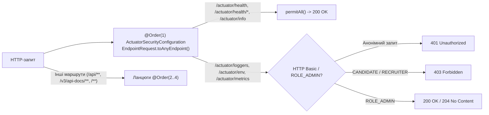
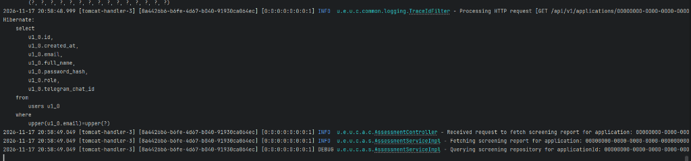
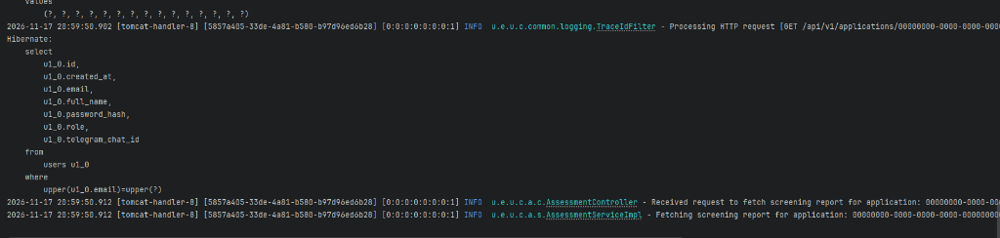
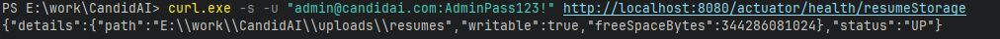
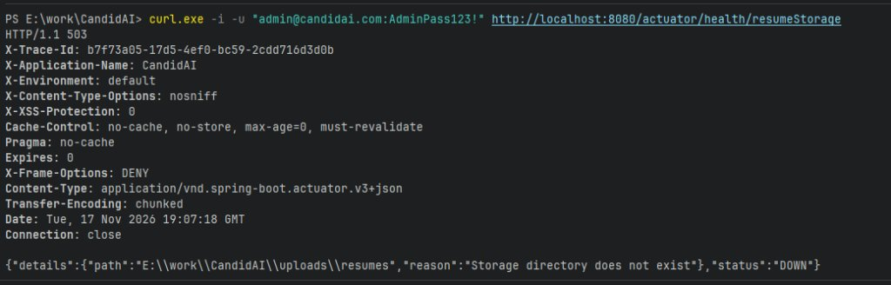
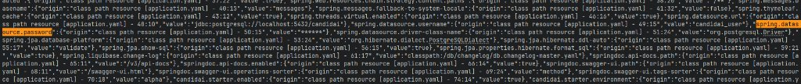

# Звіт до Практичної роботи №11

## Тема: Spring Boot Actuator

---

## 1. Архітектура безпеки та конфігурація Actuator

У проєкті CandidAI для службових ендпоінтів Spring Boot Actuator виділено окремий ланцюг безпеки з найвищим пріоритетом `@Order(1)` у [`ActuatorSecurityConfiguration.java`](../src/main/java/ua/edu/ukma/candidai/common/security/config/ActuatorSecurityConfiguration.java):



### Конфігурація у [`application.yaml`](../src/main/resources/application.yaml)

| Параметр | Значення | Призначення |
|---|---|---|
| `management.endpoints.web.exposure.include` | `health,info,loggers,env,metrics` | Явна веб-експозиція потрібних ендпоінтів (без `*`) |
| `management.endpoint.health.probes.enabled` | `true` | Підтримка Kubernetes/Docker проб `liveness` та `readiness` |
| `management.endpoint.health.show-details` | `when-authorized` | Приховування деталей здоров'я від неавторизованих клієнтів |
| `management.endpoint.health.show-components` | `when-authorized` | Приховування окремих компонентів здоров'я від неавторизованих клієнтів |
| `management.endpoint.health.roles` | `ADMIN` | Перегляд деталей та компонентів `/actuator/health` лише для ролі `ADMIN` |
| `management.endpoint.env.show-values` | `when-authorized` | Доступ до значень `/actuator/env` лише з роллю `ADMIN` |
| `management.info.env.enabled` | `true` | Публікація властивостей `info.app.*` у `/actuator/info` |

---

## 2. Реалізація завдань за блоками

### 2.1. Блок 1: Захист Actuator та матриця доступу

У [`ActuatorSecurityConfiguration.java`](../src/main/java/ua/edu/ukma/candidai/common/security/config/ActuatorSecurityConfiguration.java):
- Налаштовано `securityMatcher(EndpointRequest.toAnyEndpoint())`, `SessionCreationPolicy.STATELESS` та вимкнено CSRF для підтримки `POST /actuator/loggers/...`.
- Публічний доступ (`permitAll()`) залишено лише для `health` та `info`.
- Усі інші ендпоінти Actuator вимагають роль `ADMIN` та підтримують `httpBasic(Customizer.withDefaults())`.

Перевірка блокування неавторизованого доступу до захищених ресурсів:
```bash
curl -i http://localhost:8080/actuator/loggers
```
Відповідь сервера: `HTTP/1.1 401 Unauthorized` (`WWW-Authenticate: Basic realm="Realm"`). Запити від авторизованих користувачів із ролями `CANDIDATE` або `RECRUITER` повертають `403 Forbidden`.

### 2.2. Блок 2: Динамічне логування (`Loggers API`)

У бізнес-сервіси [`AssessmentServiceImpl.java`](../src/main/java/ua/edu/ukma/candidai/assessment/service/AssessmentServiceImpl.java) та [`CandidateEvaluationServiceImpl.java`](../src/main/java/ua/edu/ukma/candidai/recruitment/service/CandidateEvaluationServiceImpl.java) додано діагностичні `log.debug(...)` повідомлення.

Сценарій перевірки без перезапуску JVM:
1. Перевірка поточного рівня: `GET /actuator/loggers/ua.edu.ukma.candidai.assessment.service` -> `effectiveLevel: "INFO"`.
2. Перемикання рівня на `DEBUG`:
   ```bash
   curl -i -X POST -u admin@candidai.com:AdminPass123! \
     -H "Content-Type: application/json" \
     -d '{"configuredLevel":"DEBUG"}' \
     http://localhost:8080/actuator/loggers/ua.edu.ukma.candidai.assessment.service
   ```
   Відповідь: `204 No Content`.
3. Виклик сервісу фіксує появу `DEBUG`-рядків у журналі консолі.
4. Скидання рівня на дефолтний (`{"configuredLevel":null}`) -> `204 No Content`, подальші виклики не виводять `DEBUG`-повідомлення.

> 

> 

### 2.3. Блок 3: Кастомний індикатор здоров'я, маскування секретів та `/actuator/info`

1. **[`ResumeStorageHealthIndicator.java`](../src/main/java/ua/edu/ukma/candidai/common/actuator/ResumeStorageHealthIndicator.java)** (`@Component("resumeStorage")`, `implements HealthIndicator`):
   - Перевіряє існування каталогу `StorageProperties.uploadDir()`, тип директорії, доступність на запис та вільне місце (`freeSpaceBytes`).
   - Штатний стан повертає `Health.up()` (`200 OK`), відсутність каталогу або невалідний шлях повертає `Health.down()` (`503 Service Unavailable`).

   Запит `GET /actuator/health/resumeStorage` (штатний стан `UP`, `200 OK`):
   ```json
   {
     "details": {
       "path": "E:\\work\\CandidAI\\uploads\\resumes",
       "writable": true,
       "freeSpaceBytes": 344286081024
     },
     "status": "UP"
   }
   ```

   Змодельований збій (`DOWN`, `503 Service Unavailable`, відсутній каталог сховища):
   ```json
   {
     "details": {
       "path": "E:\\work\\CandidAI\\uploads\\resumes",
       "reason": "Storage directory does not exist"
     },
     "status": "DOWN"
   }
   ```

   > 

   > 

2. **[`ActuatorEnvSanitizingConfiguration.java`](../src/main/java/ua/edu/ukma/candidai/common/actuator/ActuatorEnvSanitizingConfiguration.java)** (`SanitizingFunction`):
   - У Spring Boot 4.1 при `show-values: when-authorized` вбудованого маскування за ключами немає, тому зареєстровано власний бін `SanitizingFunction`.
   - Ключі, що містять чутливі маркери (`password`, `secret`, `token`, `api-key`, `apikey`, `credential`, `private-key` з нормалізацією `_` -> `-`), маскуються значенням `******`.

   > 

3. **[`CandidAiInfoContributor.java`](../src/main/java/ua/edu/ukma/candidai/common/actuator/CandidAiInfoContributor.java)** (`implements InfoContributor`):
   - Доповнює статичні метадані `info.app.*` у `GET /actuator/info` динамічним станом інтеграцій (`mailNotificationsEnabled`, `telegramBotEnabled`, `aiScreeningConfigured`).
