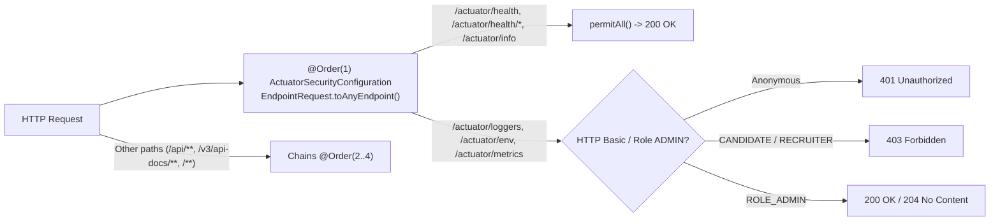

# Практична робота №11. Spring Boot Actuator — Захист службових ендпоінтів, кастомні індикатори та динамічне логування

**Мета:** налаштувати production-ready моніторинг, захист службових ендпоінтів Spring Boot Actuator через окремий ланцюг безпеки Spring Security, маскування чутливих властивостей оточення (`SanitizingFunction`), кастомний індикатор здоров'я (`ResumeStorageHealthIndicator`), розширення `/actuator/info` (`CandidAiInfoContributor`) та динамічну зміну рівнів логування без перезапуску JVM (`Loggers API`).

---

## 1. Архітектура моніторингу та безпеки Actuator у CandidAI

У проєкті `CandidAI` (Spring Boot 4.1.1, Java 25, Spring Modulith) безпеку розділено на незалежні ланцюги `SecurityFilterChain` за пріоритетом `@Order`. Для службових ендпоінтів Actuator виділено перший ланцюг з `@Order(1)` у [`ActuatorSecurityConfiguration.java`](../src/main/java/ua/edu/ukma/candidai/common/security/config/ActuatorSecurityConfiguration.java):



### Ключові параметри конфігурації ([`application.yaml`](../src/main/resources/application.yaml) та [`application-prod.yaml`](../src/main/resources/application-prod.yaml))

| Параметр | Значення | Призначення |
| :--- | :--- | :--- |
| `management.endpoints.web.exposure.include` | `health,info,loggers,env,metrics` | Явна експозиція лише необхідних ендпоінтів (без `*`) |
| `management.endpoint.health.probes.enabled` | `true` | Активація груп `liveness` та `readiness` для оркестратора |
| `management.endpoint.health.show-details` | `when-authorized` | Приховування деталей інфраструктури від анонімних запитів |
| `management.endpoint.health.roles` | `ADMIN` | Перегляд деталей компонентів здоров'я лише для `ROLE_ADMIN` |
| `management.endpoint.env.show-values` | `when-authorized` | Доступ до значень `/actuator/env` лише авторизованим (`ADMIN`) |
| `management.info.env.enabled` | `true` | Публікація `info.app.*` у відповідь `/actuator/info` |

---

## 2. Власний індикатор працездатності (`ResumeStorageHealthIndicator`) та `/actuator/info`

### 2.1. Реалізація [`ResumeStorageHealthIndicator.java`](../src/main/java/ua/edu/ukma/candidai/common/actuator/ResumeStorageHealthIndicator.java)

Індикатор зареєстрований як бін `@Component("resumeStorage")` та реалізує `org.springframework.boot.health.contributor.HealthIndicator`. Він перевіряє каталог завантаження резюме (`StorageProperties.uploadDir()`):
1. Наявність каталогу (`Files.exists`), тип директорії (`Files.isDirectory`) та право запису (`Files.isWritable`).
2. За успішної перевірки обчислює доступний обсяг дискового простору (`Files.getFileStore(storagePath).getUsableSpace()`) і повертає `Health.up()` з полями `path`, `writable`, `freeSpaceBytes`.
3. У разі відсутності каталогу, некоректного шляху або відмови доступу повертає `Health.down()` з діагностичним полем `reason`.

### 2.2. Перевірка штатного стану (`UP`) та змодельованого збою (`DOWN`)

**Запит (адміністратор, штатний стан `UP`):**

```bash
curl -s -u admin@candidai.com:AdminPass123! http://localhost:8080/actuator/health/resumeStorage
```

**Очікувана та тестована JSON-відповідь (`200 OK`):**

```json
{
  "status": "UP",
  "details": {
    "path": "/app/uploads/resumes",
    "writable": true,
    "freeSpaceBytes": 42815422464
  }
}
```

**Зведений стан `/actuator/health` для адміністратора (`200 OK`):**

```json
{
  "status": "UP",
  "components": {
    "db": {
      "status": "UP",
      "details": {
        "database": "PostgreSQL",
        "validationQuery": "isValid()"
      }
    },
    "diskSpace": {
      "status": "UP"
    },
    "livenessState": {
      "status": "UP"
    },
    "ping": {
      "status": "UP"
    },
    "readinessState": {
      "status": "UP"
    },
    "resumeStorage": {
      "status": "UP",
      "details": {
        "path": "/app/uploads/resumes",
        "writable": true,
        "freeSpaceBytes": 42815422464
      }
    }
  },
  "groups": ["liveness", "readiness"]
}
```

**Анонімний запит `GET /actuator/health` (`200 OK`, без розкриття деталей):**

```json
{
  "status": "UP",
  "groups": ["liveness", "readiness"]
}
```

**Змодельований збій (`DOWN`, наприклад, відсутній або невалідний каталог сховища — `503 Service Unavailable`):**

```json
{
  "status": "DOWN",
  "details": {
    "path": "/tmp/missing-resumes",
    "reason": "Storage directory does not exist"
  }
}
```

### 2.3. Розширення `/actuator/info` ([`CandidAiInfoContributor.java`](../src/main/java/ua/edu/ukma/candidai/common/actuator/CandidAiInfoContributor.java))

Публічний запит `GET /actuator/info` (`200 OK`) повертає опис платформи та статус функціональних інтеграцій:

```json
{
  "app": {
    "name": "CandidAI",
    "description": "Smart HR & AI Candidate Screening Platform"
  },
  "application": {
    "name": "CandidAI",
    "description": "Smart HR & AI Candidate Screening Platform"
  },
  "features": {
    "mailNotificationsEnabled": false,
    "telegramBotEnabled": false,
    "aiScreeningConfigured": false
  }
}
```

---

## 3. Маскування чутливих змінних у `/actuator/env` (`SanitizingFunction`)

У Spring Boot 4.1 вбудоване маскування за ключами в режимах `show-values: when-authorized` та `always` відсутнє, тому реалізовано власний бін `SanitizingFunction` у [`ActuatorEnvSanitizingConfiguration.java`](../src/main/java/ua/edu/ukma/candidai/common/actuator/ActuatorEnvSanitizingConfiguration.java).

Функція нормалізує ключ (нижній регістр, заміна `_` на `-`) та перевіряє наявність чутливих маркерів (`jwt.secret`, `spring.datasource.password`, `telegram.bot-token`, `gemini.api-key`, `password`, `secret`, `token`, `api-key`, `apikey`, `credential`, `private-key`), замінюючи значення на `SanitizableData.SANITIZED_VALUE` (`"******"`):

```json
{
  "candidai.security.jwt.secret": {
    "value": "******"
  },
  "spring.datasource.password": {
    "value": "******"
  },
  "spring.application.name": {
    "value": "CandidAI"
  }
}
```

---

## 4. Сценарій динамічної зміни рівня логування без перезапуску JVM

Для діагностики бізнес-процесів у [`AssessmentServiceImpl.java`](../src/main/java/ua/edu/ukma/candidai/assessment/service/AssessmentServiceImpl.java) та [`CandidateEvaluationServiceImpl.java`](../src/main/java/ua/edu/ukma/candidai/recruitment/service/CandidateEvaluationServiceImpl.java) додано `log.debug(...)` повідомлення.

### Покроковий сценарій верифікації

1. **Перевірка поточного рівня логування (за замовчуванням `INFO`):**

```bash
curl -s -u admin@candidai.com:AdminPass123! \
  http://localhost:8080/actuator/loggers/ua.edu.ukma.candidai.assessment.service
```

Відповідь (`200 OK`):

```json
{
  "configuredLevel": null,
  "effectiveLevel": "INFO"
}
```

2. **Спроба зміни рівня анонімно або роллю `RECRUITER` / `CANDIDATE`:**
   - Без авторизації $\rightarrow$ `401 Unauthorized`
   - З JWT/автентифікацією `CANDIDATE` або `RECRUITER` $\rightarrow$ `403 Forbidden`

3. **Динамічне перемикання рівня на `DEBUG` без перезапуску сервісу:**

```bash
curl -i -X POST \
  -u admin@candidai.com:AdminPass123! \
  -H "Content-Type: application/json" \
  -d '{"configuredLevel":"DEBUG"}' \
  http://localhost:8080/actuator/loggers/ua.edu.ukma.candidai.assessment.service
```

Відповідь: `HTTP/1.1 204 No Content`.

4. **Поява діагностичних повідомлень у журналі під час виклику сервісу:**

```text
DEBUG u.e.u.c.a.s.AssessmentServiceImpl : Querying screening repository for applicationId=c0a80101-...
DEBUG u.e.u.c.a.s.AssessmentServiceImpl : Initiating AI screening for applicationId=c0a80101-..., vacancyId=...
```

5. **Скидання рівня логування до успадкованого значення (`INFO`):**

```bash
curl -i -X POST \
  -u admin@candidai.com:AdminPass123! \
  -H "Content-Type: application/json" \
  -d '{"configuredLevel":null}' \
  http://localhost:8080/actuator/loggers/ua.edu.ukma.candidai.assessment.service
```

Відповідь: `HTTP/1.1 204 No Content`, подальші виклики сервісу знову припиняють логування `DEBUG`-подій.

---

## 5. Автоматизована верифікація та статичний аналіз

| Набір перевірок | Клас / Завдання | Покриття |
| :--- | :--- | :--- |
| Модульні тести індикатора сховища | `ResumeStorageHealthIndicatorTest` | Штатний стан `UP` (`writable`, `freeSpaceBytes`), збої `DOWN` (відсутній каталог, файл замість директорії) |
| Модульні тести маскування `/actuator/env` | `ActuatorEnvSanitizingConfigurationTest` | Маскування секретів (`jwt.secret`, `datasource.password`, `bot-token`, `api-key`, env-ключів з `_`) та збереження безпечних значень |
| Модульні тести `/actuator/info` | `CandidAiInfoContributorTest` | Відображення метаданих застосунку та прапорців інтеграцій (`mail`, `telegram`, `aiScreening`) |
| Інтеграційні тести безпеки | `ActuatorSecurityIntegrationTest` | Публічність `/actuator/health`, `/health/liveness`, `/health/readiness`, `/info`; `401`/`403`/`200` для захищених ендпоінтів |
| Інтеграційні тести динамічного логування | `ActuatorLoggersIntegrationTest` | Перевірка `401`/`403`/`400`/`204`/`200`, наскрізна перевірка `DEBUG`-логів через Logback `ListAppender` і скидання рівня |
| Інтеграційні тести індикаторів і санітизації | `ActuatorIndicatorsAndSanitizingIntegrationTest` | Компоненти `resumeStorage` і `db` у `/actuator/health`, маскування у `/actuator/env`, відповідь `/actuator/info` |
| Статичний аналіз коду | `checkstyleMain`, `checkstyleTest` | 0 порушень |
