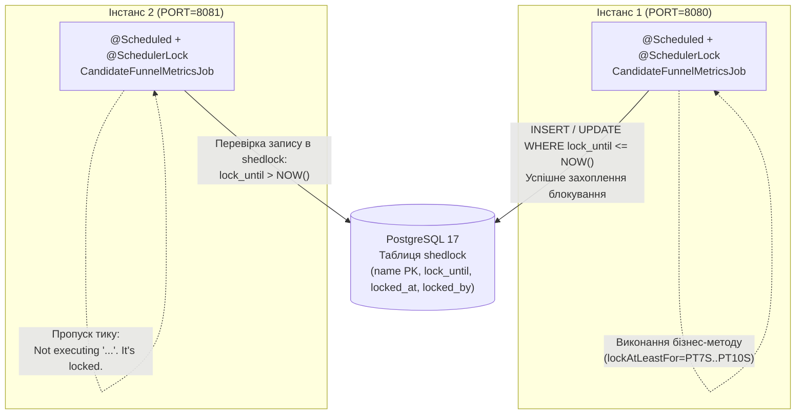

# Звіт до Практичної роботи №12

## Тема: Фонове планування завдань і розподілене блокування (Spring Scheduling & ShedLock)

---

## 1. Архітектура планувальника та розподіленого блокування

У проєкті CandidAI фонові задачі виконуються за допомогою Spring Scheduling (`@EnableScheduling`) поверх віртуальних потоків (`spring.threads.virtual.enabled: true`) із коректним завершенням активних задач при зупинці (`await-termination: true`, `30s`) та префіксом потоків `candidai-scheduler-`.

Для уникнення дублювання регламентних операцій при горизонтальному масштабуванні підключено **ShedLock** (`shedlock-spring` + `shedlock-provider-jdbc-template` версії `7.11.0`) з координацією через таблицю `shedlock` у PostgreSQL (`usingDbTime()`).



### Зведена таблиця фонових завдань

| Компонент | Метод | Розклад (`@Scheduled`) | Замок (`@SchedulerLock`) | Призначення |
|---|---|---|---|---|
| [`TelegramPollingService`](../src/main/java/ua/edu/ukma/candidai/notification/telegram/TelegramPollingService.java) | `pollUpdates` | `fixedDelay` `5000ms` | — | Опитування Telegram Bot API (умовний бін `notification.telegram.enabled=true`) |
| [`AuditCleanupScheduler`](../src/main/java/ua/edu/ukma/candidai/common/audit/scheduler/AuditCleanupScheduler.java) | `purgeExpiredAuditLogs` | `cron = "0 0 3 * * ?"`, `Europe/Kyiv` | `AuditCleanupJob` (`PT1M`..`PT15M`) | Видалення застарілих записів `audit_log` старших за `retention-days` |
| [`InterviewReminderScheduler`](../src/main/java/ua/edu/ukma/candidai/interview/scheduler/InterviewReminderScheduler.java) | `sendUpcomingInterviewReminders` | `fixedDelay = 30m` | `InterviewReminderJob` (`PT30S`..`PT5M`) | Публікація подій нагадування про інтерв'ю у найближчі 24 год |
| [`StaleApplicationsScheduler`](../src/main/java/ua/edu/ukma/candidai/recruitment/scheduler/StaleApplicationsScheduler.java) | `archiveStaleApplications` | `cron = "0 0 4 * * ?"`, `Europe/Kyiv` | `StaleApplicationsJob` (`PT1M`..`PT10M`) | Переведення заявок у статусах `APPLIED`/`SCREENING` без активності > 30 днів у `REJECTED` |
| [`CandidateFunnelMetricsScheduler`](../src/main/java/ua/edu/ukma/candidai/recruitment/scheduler/CandidateFunnelMetricsScheduler.java) | `calculateFunnelMetrics` | `fixedDelay = 900s`, `initialDelay = 900s` | `CandidateFunnelMetricsJob` (`PT10S`..`PT2M`) | Агрегація метрик вирви найму, конверсії `HIRED` та середнього `matchingScore` |

---

## 2. Реалізація завдань за блоками

### 2.1. Блок 1: Інфраструктура ShedLock та очищення журналу аудиту

1. У [`build.gradle.kts`](../build.gradle.kts) підключено `net.javacrumbs.shedlock:shedlock-spring:7.11.0` та `net.javacrumbs.shedlock:shedlock-provider-jdbc-template:7.11.0`.
2. У [`V20261120_120000_create_shedlock_table.sql`](../src/main/resources/db/changelog/changeset/V20261120_120000_create_shedlock_table.sql) додано Liquibase-міграцію створення таблиці `shedlock(name, lock_until, locked_at, locked_by)`.
3. У [`ShedLockConfig.java`](../src/main/java/ua/edu/ukma/candidai/common/config/ShedLockConfig.java) активовано `@EnableScheduling`, `@EnableSchedulerLock(defaultLockAtMostFor = "PT30S", interceptMode = PROXY_METHOD)` та зареєстровано `JdbcTemplateLockProvider` з `.usingDbTime()` (єдине джерело часу PostgreSQL замість годинників окремих вузлів).
4. У [`AuditCleanupScheduler.java`](../src/main/java/ua/edu/ukma/candidai/common/audit/scheduler/AuditCleanupScheduler.java) реалізовано щоденне видалення записів `audit_log` старших за 90 днів (`candidai.audit.retention-days`), перевірене DBUnit-тестом [`ShedLockAuditCleanupIntegrationTest.java`](../src/test/java/ua/edu/ukma/candidai/common/audit/scheduler/ShedLockAuditCleanupIntegrationTest.java).

### 2.2. Блок 2: Нагадування про співбесіди та архівація неактивних заявок

1. [`InterviewReminderScheduler.java`](../src/main/java/ua/edu/ukma/candidai/interview/scheduler/InterviewReminderScheduler.java) відбирає активні інтерв'ю (`SCHEDULED`, `RESCHEDULED`) у вікні найближчих 24 годин із незаповненим `reminder_sent_at`, фіксує час відправки та публікує `InterviewReminderEvent` для [`InterviewNotificationListener`](../src/main/java/ua/edu/ukma/candidai/notification/listener/InterviewNotificationListener.java).
2. [`StaleApplicationsScheduler.java`](../src/main/java/ua/edu/ukma/candidai/recruitment/scheduler/StaleApplicationsScheduler.java) щодня о 04:00 за Києвом закриває неактивні заявки (`APPLIED`, `SCREENING`, `updated_at` старше 30 днів) із коментарем `"Automatically closed due to inactivity"`.
3. Обидва планувальники захищені `@SchedulerLock` та покриті модульними й інтеграційними тестами в пакеті `scheduler` модулів `interview` і `recruitment`.

### 2.3. Блок 3: Перерахунок аналітики вирви найму

У [`CandidateFunnelMetricsScheduler.java`](../src/main/java/ua/edu/ukma/candidai/recruitment/scheduler/CandidateFunnelMetricsScheduler.java) реалізовано регулярний агрегуючий планувальник:
- Читає агреговані підрахунки за статусами (`APPLIED`, `SCREENING`, `INTERVIEW`, `OFFER`, `HIRED`, `REJECTED`) та середній `matchingScore` напряму через JPQL-запити в [`ApplicationFunnelRepository.java`](../src/main/java/ua/edu/ukma/candidai/recruitment/repository/ApplicationFunnelRepository.java).
- Формує незмінний [`CandidateFunnelMetricsSnapshot`](../src/main/java/ua/edu/ukma/candidai/recruitment/scheduler/CandidateFunnelMetricsSnapshot.java), зберігає останній знімок в `AtomicReference` та логує зведену статистику.
- Параметри розкладу і тривалості замка винесено в [`application.yaml`](../src/main/resources/application.yaml) (`candidai.scheduler.funnel-metrics.*`) зі стандартним інтервалом `900s` (15 хвилин).

---

## 3. Перевірка роботи при двох запущених інстансах

Для підтвердження взаємного виключення у кластерному режимі зібрано артефакт `./gradlew bootJar` та паралельно запущено два екземпляри `CandidAI-0.0.1-SNAPSHOT.jar` проти спільної бази даних PostgreSQL 17 ([`compose.yaml`](../compose.yaml)), у якій попередньо додано 4 заявки у статусах `APPLIED`, `SCREENING`, `HIRED` і `REJECTED` (оцінки `74`, `82`, `94`, `NULL`).

Команди запуску обох екземплярів (інтервал `8s`, мінімальний час утримання замка `PT7S`):

```bash
# Термінал 1 — Інстанс 1 (порт 8080)
PORT=8080 FUNNEL_METRICS_INITIAL_DELAY_SECONDS=4 FUNNEL_METRICS_FIXED_DELAY_SECONDS=8 FUNNEL_METRICS_LOCK_AT_LEAST_FOR=PT7S \
  java --enable-preview -jar build/libs/CandidAI-0.0.1-SNAPSHOT.jar --logging.level.net.javacrumbs.shedlock=DEBUG

# Термінал 2 — Інстанс 2 (порт 8081)
PORT=8081 FUNNEL_METRICS_INITIAL_DELAY_SECONDS=2 FUNNEL_METRICS_FIXED_DELAY_SECONDS=8 FUNNEL_METRICS_LOCK_AT_LEAST_FOR=PT7S \
  java --enable-preview -jar build/libs/CandidAI-0.0.1-SNAPSHOT.jar --logging.level.net.javacrumbs.shedlock=DEBUG
```

### Журнал Інстансу 1 (`:8080`) — захоплення замка та виконання задачі

```text
2026-11-24 14:34:55.405 [main] INFO  u.e.u.candidai.CandidAiApplication - Started CandidAiApplication in 9.84 seconds (process running for 10.413)
2026-11-24 14:34:59.488 [candidai-scheduler-2] DEBUG n.j.s.c.DefaultLockingTaskExecutor - Locked 'CandidateFunnelMetricsJob', lock will be held at most until 2026-11-24T12:36:59.425Z
2026-11-24 14:34:59.607 [candidai-scheduler-2] INFO  u.e.u.c.r.s.CandidateFunnelMetricsScheduler - [SCHEDULER] CandidateFunnelMetricsJob: snapshot at 2026-11-24T12:34:59.491671Z (total=4, applied=1, screening=1, interview=0, offer=0, hired=1, rejected=1, avgScore=83.33, hireRate=25.0%)
2026-11-24 14:34:59.626 [candidai-scheduler-2] DEBUG n.j.s.c.DefaultLockingTaskExecutor - Task finished, lock 'CandidateFunnelMetricsJob' will be released at 2026-11-24T12:35:06.425Z
2026-11-24 14:35:07.711 [candidai-scheduler-2] DEBUG n.j.s.c.DefaultLockingTaskExecutor - Locked 'CandidateFunnelMetricsJob', lock will be held at most until 2026-11-24T12:37:07.654Z
2026-11-24 14:35:07.771 [candidai-scheduler-2] INFO  u.e.u.c.r.s.CandidateFunnelMetricsScheduler - [SCHEDULER] CandidateFunnelMetricsJob: snapshot at 2026-11-24T12:35:07.723469Z (total=4, applied=1, screening=1, interview=0, offer=0, hired=1, rejected=1, avgScore=83.33, hireRate=25.0%)
2026-11-24 14:35:07.782 [candidai-scheduler-2] DEBUG n.j.s.c.DefaultLockingTaskExecutor - Task finished, lock 'CandidateFunnelMetricsJob' will be released at 2026-11-24T12:35:14.654Z
```

### Журнал Інстансу 2 (`:8081`) — виявлення активного замка та пропуск виконання

```text
2026-11-24 14:35:08.782 [main] INFO  u.e.u.candidai.CandidAiApplication - Started CandidAiApplication in 11.64 seconds (process running for 12.26)
2026-11-24 14:35:10.815 [candidai-scheduler-2] DEBUG n.j.s.c.DefaultLockingTaskExecutor - Not executing 'CandidateFunnelMetricsJob'. It's locked.
2026-11-24 14:35:18.870 [candidai-scheduler-2] DEBUG n.j.s.c.DefaultLockingTaskExecutor - Not executing 'CandidateFunnelMetricsJob'. It's locked.
```

### Стан таблиці `shedlock` у PostgreSQL під час паралельної роботи

```sql
SELECT name, lock_until, locked_at, locked_by FROM shedlock;
```

```text
           name            |         lock_until         |         locked_at          |        locked_by
---------------------------+----------------------------+----------------------------+-------------------------
 CandidateFunnelMetricsJob | 2026-11-24 12:35:30.908952 | 2026-11-24 12:35:23.908952 | MacBook-Pro-Volya.local
(1 row)
```

Перший інстанс утримує блокування протягом `7s` (`12:35:23.908952` — `12:35:30.908952` UTC), через що другий інстанс о `14:35:10` та `14:35:18` (UTC `12:35:10`, `12:35:18`) отримує сигнал про активний лок і не дублює перерахунок.

---

## 4. Автоматизовані тести та перевірка збірки

Перевірено модульними та інтеграційними тестами із Testcontainers (PostgreSQL 17):
- [`CandidateFunnelMetricsSchedulerTest.java`](../src/test/java/ua/edu/ukma/candidai/recruitment/scheduler/CandidateFunnelMetricsSchedulerTest.java): розрахунок статистики за статусами, коефіцієнта найму, середнього балу та коректна обробка порожньої вибірки (`2` тести).
- [`ShedLockCandidateFunnelMetricsIntegrationTest.java`](../src/test/java/ua/edu/ukma/candidai/recruitment/scheduler/ShedLockCandidateFunnelMetricsIntegrationTest.java): захоплення блокування `CandidateFunnelMetricsJob` у PostgreSQL та пропуск виконання за наявності активного запису в `shedlock` від іншого вузла (`2` тести).
- [`ModularityTests.java`](../src/test/java/ua/edu/ukma/candidai/ModularityTests.java): перевірка меж модулів Spring Modulith (`1` тест).

Результат команди `./gradlew checkstyleMain checkstyleTest :test :candidai-spring-boot-starter:test --no-daemon`:
- **Checkstyle (`checkstyleMain`, `checkstyleTest`):** `0` зауважень.
- **Root `:test`:** `95` тестових класів, `669` тестів (`0` failures, `0` skipped).
- **`:candidai-spring-boot-starter:test`:** `2` тестових класи, `10` тестів (`0` failures, `0` skipped).
