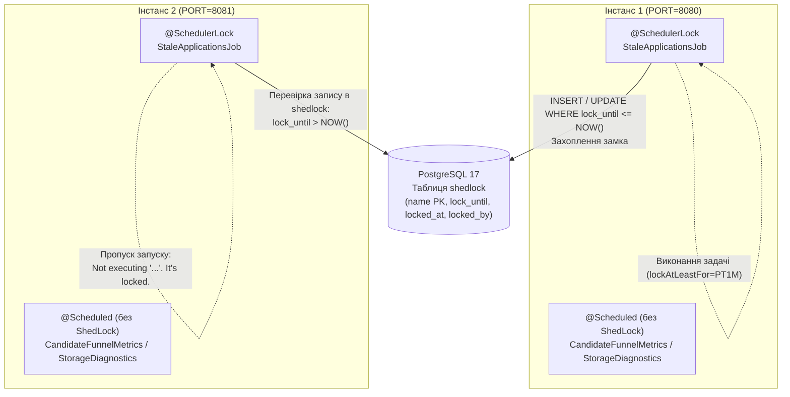

# Звіт до Практичної роботи №12

## Тема: Фонове планування завдань і розподілене блокування (Spring Scheduling & ShedLock)

---

## 1. Конфігурація планувальника та ShedLock

У застосунку CandidAI фонові задачі працюють через Spring Scheduling (`@EnableScheduling`) поверх віртуальних потоків (`spring.threads.virtual.enabled: true`) із очікуванням завершення активних задач під час зупинки (`await-termination: true`, `30s`) та префіксом потоків `candidai-scheduler-`.

Для розділення локальних завдань (які мають виконуватися на кожному інстансі окремо) та кластерних регламентних задач (які повинні виконуватися лише одним екземпляром у кластері) реалізовано **6 різних фонових завдань**:
- **3 завдання лише з `@Scheduled`** (локальне виконання на кожному екземплярі);
- **3 завдання з `@SchedulerLock`** через **ShedLock** (`shedlock-spring` та `shedlock-provider-jdbc-template` `7.11.0`, координація через таблицю `shedlock` у PostgreSQL з `usingDbTime()`).



### Зведена таблиця фонових завдань (6 завдань: 3 `@Scheduled` + 3 `ShedLock`)

| № | Компонент | Метод | Механізм | Розклад / Замок | Призначення |
|---|---|---|---|---|---|
| 1 | [`TelegramPollingService`](../src/main/java/ua/edu/ukma/candidai/notification/telegram/TelegramPollingService.java) | `pollUpdates` | Тільки `@Scheduled` | `fixedDelay = 5000ms` | Опитування Telegram Bot API (`notification.telegram.enabled=true`) |
| 2 | [`CandidateFunnelMetricsScheduler`](../src/main/java/ua/edu/ukma/candidai/recruitment/scheduler/CandidateFunnelMetricsScheduler.java) | `calculateFunnelMetrics` | Тільки `@Scheduled` | `fixedDelay = 900s`, `initialDelay = 900s` | Оновлення локального знімка метрик воронки найму на кожному інстансі |
| 3 | [`StorageDiagnosticsScheduler`](../src/main/java/ua/edu/ukma/candidai/common/storage/StorageDiagnosticsScheduler.java) | `collectStorageDiagnostics` | Тільки `@Scheduled` | `fixedDelay = 900s`, `initialDelay = 900s` | Перевірка локального каталогу `uploads` і вільного місця на диску вузла |
| 4 | [`AuditCleanupScheduler`](../src/main/java/ua/edu/ukma/candidai/common/audit/scheduler/AuditCleanupScheduler.java) | `purgeExpiredAuditLogs` | `@Scheduled` + `@SchedulerLock` | `cron = "0 0 3 * * ?"`, `AuditCleanupJob` (`PT1M`..`PT15M`) | Очищення записів `audit_log`, старших за `retention-days` (90 днів) |
| 5 | [`InterviewReminderScheduler`](../src/main/java/ua/edu/ukma/candidai/interview/scheduler/InterviewReminderScheduler.java) | `sendUpcomingInterviewReminders` | `@Scheduled` + `@SchedulerLock` | `fixedDelay = 30m`, `InterviewReminderJob` (`PT30S`..`PT5M`) | Відправка нагадувань про заплановані співбесіди на найближчі 24 год |
| 6 | [`StaleApplicationsScheduler`](../src/main/java/ua/edu/ukma/candidai/recruitment/scheduler/StaleApplicationsScheduler.java) | `archiveStaleApplications` | `@Scheduled` + `@SchedulerLock` | `cron = "0 0 4 * * ?"`, `StaleApplicationsJob` (`PT1M`..`PT10M`) | Автоматичне закриття (`REJECTED`) заявок у статусах `APPLIED`/`SCREENING` без активності > 30 днів |

---

## 2. Опис реалізованих компонентів

### 2.1. Локальні завдання без ShedLock (`@Scheduled`)

1. **[`TelegramPollingService.java`](../src/main/java/ua/edu/ukma/candidai/notification/telegram/TelegramPollingService.java)**: фонове опитування вхідних оновлень Telegram Bot API за інтервалом `notification.telegram.polling-interval-ms`.
2. **[`CandidateFunnelMetricsScheduler.java`](../src/main/java/ua/edu/ukma/candidai/recruitment/scheduler/CandidateFunnelMetricsScheduler.java)**: агрегує кількість заявок за статусами та середній `matchingScore` через [`ApplicationFunnelRepository.java`](../src/main/java/ua/edu/ukma/candidai/recruitment/repository/ApplicationFunnelRepository.java) і оновлює локальний in-memory знімок [`CandidateFunnelMetricsSnapshot`](../src/main/java/ua/edu/ukma/candidai/recruitment/scheduler/CandidateFunnelMetricsSnapshot.java) на кожному інстансі.
3. **[`StorageDiagnosticsScheduler.java`](../src/main/java/ua/edu/ukma/candidai/common/storage/StorageDiagnosticsScheduler.java)**: перевіряє стан локальної директорії `candidai.storage.upload-dir` (наявність, права запису, вільний простір) на конкретному інстансі.

### 2.2. Інфраструктура ShedLock та розподілені задачі (`@SchedulerLock`)

1. У [`build.gradle.kts`](../build.gradle.kts) додано `net.javacrumbs.shedlock:shedlock-spring:7.11.0` і `net.javacrumbs.shedlock:shedlock-provider-jdbc-template:7.11.0`, у міграції [`V20261120_120000_create_shedlock_table.sql`](../src/main/resources/db/changelog/changeset/V20261120_120000_create_shedlock_table.sql) створено таблицю `shedlock`, а в [`ShedLockConfig.java`](../src/main/java/ua/edu/ukma/candidai/common/config/ShedLockConfig.java) налаштовано `JdbcTemplateLockProvider` з `.usingDbTime()`.
2. [`AuditCleanupScheduler.java`](../src/main/java/ua/edu/ukma/candidai/common/audit/scheduler/AuditCleanupScheduler.java) видаляє застарілі записи з `audit_log` під замком `AuditCleanupJob`.
3. [`InterviewReminderScheduler.java`](../src/main/java/ua/edu/ukma/candidai/interview/scheduler/InterviewReminderScheduler.java) публікує `InterviewReminderEvent` для [`InterviewNotificationListener`](../src/main/java/ua/edu/ukma/candidai/notification/listener/InterviewNotificationListener.java) під замком `InterviewReminderJob`.
4. [`StaleApplicationsScheduler.java`](../src/main/java/ua/edu/ukma/candidai/recruitment/scheduler/StaleApplicationsScheduler.java) закриває неактивні заявки зі статусом `REJECTED` під замком `StaleApplicationsJob`.

---

## 3. Перевірка роботи при 2-х запущених інстансах

Зібрано JAR-файл (`./gradlew bootJar`) та одночасно запущено два інстанси застосунку на портах `8080` і `8081`, підключені до спільної БД PostgreSQL 17 ([`compose.yaml`](../compose.yaml)). Перед запуском додано 2 заявки (одна активна давністю 2 дні, друга застаріла — давністю 45 днів), а для наочності cron `StaleApplicationsJob` перевизначено на кожні `8s` (з утриманням замка `PT1M`) і скорочено інтервали локальних `@Scheduled` задач:

```bash
# Термінал 1 — Інстанс 1 (порт 8080)
PORT=8080 FUNNEL_METRICS_INITIAL_DELAY_SECONDS=4 FUNNEL_METRICS_FIXED_DELAY_SECONDS=15 \
STORAGE_DIAGNOSTICS_INITIAL_DELAY_SECONDS=5 STORAGE_DIAGNOSTICS_FIXED_DELAY_SECONDS=15 \
  java --enable-preview -jar build/libs/CandidAI-0.0.1-SNAPSHOT.jar \
  --candidai.scheduler.stale-applications.cron="*/8 * * * * *" \
  --logging.level.net.javacrumbs.shedlock=DEBUG

# Термінал 2 — Інстанс 2 (порт 8081)
PORT=8081 FUNNEL_METRICS_INITIAL_DELAY_SECONDS=4 FUNNEL_METRICS_FIXED_DELAY_SECONDS=15 \
STORAGE_DIAGNOSTICS_INITIAL_DELAY_SECONDS=5 STORAGE_DIAGNOSTICS_FIXED_DELAY_SECONDS=15 \
  java --enable-preview -jar build/libs/CandidAI-0.0.1-SNAPSHOT.jar \
  --candidai.scheduler.stale-applications.cron="*/8 * * * * *" \
  --logging.level.net.javacrumbs.shedlock=DEBUG
```

### Логи Інстансу 1 (`:8080`) — захоплення замка `StaleApplicationsJob` та виконання локальних задач

```text
2026-11-28 12:18:08.793 [main] INFO  u.e.u.candidai.CandidAiApplication - Started CandidAiApplication in 10.02 seconds (process running for 10.603)
2026-11-28 12:18:12.909 [candidai-scheduler-2] INFO  u.e.u.c.r.s.CandidateFunnelMetricsScheduler - [SCHEDULER] CandidateFunnelMetricsJob: snapshot at 2026-11-28T10:18:12.825662Z (total=2, applied=1, screening=1, interview=0, offer=0, hired=0, rejected=0, avgScore=78.0, hireRate=0.0%)
2026-11-28 12:18:13.796 [candidai-scheduler-2] INFO  u.e.u.c.c.s.StorageDiagnosticsScheduler - [SCHEDULER] StorageDiagnostics: path='/Users/knubisoft/UNIVERSITY/spring/candidai/uploads/resumes', exists=true, directory=true, writable=true, usableSpaceBytes=677779378176
2026-11-28 12:18:16.050 [candidai-scheduler-3] DEBUG n.j.s.c.DefaultLockingTaskExecutor - Locked 'StaleApplicationsJob', lock will be held at most until 2026-11-28T10:28:16.022Z
2026-11-28 12:18:16.101 [candidai-scheduler-3] INFO  u.e.u.c.r.s.StaleApplicationsScheduler - [SCHEDULER] StaleApplicationsJob: archived 1 stale application(s) inactive since before 2026-10-29T10:18:16.054680Z
2026-11-28 12:18:16.125 [candidai-scheduler-3] DEBUG n.j.s.c.DefaultLockingTaskExecutor - Task finished, lock 'StaleApplicationsJob' will be released at 2026-11-28T10:19:16.022Z
2026-11-28 12:18:27.956 [candidai-scheduler-2] INFO  u.e.u.c.r.s.CandidateFunnelMetricsScheduler - [SCHEDULER] CandidateFunnelMetricsJob: snapshot at 2026-11-28T10:18:27.932997Z (total=2, applied=0, screening=1, interview=0, offer=0, hired=0, rejected=1, avgScore=78.0, hireRate=0.0%)
```

### Логи Інстансу 2 (`:8081`) — пропуск `StaleApplicationsJob` при активному замку та локальне виконання `@Scheduled`

```text
2026-11-28 12:18:20.328 [main] INFO  u.e.u.candidai.CandidAiApplication - Started CandidAiApplication in 9.541 seconds (process running for 10.201)
2026-11-28 12:18:24.033 [candidai-scheduler-3] DEBUG n.j.s.c.DefaultLockingTaskExecutor - Not executing 'StaleApplicationsJob'. It's locked.
2026-11-28 12:18:24.396 [candidai-scheduler-2] INFO  u.e.u.c.r.s.CandidateFunnelMetricsScheduler - [SCHEDULER] CandidateFunnelMetricsJob: snapshot at 2026-11-28T10:18:24.334840Z (total=2, applied=0, screening=1, interview=0, offer=0, hired=0, rejected=1, avgScore=78.0, hireRate=0.0%)
2026-11-28 12:18:25.331 [candidai-scheduler-2] INFO  u.e.u.c.c.s.StorageDiagnosticsScheduler - [SCHEDULER] StorageDiagnostics: path='/Users/knubisoft/UNIVERSITY/spring/candidai/uploads/resumes', exists=true, directory=true, writable=true, usableSpaceBytes=677782794240
2026-11-28 12:18:32.036 [candidai-scheduler-4] DEBUG n.j.s.c.DefaultLockingTaskExecutor - Not executing 'StaleApplicationsJob'. It's locked.
```

### Вміст таблиці `shedlock` у PostgreSQL

```sql
SELECT name, lock_until, locked_at, locked_by FROM shedlock;
```

```text
         name         |         lock_until         |         locked_at          |        locked_by
----------------------+----------------------------+----------------------------+-------------------------
 InterviewReminderJob | 2026-11-28 10:18:38.860478 | 2026-11-28 10:18:08.860478 | MacBook-Pro-Volya.local
 StaleApplicationsJob | 2026-11-28 10:19:16.044492 | 2026-11-28 10:18:16.044492 | MacBook-Pro-Volya.local
(2 rows)
```

Перший інстанс захоплює замок `StaleApplicationsJob` на `1m` (`10:18:16.044492` — `10:19:16.044492` UTC) і архівує застарілу заявку один раз, тоді як другий інстанс фіксує активне блокування (`Not executing 'StaleApplicationsJob'. It's locked.`). Водночас локальні `@Scheduled`-задачі без ShedLock (`CandidateFunnelMetricsScheduler`, `StorageDiagnosticsScheduler`) успішно виконуються на кожному інстансі незалежно.
