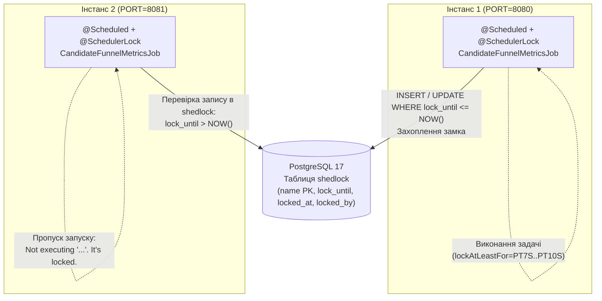

# Звіт до Практичної роботи №12

## Тема: Фонове планування завдань і розподілене блокування (Spring Scheduling & ShedLock)

---

## 1. Конфігурація планувальника та ShedLock

У застосунку CandidAI фонові задачі працюють через Spring Scheduling (`@EnableScheduling`) поверх віртуальних потоків (`spring.threads.virtual.enabled: true`) із очікуванням завершення активних задач під час зупинки (`await-termination: true`, `30s`) та префіксом потоків `candidai-scheduler-`.

Для координації задач між репліками підключено **ShedLock** (`shedlock-spring` та `shedlock-provider-jdbc-template` `7.11.0`) із блокуванням через таблицю `shedlock` у PostgreSQL та використанням часу БД (`usingDbTime()`).



### Зведена таблиця фонових завдань

| Компонент | Метод | Розклад (`@Scheduled`) | Замок (`@SchedulerLock`) | Призначення |
|---|---|---|---|---|
| [`TelegramPollingService`](../src/main/java/ua/edu/ukma/candidai/notification/telegram/TelegramPollingService.java) | `pollUpdates` | `fixedDelay = 5000ms` | — | Опитування Telegram Bot API (`notification.telegram.enabled=true`) |
| [`AuditCleanupScheduler`](../src/main/java/ua/edu/ukma/candidai/common/audit/scheduler/AuditCleanupScheduler.java) | `purgeExpiredAuditLogs` | `cron = "0 0 3 * * ?"`, `Europe/Kyiv` | `AuditCleanupJob` (`PT1M`..`PT15M`) | Очищення записів `audit_log`, старших за `retention-days` (90 днів) |
| [`InterviewReminderScheduler`](../src/main/java/ua/edu/ukma/candidai/interview/scheduler/InterviewReminderScheduler.java) | `sendUpcomingInterviewReminders` | `fixedDelay = 30m` | `InterviewReminderJob` (`PT30S`..`PT5M`) | Відправка нагадувань про заплановані співбесіди на найближчі 24 год |
| [`StaleApplicationsScheduler`](../src/main/java/ua/edu/ukma/candidai/recruitment/scheduler/StaleApplicationsScheduler.java) | `archiveStaleApplications` | `cron = "0 0 4 * * ?"`, `Europe/Kyiv` | `StaleApplicationsJob` (`PT1M`..`PT10M`) | Автоматичне закриття (`REJECTED`) заявок у статусах `APPLIED`/`SCREENING` без активності понад 30 днів |
| [`CandidateFunnelMetricsScheduler`](../src/main/java/ua/edu/ukma/candidai/recruitment/scheduler/CandidateFunnelMetricsScheduler.java) | `calculateFunnelMetrics` | `fixedDelay = 900s`, `initialDelay = 900s` | `CandidateFunnelMetricsJob` (`PT10S`..`PT2M`) | Підрахунок статистики воронки найму, конверсії в `HIRED` та середнього `matchingScore` |

---

## 2. Опис реалізованих фонових завдань

### 2.1. Інфраструктура ShedLock та очищення журналу аудиту (`AuditCleanupScheduler`)

1. У [`build.gradle.kts`](../build.gradle.kts) додано залежності `net.javacrumbs.shedlock:shedlock-spring:7.11.0` і `net.javacrumbs.shedlock:shedlock-provider-jdbc-template:7.11.0`.
2. У міграції [`V20261120_120000_create_shedlock_table.sql`](../src/main/resources/db/changelog/changeset/V20261120_120000_create_shedlock_table.sql) створено таблицю `shedlock(name, lock_until, locked_at, locked_by)`.
3. У [`ShedLockConfig.java`](../src/main/java/ua/edu/ukma/candidai/common/config/ShedLockConfig.java) налаштовано `@EnableScheduling`, `@EnableSchedulerLock(defaultLockAtMostFor = "PT30S", interceptMode = PROXY_METHOD)` та бін `JdbcTemplateLockProvider` з `.usingDbTime()`.
4. [`AuditCleanupScheduler.java`](../src/main/java/ua/edu/ukma/candidai/common/audit/scheduler/AuditCleanupScheduler.java) щоночі о 03:00 видаляє застарілі записи з таблиці `audit_log` через `AuditLogRepository#deleteByCreatedAtBefore`.

### 2.2. Нагадування про співбесіди (`InterviewReminderScheduler`) та закриття неактивних заявок (`StaleApplicationsScheduler`)

1. [`InterviewReminderScheduler.java`](../src/main/java/ua/edu/ukma/candidai/interview/scheduler/InterviewReminderScheduler.java) кожні 30 хвилин знаходить активні співбесіди (`SCHEDULED`, `RESCHEDULED`) на наступні 24 години з `reminder_sent_at IS NULL`, проставляє час відправки та публікує `InterviewReminderEvent` для [`InterviewNotificationListener`](../src/main/java/ua/edu/ukma/candidai/notification/listener/InterviewNotificationListener.java).
2. [`StaleApplicationsScheduler.java`](../src/main/java/ua/edu/ukma/candidai/recruitment/scheduler/StaleApplicationsScheduler.java) щоночі о 04:00 знаходить заявки в статусах `APPLIED` та `SCREENING`, які не оновлювалися понад 30 днів, і переводить їх у статус `REJECTED` з коментарем `"Automatically closed due to inactivity"`.

### 2.3. Збір метрик воронки найму (`CandidateFunnelMetricsScheduler`)

[`CandidateFunnelMetricsScheduler.java`](../src/main/java/ua/edu/ukma/candidai/recruitment/scheduler/CandidateFunnelMetricsScheduler.java) кожні 15 хвилин агрегує статистику за статусами заявок та середній бал скринінгу (`matchingScore`) через JPQL-запити в [`ApplicationFunnelRepository.java`](../src/main/java/ua/edu/ukma/candidai/recruitment/repository/ApplicationFunnelRepository.java), оновлює поточний знімок [`CandidateFunnelMetricsSnapshot`](../src/main/java/ua/edu/ukma/candidai/recruitment/scheduler/CandidateFunnelMetricsSnapshot.java) і записує зведені показники в лог.

---

## 3. Перевірка роботи при 2-х запущених інстансах

Зібрано JAR-файл (`./gradlew bootJar`) та одночасно запущено два інстанси застосунку на портах `8080` і `8081`, підключені до однієї БД PostgreSQL 17 ([`compose.yaml`](../compose.yaml)). Для наочної перевірки інтервал запуску `CandidateFunnelMetricsJob` зменшено до `8s`, а `lockAtLeastFor` встановлено у `PT7S`:

```bash
# Термінал 1 — Інстанс 1 (порт 8080)
PORT=8080 FUNNEL_METRICS_INITIAL_DELAY_SECONDS=4 FUNNEL_METRICS_FIXED_DELAY_SECONDS=8 FUNNEL_METRICS_LOCK_AT_LEAST_FOR=PT7S \
  java --enable-preview -jar build/libs/CandidAI-0.0.1-SNAPSHOT.jar --logging.level.net.javacrumbs.shedlock=DEBUG

# Термінал 2 — Інстанс 2 (порт 8081)
PORT=8081 FUNNEL_METRICS_INITIAL_DELAY_SECONDS=2 FUNNEL_METRICS_FIXED_DELAY_SECONDS=8 FUNNEL_METRICS_LOCK_AT_LEAST_FOR=PT7S \
  java --enable-preview -jar build/libs/CandidAI-0.0.1-SNAPSHOT.jar --logging.level.net.javacrumbs.shedlock=DEBUG
```

### Логи Інстансу 1 (`:8080`) — захоплення замка та виконання задачі

```text
2026-11-24 14:34:55.405 [main] INFO  u.e.u.candidai.CandidAiApplication - Started CandidAiApplication in 9.84 seconds (process running for 10.413)
2026-11-24 14:34:59.488 [candidai-scheduler-2] DEBUG n.j.s.c.DefaultLockingTaskExecutor - Locked 'CandidateFunnelMetricsJob', lock will be held at most until 2026-11-24T12:36:59.425Z
2026-11-24 14:34:59.607 [candidai-scheduler-2] INFO  u.e.u.c.r.s.CandidateFunnelMetricsScheduler - [SCHEDULER] CandidateFunnelMetricsJob: snapshot at 2026-11-24T12:34:59.491671Z (total=4, applied=1, screening=1, interview=0, offer=0, hired=1, rejected=1, avgScore=83.33, hireRate=25.0%)
2026-11-24 14:34:59.626 [candidai-scheduler-2] DEBUG n.j.s.c.DefaultLockingTaskExecutor - Task finished, lock 'CandidateFunnelMetricsJob' will be released at 2026-11-24T12:35:06.425Z
2026-11-24 14:35:07.711 [candidai-scheduler-2] DEBUG n.j.s.c.DefaultLockingTaskExecutor - Locked 'CandidateFunnelMetricsJob', lock will be held at most until 2026-11-24T12:37:07.654Z
2026-11-24 14:35:07.771 [candidai-scheduler-2] INFO  u.e.u.c.r.s.CandidateFunnelMetricsScheduler - [SCHEDULER] CandidateFunnelMetricsJob: snapshot at 2026-11-24T12:35:07.723469Z (total=4, applied=1, screening=1, interview=0, offer=0, hired=1, rejected=1, avgScore=83.33, hireRate=25.0%)
2026-11-24 14:35:07.782 [candidai-scheduler-2] DEBUG n.j.s.c.DefaultLockingTaskExecutor - Task finished, lock 'CandidateFunnelMetricsJob' will be released at 2026-11-24T12:35:14.654Z
```

### Логи Інстансу 2 (`:8081`) — фіксація активного замка та пропуск виконання

```text
2026-11-24 14:35:08.782 [main] INFO  u.e.u.candidai.CandidAiApplication - Started CandidAiApplication in 11.64 seconds (process running for 12.26)
2026-11-24 14:35:10.815 [candidai-scheduler-2] DEBUG n.j.s.c.DefaultLockingTaskExecutor - Not executing 'CandidateFunnelMetricsJob'. It's locked.
2026-11-24 14:35:18.870 [candidai-scheduler-2] DEBUG n.j.s.c.DefaultLockingTaskExecutor - Not executing 'CandidateFunnelMetricsJob'. It's locked.
```

### Вміст таблиці `shedlock` у PostgreSQL

```sql
SELECT name, lock_until, locked_at, locked_by FROM shedlock;
```

```text
           name            |         lock_until         |         locked_at          |        locked_by
---------------------------+----------------------------+----------------------------+-------------------------
 CandidateFunnelMetricsJob | 2026-11-24 12:35:30.908952 | 2026-11-24 12:35:23.908952 | MacBook-Pro-Volya.local
(1 row)
```

Перший інстанс захоплює замок на `7s` (`12:35:23.908952` — `12:35:30.908952` UTC), тому другий інстанс під час своїх спрацювань бачить чинний `lock_until` у таблиці `shedlock` і пропускає виконання задачі.
