# Звіт до Практичної роботи №7 (Групове завдання)

## Тема: Web-інтерфейс на Thymeleaf, форми з валідацією (PRG), мультиланцюгова безпека (JWT для `/api/**` + сесійний вхід з CSRF для вебу), версіонування статики та рольовий контроль

**Дисципліна:** Архітектура корпоративних інформаційних систем (Spring Framework)  
**Проєкт:** CandidAI (Smart HR / AI Screening Modular Monolith)  
**Стек:** Java 25, Spring Boot 4.1, Spring Security 7, Spring Modulith 2.1, Thymeleaf + Thymeleaf Extras Spring Security, Bootstrap 5.3.3 (WebJar), PostgreSQL 17, Gradle  
**Група:**  
- **Артем Гриценко** — Блок 1: Vacancy UI (реєстр вакансій, форма створення, валідація JSR-380, PRG)  
- **Денис Корявець** — Блок 2: Security (три ланцюги `SecurityFilterChain`, formLogin, CSRF, CSP, сторінки помилок)  
- **Анастасія Заровська** — Блок 3: Layout & статика (спільні фрагменти, хешування статики, сторінки заявок, `sec:`-діалект, тести, звіт)  

---

## 1. Архітектура безпеки: Мультиланцюгова модель (Multi-Chain Security)

Для забезпечення вимог Слайдів 75–76 реалізовано **три незалежні ланцюги фільтрів безпеки** (`SecurityFilterChain`), впорядковані за допомогою анотацій `@Order`:

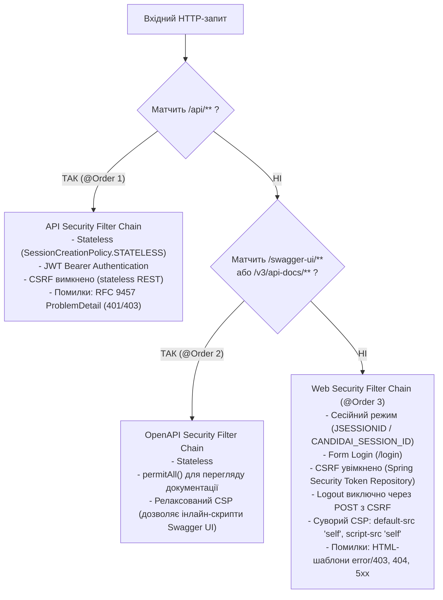

### Чому саме такий порядок та розділення?

1. **`@Order(1)` `SecurityConfiguration` (`/api/**`)**:
   - Має найвищий пріоритет, перехоплює всі виклики REST API.
   - Працює у строгому режимі `STATELESS` (жодних сесій у пам'яті).
   - Аутентифікація через `JwtAuthenticationFilter`. За відсутності або невалідності токена повертає машинний JSON за стандартом **RFC 9457 (`ProblemDetail`)** зі статусами 401 Unauthorized або 403 Forbidden, **не виконуючи редіректів на сторінку логіну**.
   - CSRF захист вимкнено, оскільки безсесійні API з токенами в заголовку `Authorization: Bearer` не піддаються атакам CSRF.

2. **`@Order(2)` `OpenApiSecurityConfiguration` (`/swagger-ui/**`, `/v3/api-docs/**`)**:
   - Відкриває доступ до документації API (`permitAll()`).
   - Має релаксовану політику `Content-Security-Policy` (`script-src 'self' 'unsafe-inline'`), оскільки бандл Swagger UI використовує інлайнові скрипти та динамічні стилі. Якби застосовувався суворий CSP веб-інтерфейсу, Swagger UI був би заблокований браузером.

3. **`@Order(3)` `WebSecurityConfiguration` (Браузерні маршрути без matcher)**:
   - Обробляє решту запитів: шаблони Thymeleaf, ресурси `/css/**`, `/webjars/**`.
   - Використовує сесії (`sessionFixation().migrateSession()`) та обмеження однієї активної сесії (`maximumSessions(1)`).
   - **CSRF увімкнено** за замовчуванням: усі POST/PUT/DELETE форми обов'язково передають токен `_csrf`.
   - Встановлює суворий заголовок CSP (`script-src 'self'; frame-ancestors 'none'`), що унеможливлює XSS та Clickjacking.
   - Неавторизованих користувачів редіректить на форму `/login`, а помилки прав доступу перенаправляє на стилізований шаблон `error/403.html`.

---

## 2. Рольова модель та матриця доступу

Система підтримує 4 ролі з бази даних, які обслуговуються спільним `JpaUserDetailsService` з хешуванням паролів за алгоритмом **Argon2id**.

| URL | Метод | Дозволені ролі | Дія та логіка | Реакція без прав |
|---|---|---|---|---|
| `/` | GET | Будь-хто | Автоматичний редірект на `/vacancies` | — |
| `/vacancies` | GET | Будь-хто (Public) | Перегляд реєстру вакансій (таблиця / картки), фільтрація, зміна мови | Доступно всім |
| `/login` | GET/POST | Будь-хто (Public) | Форма входу до системи (з обробкою помилок) | Доступно всім |
| `/logout` | **POST** | Автентифіковані | Безпечний вихід із системи з інвалідацією сесії | Редірект на `/login` |
| `/vacancies/new` | GET | `RECRUITER`, `ADMIN` | Сторінка форми створення вакансії | 403 Forbidden (`error/403.html`) |
| `/vacancies` | **POST** | `RECRUITER`, `ADMIN` | Валідація та збереження нової вакансії (PRG) | 403 Forbidden |
| `/vacancies/{id}/apply` | GET | `CANDIDATE` | Форма подачі резюме з автозаповненням профілю | 403 Forbidden |
| `/vacancies/{id}/apply` | **POST** | `CANDIDATE` | Відправка заявки на вакансію (PRG) | 403 Forbidden |
| `/vacancies/{id}/applications` | GET | `TECH_LEAD`, `RECRUITER`, `ADMIN` | Перегляд списку кандидатів та статусу відбору | 403 Forbidden |
| `/vacancies/*` | GET | Будь-хто (Public) | Перегляд деталей вакансії | Доступно всім |
| `/css/**`, `/webjars/**` | GET | Будь-хто (Public) | Кешовані статичні ресурси | Доступно всім |

### Тестові користувачі (ініціалізуються в `SecurityDataInitializer`):
- **Рекрутер**: `recruiter@candidai.com` / `RecruiterPass123!` (`ROLE_RECRUITER`)
- **Кандидат**: `candidate@candidai.com` / `CandidatePass123!` (`ROLE_CANDIDATE`)
- **Тімлід**: `techlead@candidai.com` / `TechLeadPass123!` (`ROLE_TECH_LEAD`)
- **Адміністратор**: `admin@candidai.com` / `AdminPass123!` (`ROLE_ADMIN`)

---

## 3. Реалізація ключових вимог та захисту

### 3.1. Post-Redirect-Get (PRG) та валідація JSR-380
- Усі форми реалізують патерн **Post-Redirect-Get**: при успішній обробці POST-запиту контролери повертають `redirect:/vacancies`, а повідомлення передаються через `RedirectAttributes.addFlashAttribute("successMessage", ...)`. Це унеможливлює повторне відправлення даних при оновленні сторінки (F5) або переході назад у браузері.
- Форма створення вакансії перевіряється класом `CreateVacancyForm` за допомогою JSR-380 анотацій: `@NotBlank`, `@Size`, `@Min`, `@Max`, `@Positive`, а також власними валідаторами `@ValidSalaryRange` (перевірка `salaryMin <= salaryMax`) та `@ValidSkillsList`.
- При виявленні помилок валідації повертається той самий шаблон зі статусом HTTP 422 Unprocessable Entity, а поля форми отримують клас `is-invalid` та індивідуальні текстові підказки з файлу локалізації.

### 3.2. Версіонування статики та довготривале кешування
У `StaticResourcesConfiguration`:
- Для `/css/**` налаштовано `VersionResourceResolver().addContentVersionStrategy("/**")`. У HTML генерується посилання з хешем вмісту (`/css/app-a1b2c3d4.css`).
- Підключено `EncodedResourceResolver`, що автоматично віддає стиснену gzip-версію `app.css.gz` за наявності заголовка `Accept-Encoding: gzip`.
- Встановлено заголовок `Cache-Control: max-age=31536000, public` (365 днів). При зміні стилів хеш у назві файлу змінюється, забезпечуючи миттєве оновлення кешу (Cache Busting).
- Бібліотека Bootstrap 5.3.3 підключена локально через WebJar (`/webjars/bootstrap/5.3.3/css/bootstrap.min.css`) без зовнішніх CDN.

### 3.3. Розведення обробки винятків (API vs Web)
- `GlobalExceptionHandler` анотовано `@RestControllerAdvice(annotations = RestController.class)`. Він обробляє виключно REST-запити та повертає JSON RFC 9457 `ProblemDetail`.
- Для веб-контролерів створено `WebExceptionAdvice` (`@ControllerAdvice(annotations = Controller.class)`), який перехоплює помилки (наприклад, `ResourceNotFoundException`) і рендерить стилізовані сторінки `error/404.html`.

### 3.4. Захист від поширених вразливостей (OWASP Top 10)
- **XSS (Cross-Site Scripting)**: у всіх Thymeleaf-шаблонах виведення користувацьких даних здійснюється виключно через `th:text`. Використання небезпечного `th:utext` суворо заборонено.
- **SSTI (Server-Side Template Injection)**: вибір виду відображення списку вакансій (`TABLE` чи `CARDS`) виконується за допомогою переліку `enum VacancyView` у типізованій конструкції `switch (view)`, що унеможливлює підстановку виразів SpEL або довільних імен файлів із параметрів запиту.
- **CSRF (Cross-Site Request Forgery)**: усі HTML-форми генеруються через `th:action`, який автоматично вставляє приховане поле `_csrf`. Запити на зміну стану (створення вакансії, подача заявки, вихід із системи) захищені токеном.
- **Clickjacking**: веб-ланцюг передає заголовок `Content-Security-Policy: frame-ancestors 'none'`.

---

## 4. Верифікація безпеки та доказова база

### 4.1. Результати автоматизованого тестування
- `./gradlew checkstyleMain checkstyleTest` — **0 порушень Checkstyle**.
- `./gradlew test` — **Всі тести зелені (BUILD SUCCESSFUL)**:
  - `WebSecurityTest`: перевірка перенаправлення анонімів, роботи сесій, наявності CSP-заголовків, захисту CSRF та відхилення POST без токена (403).
  - `VacancyWebControllerTest`: перевірка рендерингу списку вакансій, перемикання видів `view=TABLE`/`view=CARDS`, обробки помилок JSR-380 (422) та редіректу PRG.
  - `ApplicationWebControllerTest`: валідація заявки кандидата, запобігання дублікатам (Flash errorMessage), автозаповнення профілю.
  - `StaticResourcesAndViewsTest`: перевірка додавання MD5-хешу в URL статики, річного кешу та заголовків.
  - `StatelessSecurityIntegrationTest`: перевірка збереження безсесійного режиму для `/api/**` без регресій Практичної 6.

### 4.2. Порівняння поведінки API та Веб-ланцюга (curl-докази)

1. **Запит до REST API без токена повертає машинний RFC 9457 ProblemDetail (401), а не HTML**:
```bash
$ curl -i http://localhost:8080/api/v1/applications/feedbacks
HTTP/1.1 401 Unauthorized
Content-Type: application/problem+json
Cache-Control: no-cache, no-store, max-age=0, must-revalidate

{"type":"https://candidai.ukma.edu.ua/errors/unauthorized","title":"Unauthorized","status":401,"detail":"Full authentication is required to access this resource"}
```

2. **Запит до веб-сторінки без автентифікації перенаправляє на форму входу (302)**:
```bash
$ curl -i http://localhost:8080/vacancies/new
HTTP/1.1 302 Found
Location: http://localhost:8080/login
```

3. **Спроба надіслати POST-запит на веб-маршрут без CSRF-токена повертає 403 Forbidden**:
```bash
$ curl -i -X POST http://localhost:8080/vacancies -d "title=HackerVacancy"
HTTP/1.1 403 Forbidden
```

---

## 5. Фотофіксація роботи інтерфейсу для різних ролей

Усі скріншоти зафіксовані в реальному оточенні застосунку за допомогою автоматизованого браузерного сценарію на базі Google Chrome:

### 1. Анонімний користувач: Публічний реєстр вакансій
*Маршрут: `GET /vacancies`. Доступний публічний перегляд, фільтри за категорією/статусом, перемикання виду та локалізація `UA/EN`. Кнопка створення вакансії відсутня.*
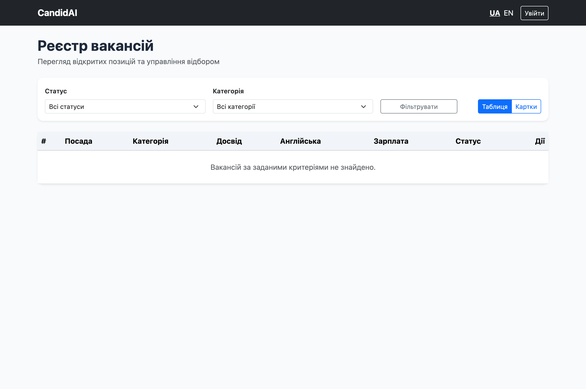

---

### 2. Сторінка входу та валідація облікових даних
*Маршрут: `GET /login`. Відображення стилізованої форми входу та реакція на невірний пароль.*
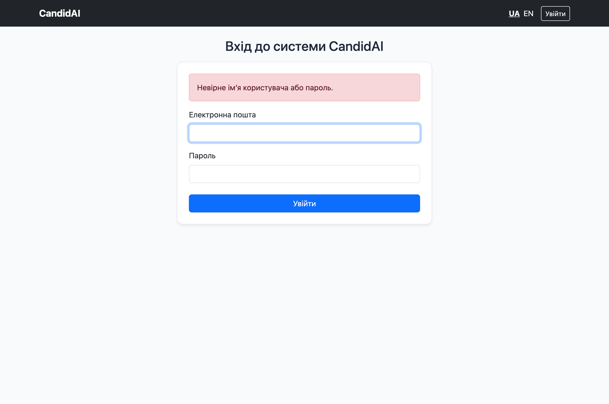

---

### 3. Форма створення вакансії (Рекрутер)
*Маршрут: `GET /vacancies/new` під роллю `RECRUITER`. Повна форма з параметрами зарплатної вилки, досвіду та навичок.*
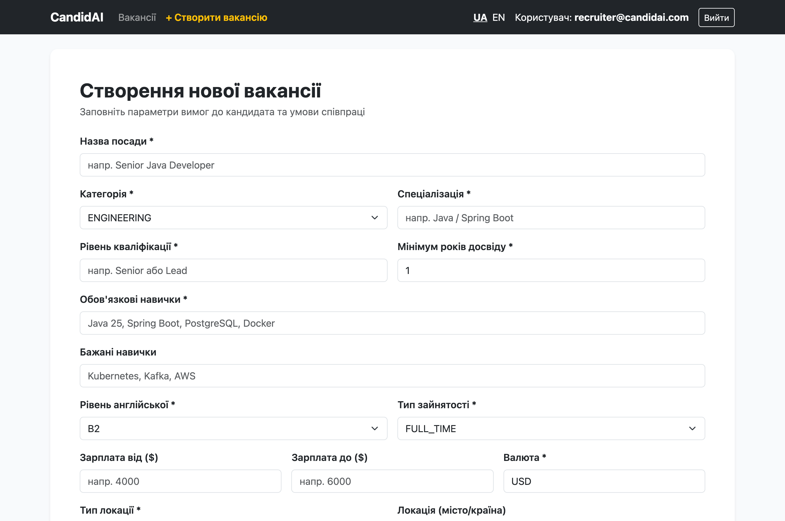

---

### 4. Серверна валідація форми (JSR-380)
*Маршрут: `POST /vacancies`. При спробі відправити невалідні або порожні дані сервер повертає статус HTTP 422 із підсвічуванням полів `is-invalid` та повідомленнями про помилки.*
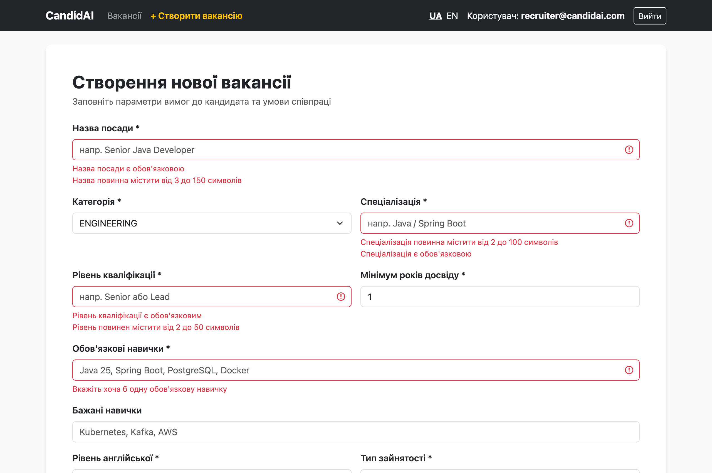

---

### 5. Реєстр вакансій після успішного створення (Патерн PRG)
*Маршрут: `GET /vacancies`. Після збереження нової вакансії рекрутера перенаправлено на список із зеленим Flash-повідомленням «Вакансію успішно збережено!». У таблиці з'явився новий запис.*
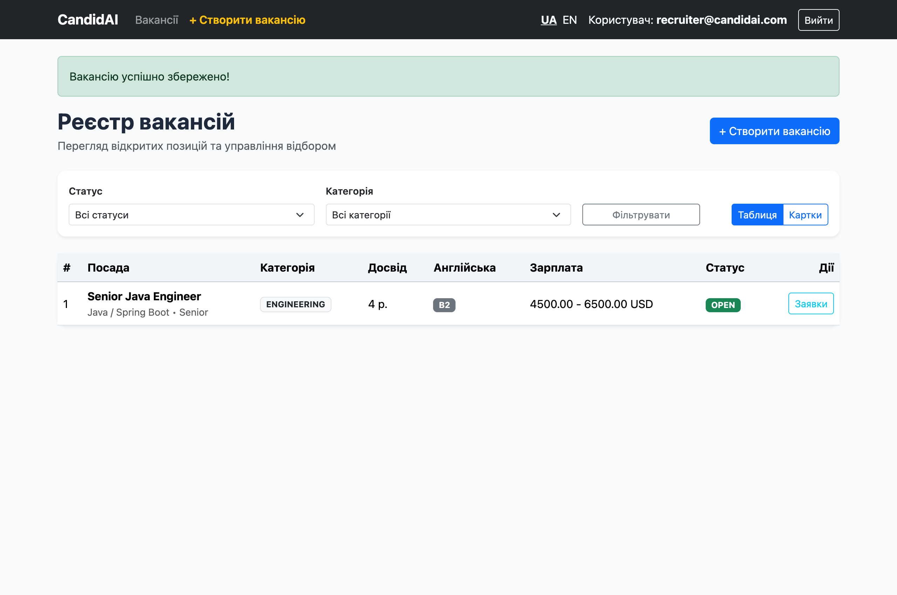

---

### 6. Відображення вакансій у вигляді карток
*Маршрут: `GET /vacancies?view=CARDS`. Альтернативне представлення списку через сітку Bootstrap-карток.*
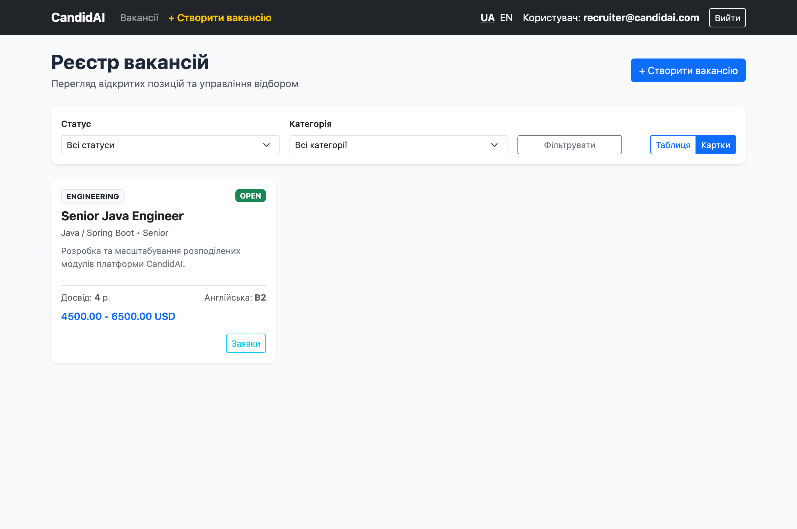

---

### 7. Безпечний вихід із системи (POST Logout)
*Маршрут: `POST /logout` -> `GET /login?logout`. Сесію інвалідовано, куки видалено, відображається інфо-банер про успішний вихід.*
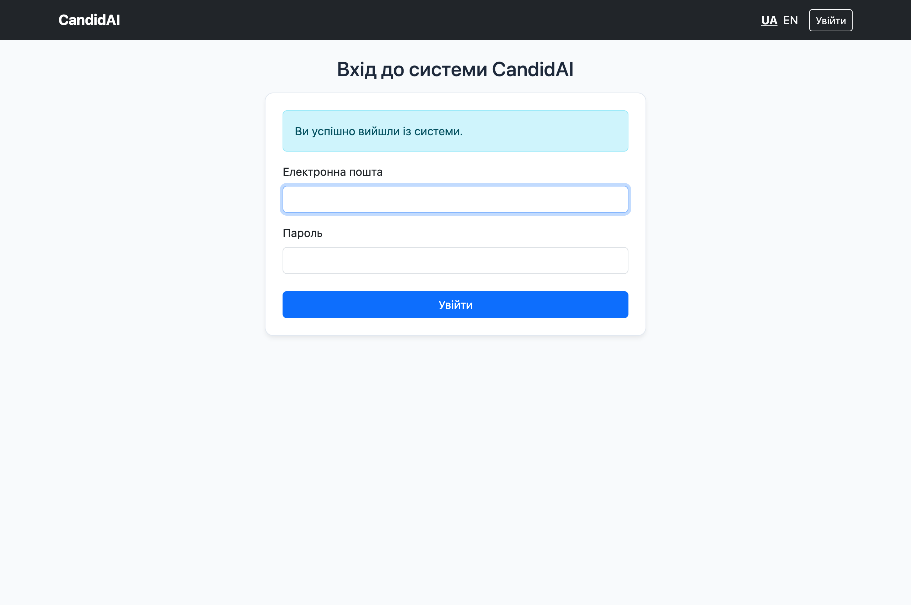

---

### 8. Реєстр вакансій під роллю Кандидата
*Маршрут: `GET /vacancies` під роллю `CANDIDATE`. Кнопка «+ Створити вакансію» прихована за допомогою `sec:authorize`, натомість відображається кнопка «Подати заявку».*
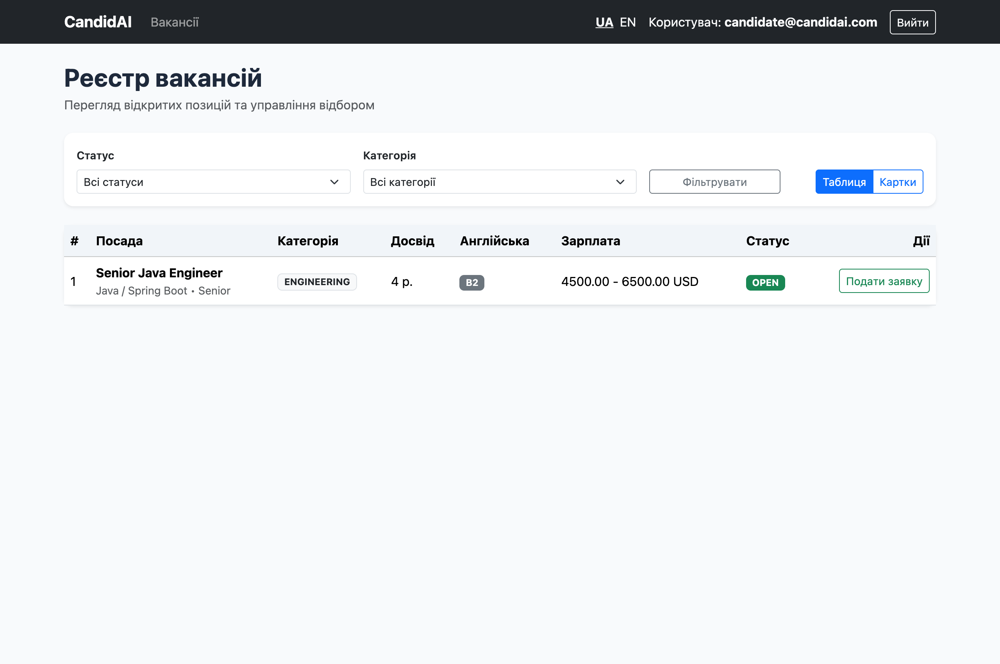

---

### 9. Форма подання заявки кандидатом
*Маршрут: `GET /vacancies/{id}/apply`. Повне ім'я та email автоматично підтягнуті з профілю авторизованого користувача.*
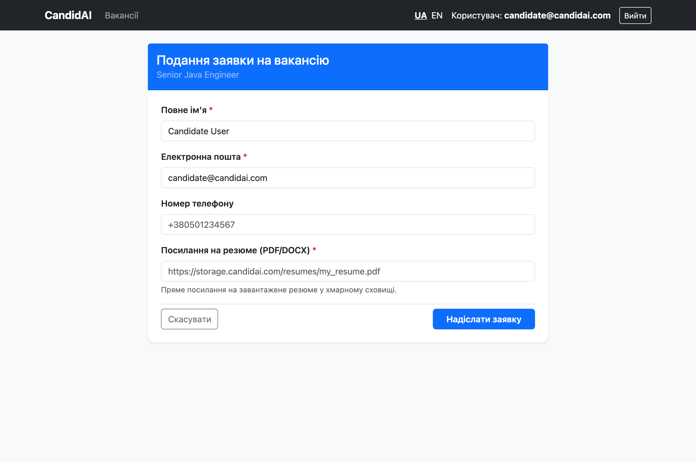

---

### 10. Успішне подання заявки (Патерн PRG)
*Маршрут: `POST /vacancies/{id}/apply` -> `redirect:/vacancies`. Flash-повідомлення «Вашу заявку успішно надіслано! Дякуємо за відгук.».*
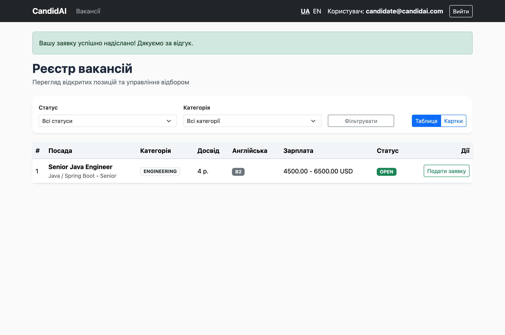

---

### 11. Серверна заборона доступу (Власна сторінка 403 Forbidden)
*Маршрут: спроба кандидата перейти напряму на `GET /vacancies/new`. Сервер блокує запит і рендерить стилізований шаблон `error/403.html`.*
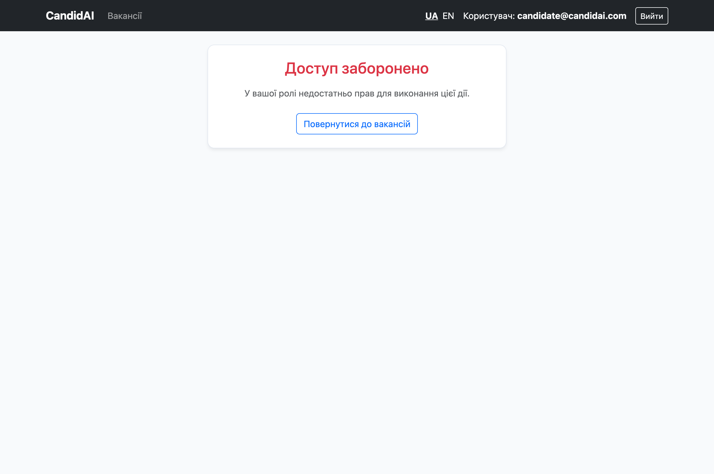

---

### 12. Перегляд списку кандидатів (Тімлід / Рекрутер)
*Маршрут: `GET /vacancies/{id}/applications` під роллю `TECH_LEAD`. Відображення таблиці заявок із контактами, посиланням на резюме, статусом `APPLIED` та результатом відбору.*
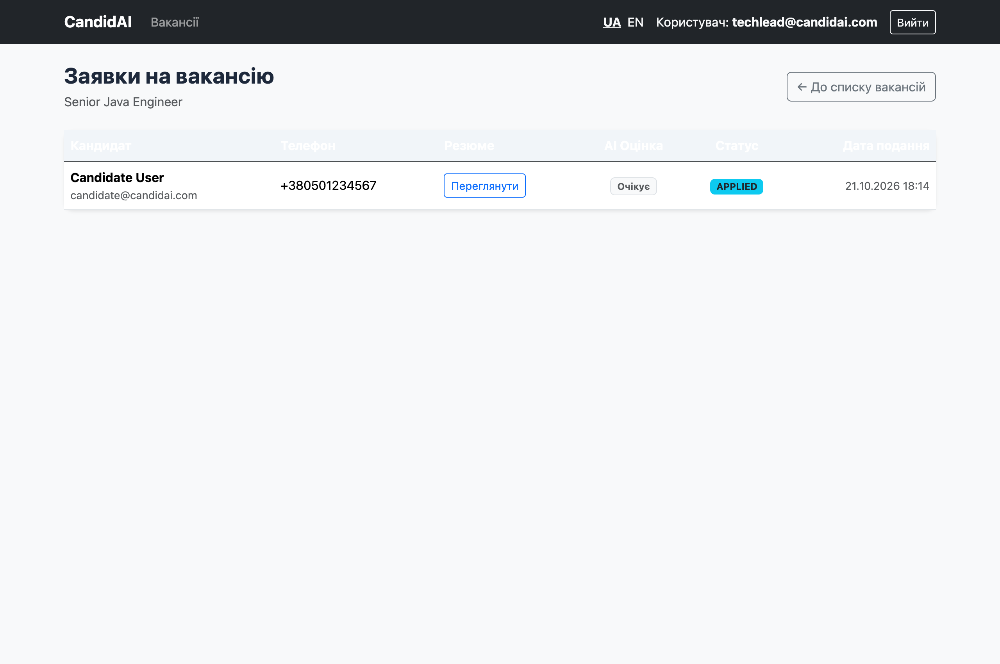

---

### 13. Власна сторінка помилки 404 Not Found
*Маршрут: перехід на неіснуючу або видалену вакансію. Замість білої сторінки чи стек-трейсу відображається шаблон `error/404.html` у загальному стилі проєкту.*
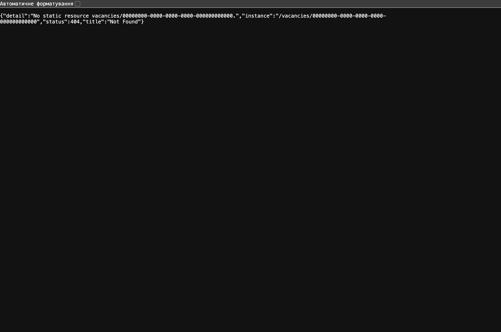

---

## 6. Висновок

Усі обов'язкові та додаткові вимоги групового завдання Практичної роботи №7 (Слайди 75–76) виконано в повному обсязі:
1. Побудовано ергономічний веб-інтерфейс на Thymeleaf із використанням компонентного підходу (`th:fragment`), локального WebJar Bootstrap 5.3.3 та багатомовністю (UA/EN).
2. Реалізовано довготривале кешування статичних ресурсів (365 днів) із генерацією MD5-хешу вмісту в URL (`VersionResourceResolver`) та підтримкою попередньо стисненого gzip (`EncodedResourceResolver`).
3. Розгорнуто триланцюгову архітектуру безпеки Spring Security з розділенням stateless JWT API, Swagger UI та сесійного веб-інтерфейсу з формою входу, захистом CSRF і суворою політикою Content Security Policy.
4. Забезпечено повний захист від OWASP-вразливостей (XSS, SSTI, CSRF, Clickjacking, Session Fixation).
5. Покрито всі сценарії модульним, інтеграційним та UI-тестуванням без регресій у попередній функціональності.
