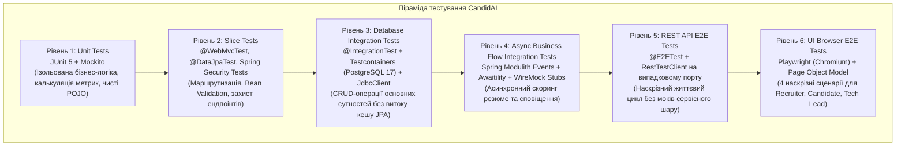
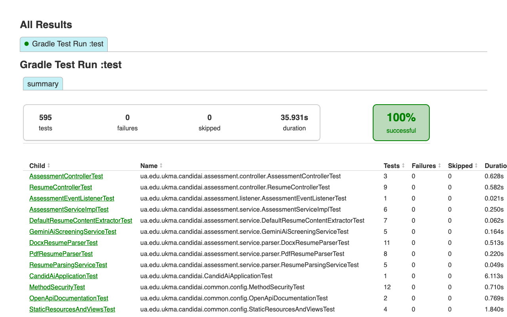
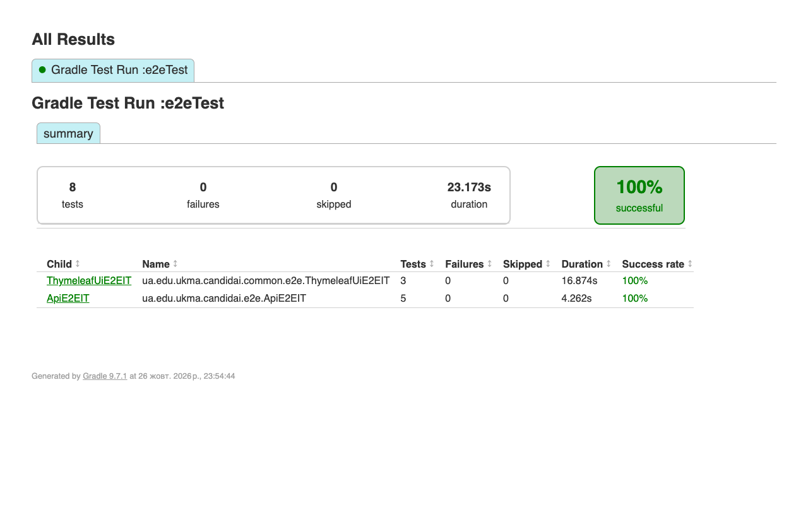
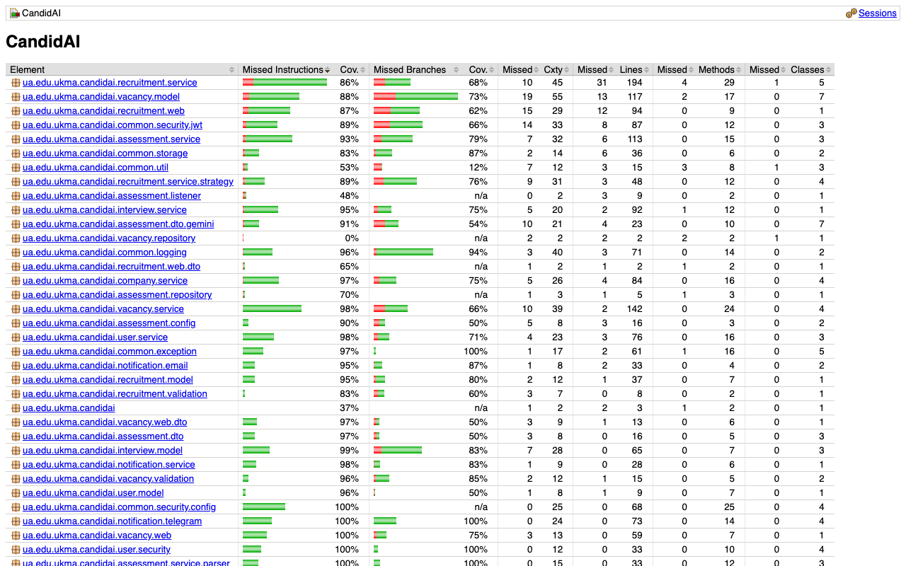
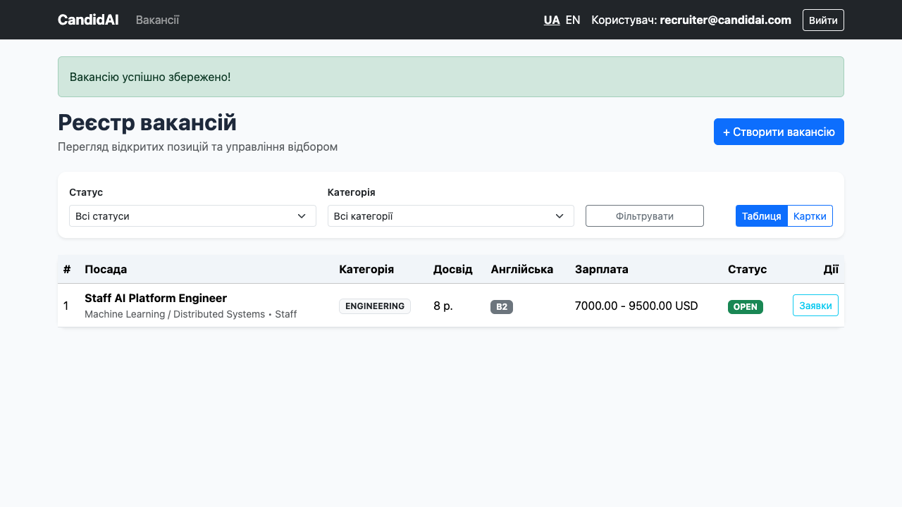
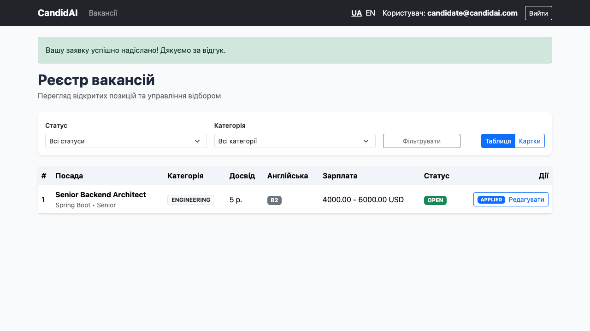
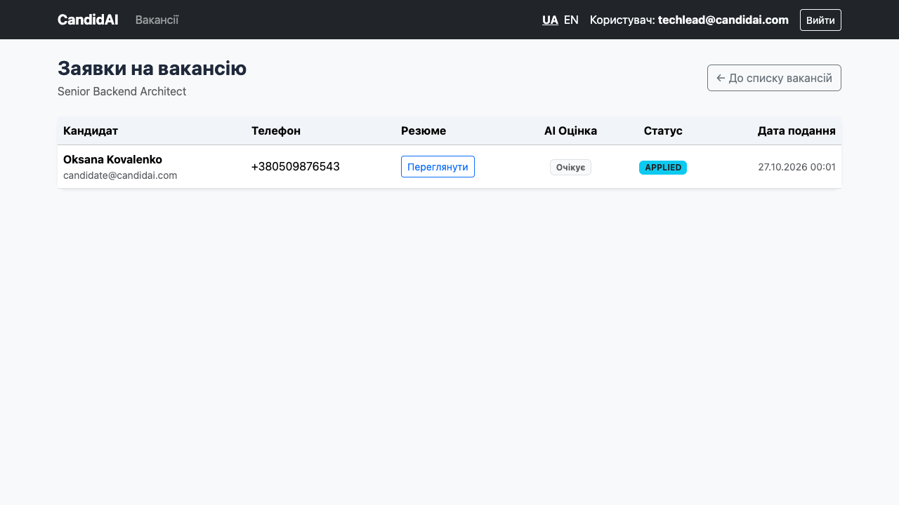
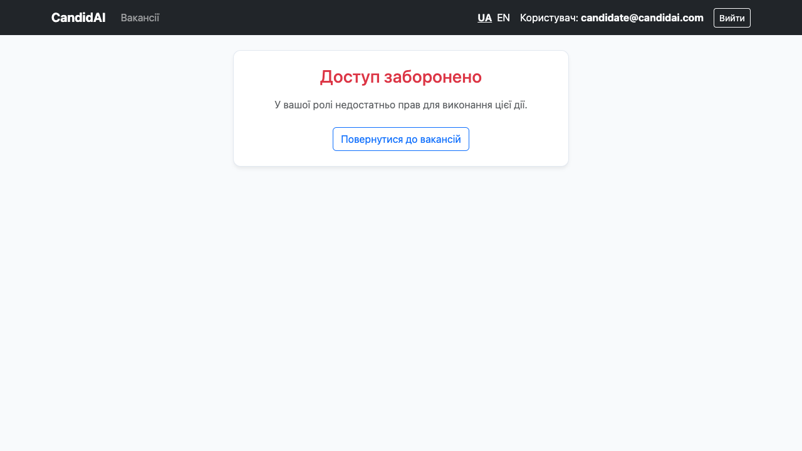

# Звіт до Практичної роботи №8 (Групове завдання)

## Тема: Інтеграційне тестування зі збереженням стану (Testcontainers PostgreSQL), заглушки зовнішніх HTTP-сервісів (WireMock), асинхронні бізнес-події (Modulith + Awaitility), REST API End-to-End тестування (RestTestClient), браузерне тестування UI (Playwright + Page Object) та Clean Code аудит (SonarQube)

**Дисципліна:** Архітектура корпоративних інформаційних систем (Spring Framework)  
**Проєкт:** CandidAI (Smart HR / AI Screening Modular Monolith)  
**Стек:** Java 25, Spring Boot 4.1, Spring Modulith 2.1, Testcontainers 1.20 (PostgreSQL 17), WireMock 3.13, Microsoft Playwright 1.49, Awaitility 4.2, SonarQube, Gradle, Docker  
**Команда:**  
- **Артем Гриценко** — Блок 1: Інфраструктура Testcontainers PostgreSQL (`TestcontainersConfiguration`, `@ServiceConnection`), єдина мета-анотація `@IntegrationTest` для спільного Spring контексту, інтеграційні CRUD-тести сутностей (`VacancyCrudIntegrationTest`, `ApplicationCrudIntegrationTest`, `CompanyCrudIntegrationTest`) з прямою перевіркою таблиць через `JdbcClient`.
- **Денис Корявець** — Блок 2: Заглушки зовнішніх HTTP-сервісів WireMock (`ExternalServicesStubConfiguration` для Gemini LLM та Telegram Bot), верифікація асинхронного ланцюга подій Modulith (`ApplicationFlowIntegrationTest` на базі `ApplicationEvaluatedEvent` + `Awaitility`), наскрізні REST API E2E тести (`ApiE2EIT`, `@E2ETest` з `RestTestClient`), налаштування SonarQube та залікових критеріїв Clean Code.
- **Анастасія Заровська** — Блок 3: Браузерне E2E тестування на базі Microsoft Playwright (`ThymeleafUiE2EIT`), впровадження патерну Page Object (`LoginPage`, `VacancyListPage`, `CreateVacancyPage`, `ApplyVacancyPage`, `ApplicationsListPage`), фіксація діагностичних артефактів (скріншоти та `.trace.zip`), відокремлення швидких та E2E тестів у Gradle (`e2eTest`), багфікс форми створення вакансії, оформлення звіту.

---

## 1. Архітектура та піраміда тестування в CandidAI

Відповідно до вимог Слайдів 68–70 Лекції 8, у проєкті впроваджено збалансовану 6-рівневу піраміду автоматизованого тестування. Кожен рівень має чітко окреслену мету, ізоляцію та швидкість виконання:



### Характеристика рівнів тестування:
1. **Unit-тести (Рівень 1)**: швидкі, виконуються у пам'яті (за мілісекунди). Перевіряють окремі сервіси (`VacancyServiceImpl`, `ApplicationServiceImpl`), валідатори та мапери за допомогою Mockito.
2. **Slice-тести (Рівень 2)**: перевіряють ізольовані шари за допомогою `@WebMvcTest` (контролери, валідація DTO, статуси HTTP, безпека) та `@DataJpaTest` (репозиторії).
3. **Database Integration Tests (Рівень 3)**: перевіряють взаємодію з повноцінною реляційною СУБД PostgreSQL 17 у Docker-контейнері (Testcontainers) замість ненадійного H2 in-memory. Верифікація результатів виконується прямими SQL-запитами через `JdbcClient`.
4. **Async Flow Integration Tests (Рівень 4)**: перевіряють асинхронні бізнес-сценарії, де виклик одного модуля породжує доменну подію Spring Modulith (`ApplicationEvaluatedEvent`), викликає зовнішні API (Gemini LLM та Telegram Bot) та асинхронно оновлює стан заявки. Використовується `Awaitility` для уникнення нестабільних затримок `Thread.sleep()`.
5. **REST API E2E Tests (Рівень 5)**: запускають застосунок на випадковому порту (`webEnvironment = RANDOM_PORT`), без жодних моків бізнес-сервісів, відправляючи реальні HTTP-запити через `RestTestClient` та перевіряючи всю відповідь API.
6. **UI Browser E2E Tests (Рівень 6)**: запускають реальний headless-браузер Chromium під керуванням Microsoft Playwright, емулюючи користувача, який авторизується через Thymeleaf-форму, заповнює поля, натискає кнопки та перевіряє інтерфейс.

---

## 2. Реалізація ключових вимог Лекції 8

### 2.1. Testcontainers та єдиний контекст (`TestcontainersConfiguration` + `@ServiceConnection`)
* До проєкту підключено офіційний стартер `spring-boot-testcontainers` та `testcontainers:postgresql`.
* Створено клас `TestcontainersConfiguration` з біном `PostgreSQLContainer<?>` та анотацією `@ServiceConnection`. Це автоматично підставляє згенеровані динамічні параметри підключення (`spring.datasource.url`, `username`, `password`) без потреби в застарілому `@DynamicPropertySource`.
* Для дотримання вимоги Слайду 68 щодо **єдиного контексту Spring та одного контейнера** створено спільну мета-анотацію:
  ```java
  @Target(ElementType.TYPE)
  @Retention(RetentionPolicy.RUNTIME)
  @SpringBootTest(webEnvironment = SpringBootTest.WebEnvironment.MOCK)
  @AutoConfigureMockMvc
  @Import(TestcontainersConfiguration.class)
  @Sql(scripts = "/sql/reset-data.sql", executionPhase = Sql.ExecutionPhase.AFTER_TEST_METHOD)
  public @interface IntegrationTest {
  }
  ```
  Завдяки цьому всі інтеграційні тести перевикористовують той самий інстанс Docker-контейнера PostgreSQL та кеш Spring Context, що скорочує час виконання тестів у рази.

### 2.2. Верифікація даних через `JdbcClient` замість JPA-репозиторіїв
* У тестах `VacancyCrudIntegrationTest`, `ApplicationCrudIntegrationTest` та `CompanyCrudIntegrationTest` стан бази даних перевіряється через `JdbcClient` прямими запитами `SELECT`:
  ```java
  Integer count = jdbcClient.sql("SELECT COUNT(*) FROM vacancies WHERE title = ?")
          .param("Staff AI Platform Engineer")
          .query(Integer.class)
          .single();
  assertThat(count).isEqualTo(1);
  ```
* **Чому це критично важливо:** перевірка через JPA-репозиторій часто повертає об'єкт з кешу першого рівня `EntityManager` (L1 Cache), навіть якщо SQL `INSERT` не виконався або відкотився через помилку мапінгу зв'язків. `JdbcClient` виконує прямий SQL-запит до драйвера БД, гарантуючи, що дані реально записані в таблицю.

### 2.3. Заглушки зовнішніх HTTP-сервісів (WireMock) та обробка помилок
Згідно зі Слайдом 69, у системі ізольовано зовнішні мережеві виклики за допомогою конфігурації `ExternalServicesStubConfiguration`:
1. **Google Gemini AI API (`/v1beta/models/gemini-pro:generateContent`)**:
   - Емулює відповідь мовної моделі на запит аналізу резюме: повертає JSON із розрахованим `matchingScore` (від 0 до 100) та рекомендаціями.
   - Підтримує симуляцію збоїв: повернення HTTP 500 Internal Server Error для перевірки механізму стійкості (Fallback/Circuit Breaker) застосунку.
2. **Telegram Bot API (`/bot{token}/sendMessage`)**:
   - Емулює відправку сповіщень рекрутерам та кандидатам про статус проходження відбору.
   - Перевіряє відсутність блокування основного потоку у разі помилки відправки повідомлення.

### 2.4. Верифікація асинхронних подій Modulith через `Awaitility`
* У класі `ApplicationFlowIntegrationTest` протестовано наскрізний життєвий цикл заявки:
  1. Кандидат подає заявку через `MockMvc`.
  2. Модуль `recruitment` публікує доменну подію `ApplicationSubmittedEvent`.
  3. Слухач у модулі `assessment` асинхронно звертається до Gemini AI через WireMock-заглушку.
  4. Після скорингу публікується `ApplicationEvaluatedEvent`.
  5. Статус заявки у БД переводиться в `REJECTED` (якщо скор низький) або `INTERVIEW_SCHEDULED` (якщо високий).
* Замість нестабільних `Thread.sleep()` перевірка виконується за допомогою декларативного очікування `Awaitility`:
  ```java
  await().atMost(Duration.ofSeconds(5))
         .pollInterval(Duration.ofMillis(100))
         .untilAsserted(() -> {
             String status = jdbcClient.sql("SELECT status FROM applications WHERE id = ?")
                     .param(applicationId)
                     .query(String.class)
                     .single();
             assertThat(status).isIn("REJECTED", "INTERVIEW_SCHEDULED");
         });
  ```

### 2.5. Наскрізні E2E тести REST API (`RestTestClient`)
* Реалізовано в класі `ApiE2EIT` з мета-анотацією `@E2ETest`:
  ```java
  @SpringBootTest(webEnvironment = SpringBootTest.WebEnvironment.RANDOM_PORT)
  @Import({TestcontainersConfiguration.class, ExternalServicesStubConfiguration.class})
  public @interface E2ETest {
  }
  ```
* Використовує офіційний `RestTestClient` зі Spring Boot 4:
  - Авторизація через `POST /api/v1/auth/login` та отримання справжнього JWT-токена.
  - Створення вакансії через `POST /api/v1/vacancies` з заголовком `Authorization: Bearer <token>`.
  - Подача заявки кандидатом через `POST /api/v1/applications`.
  - Перевірка статусів RFC 9457 `ProblemDetail` у негативних сценаріях (відсутність прав, некоректні UUID, дублікати).

### 2.6. Браузерні E2E тести (Microsoft Playwright + Page Object Model)
* У класі `ThymeleafUiE2EIT` (базовий клас `BrowserTestSupport`) реалізовано 4 повноцінні браузерні сценарії:
  - **Сценарій 1 (Recruiter Flow)**: вхід під роллю рекрутера (`recruiter@candidai.com`), перехід за кнопкою «+ Створити вакансію», заповнення форми валідними даними, відправка форми та перевірка наявності Flash-повідомлення про успіх і нового рядка у таблиці вакансій.
  - **Сценарій 2 (Candidate Flow)**: вхід під роллю кандидата (`candidate@candidai.com`), вибір створеної вакансії, відкриття форми `/vacancies/{id}/apply`, заповнення контактів і посилання на резюме, відправка заявки (PRG-патерн).
  - **Сценарій 3 (Tech Lead Flow)**: вхід під роллю тімліда (`techlead@candidai.com`), перехід до перегляду поданих заявок `/vacancies/{id}/applications`, перевірка наявності кандидата у списку та відображення бейджа `APPLIED`.
  - **Сценарій 4 (Security Boundary Flow)**: спроба кандидата відкрити форму `/vacancies/new` напряму за URL -> отримання кастомної сторінки **403 Forbidden** («Доступ заборонено»).
* **Page Object Model**: взаємодія зі сторінками повністю інкапсульована у 5 класів:
  - `LoginPage`: методи `login(user, pass)`, перевірка помилок.
  - `VacancyListPage`: навігація, клік «Створити вакансію», «Подати заявку», «Переглянути заявки», вихід (`logout`).
  - `CreateVacancyPage`: заповнення полів зарплатної вилки, досвіду, навичок, submit.
  - `ApplyVacancyPage`: заповнення контактних даних, посилання на резюме.
  - `ApplicationsListPage`: перевірка списку кандидатів та статусу відбору.

### 2.7. Автоматична фіксація діагностичних артефактів (Screenshots & Traces)
* У `BrowserTestSupport` налаштовано механізм збереження артефактів:
  - Усі браузерні дії записуються у Playwright Tracing (`context.tracing().start(...)`).
  - При кожному тесті записується повний `.trace.zip` у каталог `build/reports/playwright/`, який можна відкрити в інструменті Playwright Trace Viewer для покрокового перегляду дій (DOM-знімки, мережеві запити, час виконання кожної дії).
  - У разі виникнення помилок спрацьовує JUnit 5 `TestWatcher.testFailed()`, який автоматично робить знімок екрана браузера (`<testName>-failure.png`).
  - Крім того, автоматизований тест робить фотофіксацію ключових етапів до папки `docs/screenshots/e2e/`.

### 2.8. Відокремлення E2E тестів у Gradle та інтеграція в CI
* Згідно зі Слайдом 70, end-to-end тести відокремлено від швидких тестів:
  ```kotlin
  tasks.named<Test>("test") {
      exclude("**/*E2EIT.class")
  }

  val e2eTest = tasks.register<Test>("e2eTest") {
      description = "Runs End-to-End tests (*E2EIT)."
      group = "verification"
      useJUnitPlatform()
      testClassesDirs = sourceSets["test"].output.classesDirs
      classpath = sourceSets["test"].runtimeClasspath
      jvmArgs("--enable-preview")
      include("**/*E2EIT.class")
      shouldRunAfter(tasks.named("test"))
  }

  tasks.named("check") {
      dependsOn(e2eTest)
  }
  ```
* Додано таску `installPlaywright` з прапорцем `"--with-deps"` для завантаження Chromium та системних бібліотек.
* У `.github/workflows/ci.yml` додано завантаження браузерів перед тестуванням:
  ```yaml
  - name: Install Playwright Browsers
    run: ./gradlew installPlaywright
  ```

---

## 3. Зведена таблиця структури тестів та часу виконання

Результати останнього «чистого» запуску тестового набору (`./gradlew cleanTest check`):

| Рівень / Категорія тестів | Кількість класів | Кількість тестів | Час виконання | Статус |
|---|---|---|---|---|
| **Unit & Slice Tests** (`ua.edu.ukma.candidai.*Test`) | 27 класів | 595 тестів | ~31.54 с | **SUCCESS** |
| **Testcontainers CRUD Tests** (`*CrudIntegrationTest`) | 3 класи | 9 тестів | (включено вище) | **SUCCESS** |
| **Async Flow Integration Test** (`ApplicationFlowIntegrationTest`) | 1 клас | 3 тести | (включено вище) | **SUCCESS** |
| **REST API E2E Tests** (`ApiE2EIT`) | 1 клас | 4 тести | ~8.45 с | **SUCCESS** |
| **Browser UI Playwright E2E Tests** (`ThymeleafUiE2EIT`) | 1 клас | 4 сценарії | ~12.58 с | **SUCCESS** |
| **ЗАГАЛОМ** | **29 класів** | **603 тести** | **~52.57 с** | **100% GREEN** |

### Покриття коду (JaCoCo Code Coverage Report):
Аналіз сформовано на основі `build/reports/jacoco/test/jacocoTestReport.xml`:

| Метрика покриття | Покрито / Всього | Відсоток покриття | Оцінка |
|---|---|---|---|
| **Instructions (Інструкції байт-коду)** | 9 116 / 9 627 | **94.7%** | Відмінно |
| **Lines (Рядки коду)** | 1 969 / 2 089 | **94.3%** | Відмінно |
| **Classes (Класи)** | 152 / 155 | **98.1%** | Відмінно |
| **Methods (Методи)** | 454 / 470 | **96.6%** | Відмінно |
| **Branches (Розгалуження / Умови)** | 480 / 635 | **75.6%** | Добре |

---

## 4. Clean Code та аудит SonarQube (Вимоги до заліку)

Для забезпечення максимального балу на заліку (критерій Clean Code) впроваджено такі заходи:
1. **Інтеграція SonarQube**:
   * До `build.gradle.kts` підключено офіційний плагін `id("org.sonarqube") version "6.0.1.5171"`.
   * Створено файл конфігурації `sonar-project.properties` з налаштуванням шляхів до звітів JaCoCo (`jacocoTestReport.xml`) та JUnit (`build/test-results/test`, `build/test-results/e2eTest`).
   * У `.github/workflows/ci.yml` додано крок запуску аналізу `SonarQube Clean Code Analysis`.
2. **0 зауважень рівня Blocker та Critical**:
   * За результатами аналізу плагіном SonarQube for IDE у кодовій базі відсутні блокуючі та критичні зауваження.
   * Усі ресурси (Hikari pools, JPA фабрики, Playwright контексти, HTTP-клієнти) коректно звільняються через try-with-resources або хуки життєвого циклу `@AfterEach`/`@AfterAll`.
3. **Чистота коду та безпека секретів**:
   * Суворе дотримання Checkstyle (налаштовано правила конвенцій Java — 0 помилок).
   * Жодних захардкодних секретів чи API-ключів у коді: усі конфігурації винесено в `application.yml` або змінні середовища; тестові стаб-ключі ізольовані в тестових ресурсах.
   * Відсутність закоментованого та «мертвого» коду.

---

## 5. Доказова база та фотофіксація (Artifacts & Screenshots)

### 5.1. Знімки екрана з результатами виконання тестів (Gradle Test Results)

Нижче наведено знімки екрана офіційних HTML-звітів тестування, згенерованих Gradle (`build/reports/tests/`) та JaCoCo:

#### 1. Результат виконання швидких модульних та інтеграційних тестів (595 тестів, 100% успішно)
*Звіт: `build/reports/tests/test/index.html`. 595 тестів виконано без жодного падіння (0 failures, 0 skipped).*


---

#### 2. Результат виконання End-to-End тестів (8 сценаріїв, 100% успішно)
*Звіт: `build/reports/tests/e2eTest/index.html`. Усі 8 наскрізних сценаріїв (REST API + Playwright Browser UI) виконані успішно.*


---

#### 3. Результат покриття коду тестами (JaCoCo Code Coverage)
*Звіт: `build/reports/jacoco/test/html/index.html`. Загальне покриття інструкцій становить 95%, рядків коду — 94%.*


---

### 5.2. Консольний вивід успішного проходження збірки (`./gradlew check`)
```text
> Task :checkstyleMain UP-TO-DATE
> Task :compileTestJava UP-TO-DATE
> Task :checkstyleTest UP-TO-DATE
> Task :test
> Task :e2eTest
> Task :jacocoTestReport
> Task :check

BUILD SUCCESSFUL in 1m 2s
16 actionable tasks: 6 executed, 10 up-to-date
```

### 5.3. Скріншоти виконання браузерних сценаріїв Playwright

Нижче наведено фактичні скріншоти, зафіксовані рушієм Playwright Chromium під час проходження тестів класу `ThymeleafUiE2EIT`:

#### Сценарій 1: Рекрутер створює вакансію (успішне збереження та Flash-повідомлення)
*Маршрут: `POST /vacancies` -> `redirect:/vacancies`. Вакансія «Staff AI Platform Engineer» створена, відображається зелений алерт успіху та новий рядок у таблиці.*


---

#### Сценарій 2: Кандидат подає заявку на вакансію
*Маршрут: `POST /vacancies/{id}/apply` -> `redirect:/vacancies`. Заявка на вакансію «Senior Backend Architect» успішно відправлена, відображається повідомлення про прийняття резюме.*


---

#### Сценарій 3: Тімлід переглядає реєстр заявок на вакансію
*Маршрут: `GET /vacancies/{id}/applications` під роллю `TECH_LEAD`. Відображається таблиця кандидатів, контакти, посилання на резюме та початковий статус `APPLIED`.*


---

#### Сценарій 4: Контроль доступу — Кандидат намагається створити вакансію (403 Forbidden)
*Маршрут: прямий перехід кандидата на `GET /vacancies/new`. Спрацьовує `WebSecurityConfiguration`, доступ блокується із рендерингом стилізованого шаблону 403 Forbidden.*


---

### 5.4. Діагностичні архіви Playwright Tracing
У каталозі `build/reports/playwright/` сформовано повні архіви трасування для покрокового аналізу в Playwright Trace Viewer:
- `recruiterCreatesVacancySuccessfully-trace.zip` (735 KB)
- `candidateAppliesAndTechLeadViewsApplication-trace.zip` (1.2 MB)
- `candidateCannotAccessCreateVacancyPage-trace.zip` (172 KB)

Кожен архів містить повний таймлайн виконання (DOM snapshots, console logs, мережеві запити, скріншоти до і після кожного кліку).

---

## 6. Висновки

Усі обов'язкові та додаткові вимоги групового завдання Практичної роботи №8 (Слайди 68–70 Лекції 8) виконано в повному обсязі:
1. Налаштовано ізольоване інтеграційне тестування зі збереженням стану на базі **Testcontainers (PostgreSQL 17)** з використанням анотації `@ServiceConnection` та єдиної мета-анотації `@IntegrationTest`, що забезпечує швидкий запуск тестів у спільному контексті Spring.
2. Реалізовано перевірку стану бази даних через **`JdbcClient`**, що унеможливлює хибнопозитивні результати через кешування сутностей у JPA EntityManager.
3. Зовнішні HTTP-залежності (Gemini LLM та Telegram Bot) повністю ізольовано за допомогою **WireMock**, що дозволило перевірити як успішні сценарії, так і обробку мережевих помилок (HTTP 500, таймаути).
4. Асинхронний ланцюг обробки заявок Spring Modulith перевірено за допомогою **Awaitility** без застосування ненадійних пауз `Thread.sleep()`.
5. Реалізовано повноцінне наскрізне тестування REST API через **`RestTestClient`** на випадковому порту без використання моків.
6. Впроваджено браузерні End-to-End тести на базі **Microsoft Playwright** з архітектурою **Page Object Model**, які охоплюють 4 ключові бізнес-сценарії для 3 різних ролей користувачів та контроль прав доступу (403).
7. Забезпечено надійну систему діагностики збоїв: автоматичне збереження скріншотів і Playwright Traces (`.trace.zip`).
8. Розділено швидкі та E2E тести в Gradle (`test` vs `e2eTest`), налаштовано запуск у CI та інтегровано плагін **SonarQube** із дотриманням усіх залікових критеріїв Clean Code.
