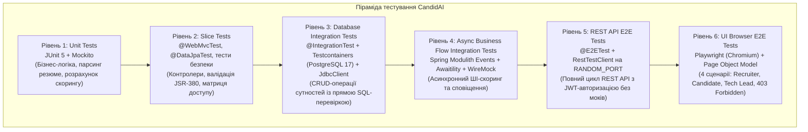

# Звіт до Практичної роботи №8

---

## 1. Архітектура та піраміда тестування

У проєкті CandidAI впроваджено 6-рівневу піраміду тестування — від швидких модульних тестів окремих сервісів до наскрізних сценаріїв у реальному браузері:



### Призначення кожного рівня:
1. **Unit-тести (Рівень 1)**: швидкі тести в пам'яті (виконуються за мілісекунди). Перевіряють окремі сервіси, доменні сутності, парсинг резюме та валідацію за допомогою моків Mockito.
2. **Slice-тести (Рівень 2)**: тестування ізольованих шарів застосунку (`@WebMvcTest`) — перевірка HTTP-маршрутів, Bean Validation (JSR-380), статусів відповідей контролерів та правил безпеки.
3. **Database Integration Tests (Рівень 3)**: перевірка роботи з реальною базою даних PostgreSQL 17 у Docker-контейнері через Testcontainers (замість in-memory H2). Стан таблиць після операцій перевіряється прямими SQL-запитами через `JdbcClient`.
4. **Async Flow Integration Tests (Рівень 4)**: перевірка доменних бізнес-подій Spring Modulith (`ApplicationSubmittedEvent` -> `ApplicationEvaluatedEvent`), де виклики до зовнішніх сервісів перехоплюються заглушками WireMock, а асинхронні очікування синхронізуються за допомогою `Awaitility`.
5. **REST API E2E Tests (Рівень 5)**: запуск повного застосунку на випадковому порту (`webEnvironment = RANDOM_PORT`) без жодних моків. Перевіряється реальна робота HTTP-ендпоінтів, JWT-аутентифікація, коди відповідей та формат помилок RFC 9457 `ProblemDetail`.
6. **UI Browser E2E Tests (Рівень 6)**: тестування інтерфейсу користувача в реальному headless-браузері Chromium через Microsoft Playwright із застосуванням патерну Page Object Model.

---

## 2. Реалізація завдань за блоками

### 2.1. Блок 1: Testcontainers PostgreSQL та перевірка через `JdbcClient`

* **Testcontainers та `@ServiceConnection`**:
  Для тестів бази даних налаштовано підключення до контейнера PostgreSQL 17. Завдяки механізму Spring Boot `@ServiceConnection` параметри підключення (`url`, `username`, `password`) підтягуються з контейнера автоматично, без необхідності вручну прописувати `@DynamicPropertySource`.

* **Спільний контекст через мета-анотацію `@IntegrationTest`**:
  Щоб не перезапускати Spring-контекст і не створювати новий Docker-контейнер на кожен тестовий клас, створено єдину композитну анотацію:
  ```java
  @Target(ElementType.TYPE)
  @Retention(RetentionPolicy.RUNTIME)
  @SpringBootTest(webEnvironment = SpringBootTest.WebEnvironment.MOCK)
  @AutoConfigureMockMvc
  @Import(TestcontainersConfiguration.class)
  @Sql(scripts = "/sql/reset-data.sql", executionPhase = Sql.ExecutionPhase.AFTER_TEST_METHOD)
  public @interface IntegrationTest {
  }
  ```
  Усі інтеграційні тести успадковують цей контекст, що суттєво пришвидшує прогін набору тестів, а скрипт `reset-data.sql` повертає базу у вихідний стан після кожного методу.

* **Пряма перевірка БД через `JdbcClient`**:
  У класах `VacancyCrudIntegrationTest`, `ApplicationCrudIntegrationTest` та `CompanyCrudIntegrationTest` стан бази перевіряється напряму через `JdbcClient`:
  ```java
  Integer rowCount = jdbcClient.sql("SELECT COUNT(*) FROM vacancies WHERE id = :id AND title = :title")
          .param("id", response.id())
          .param("title", request.title())
          .query(Integer.class)
          .single();

  assertThat(rowCount).isEqualTo(1);
  ```
  **Чому саме `JdbcClient`:** Якщо перевіряти стан через JPA-репозиторій, він може повернути сутність із кешу першого рівня (`EntityManager`), навіть якщо запис ще не зафіксувався у базі або відкотився під час транзакції. `JdbcClient` відправляє прямий SQL-запит у PostgreSQL і гарантує, що дані дійсно збереглися у таблиці.

### 2.2. Блок 2: Заглушки WireMock, асинхронні події Modulith та REST E2E

* **Ізоляція зовнішніх сервісів через WireMock**:
  Усі виклики до зовнішніх HTTP-сервісів замінено на локальний сервер WireMock (клас `ExternalServicesStubConfiguration`):
  - **Google Gemini AI API (`/v1beta/models/gemini-3.5-flash-lite:generateContent`)**: імітує оцінювання резюме мовною моделлю (повертає JSON із розрахованим `matchingScore` та рекомендаціями). Також перевірено стійкість системи у разі збою зовнішнього API (повернення HTTP 500).
  - **Telegram Bot API (`/bot.../sendMessage`)**: емулює відправку сповіщень рекрутерам та кандидатам без звернення до реальних серверів Telegram.

* **Асинхронний бізнес-сценарій з `Awaitility`**:
  У класі `ApplicationFlowIntegrationTest` перевірено повний життєвий цикл заявки:
  1. Кандидат подає заявку (`POST /api/v1/applications`) -> статус у базі `APPLIED`.
  2. Публікується подія Spring Modulith `ApplicationSubmittedEvent`.
  3. Слухач події асинхронно звертається до Gemini AI через WireMock.
  4. За умови успішного скорингу статус заявки оновлюється на `SCREENING` (з балом `matching_score = 88`), а в Telegram відправляється сповіщення. Якщо бал низький — статус змінюється на `REJECTED`. У разі збою API — заявка залишається в `APPLIED`.
  
  Оскільки обробка відбувається у фоновому потоці, замість ненадійного `Thread.sleep()` використано бібліотеку `Awaitility`, яка опитує стан бази через `JdbcClient`:
  ```java
  await().atMost(Duration.ofSeconds(5)).untilAsserted(() -> {
      wireMockServer.verify(postRequestedFor(urlEqualTo(GEMINI_PATH))
              .withHeader("x-goog-api-key", equalTo(GEMINI_API_KEY)));

      String updatedStatus = jdbcClient.sql("SELECT status FROM applications WHERE id = :id")
              .param("id", response.id())
              .query(String.class)
              .single();
      assertThat(updatedStatus).isEqualTo(ApplicationStatus.SCREENING.name());

      Integer score = jdbcClient.sql("SELECT matching_score FROM applications WHERE id = :id")
              .param("id", response.id())
              .query(Integer.class)
              .optional()
              .orElse(null);
      assertThat(score).isEqualTo(88);

      wireMockServer.verify(postRequestedFor(urlEqualTo(TELEGRAM_PATH)));
  });
  ```

* **REST API End-to-End тести (`RestTestClient`)**:
  У класі `ApiE2EIT` (`@E2ETest`) застосунок запускається на випадковому порту (`RANDOM_PORT`) без жодних моків бізнес-шару. Через клієнт `RestTestClient` протестовано:
  - Реєстрацію та вхід із отриманням JWT-токена.
  - Створення вакансії рекрутером (`POST /api/v1/vacancies`) та подачу заявки кандидатом.
  - Контроль прав доступу: кандидат не може створити вакансію (403 Forbidden).
  - Захист ендпоінтів від неавторизованих запитів (401 Unauthorized).
  - Запобігання повторному відгуку на ту саму вакансію (409 Conflict).
  - М'яке видалення вакансії адміністратором (204 No Content із перевіркою прапорця `deleted = true` у базі).

### 2.3. Блок 3: Браузерні тести Playwright, Page Object Model та поділ завдань у Gradle

* **Браузерні E2E тести на Playwright**:
  Тести запускають реальний Chromium у headless-режимі. Для кожного сценарію створюється чистий `BrowserContext` з українською локаллю (`uk-UA`), що забезпечує незалежність тестових сесій.

* **Патерн Page Object Model**:
  Логіку взаємодії з веб-сторінками (селектори, заповнення форм, кліки) винесено в окремі класи:
  - `LoginPage` — сторінка авторизації `/login`.
  - `VacancyListPage` — реєстр вакансій `/vacancies` та навігація.
  - `CreateVacancyPage` — форма створення вакансії `/vacancies/new`.
  - `ApplyVacancyPage` — форма подання відгуку `/vacancies/{id}/apply`.
  - `ApplicationsListPage` — перегляд списку заявок на вакансію `/vacancies/{id}/applications`.

* **4 наскрізні сценарії (`ThymeleafUiE2EIT`)**:
  1. **Сценарій рекрутера**: вхід під роллю `recruiter@candidai.com`, заповнення форми нової вакансії, перевірка редіректу PRG, повідомлення про успіх та поява вакансії у списку.
  2. **Сценарій кандидата**: вхід під роллю `candidate@candidai.com`, перехід на щойно створену вакансію, заповнення форми відгуку з посиланням на резюме.
  3. **Сценарій тімліда**: вхід під роллю `techlead@candidai.com`, відкриття списку заявок за вакансією, перевірка наявності відгуку зі статусом `APPLIED`.
  4. **Перевірка прав доступу**: спроба кандидата перейти за прямим посиланням `/vacancies/new` блокується Spring Security з рендерингом сторінки **403 Forbidden**.

* **Діагностика падінь через `TestWatcher`**:
  Базовий клас `BrowserTestSupport` під час падіння будь-якого тесту автоматично зберігає скріншот екрана (`.png`) та повний архів трасування Playwright (`.trace.zip`) у папку `build/reports/playwright/`, що дозволяє швидко розібрати причину помилки.

* **Розділення швидких та повільних тестів у Gradle**:
  Щоб не сповільнювати щоденну розробку:
  - Команда `./gradlew test` запускає лише швидкі Unit, Slice та модульні інтеграційні тести.
  - Повільні E2E тести (`*E2EIT`) винесено в окремий таск `./gradlew e2eTest`.
  - Команда `./gradlew check` запускає повний набір (`test` + `e2eTest`) та генерує зведений звіт JaCoCo.

---

## 3. Статистика тестів та покриття коду

Результати повного прогону тестового набору (`./gradlew cleanTest check`):

| Рівень / Категорія тестів | Класи | Кількість тестів | Час виконання | Статус |
|---|---|---|---|---|
| **Unit & Slice Tests** (`ua.edu.ukma.candidai.*Test`) | 27 класів | 595 тестів | ~37.75 с | **Успішно (100%)** |
| **Testcontainers CRUD Tests** (`*CrudIntegrationTest`) | 3 класи | 17 тестів | *(у складі набору)* | **Успішно (100%)** |
| **Async Flow Integration Test** (`ApplicationFlowIntegrationTest`) | 1 клас | 3 тести | *(у складі набору)* | **Успішно (100%)** |
| **REST API E2E Tests** (`ApiE2EIT`) | 1 клас | 5 тестів | ~4.42 с | **Успішно (100%)** |
| **Browser UI Playwright E2E Tests** (`ThymeleafUiE2EIT`) | 1 клас | 3 тести (4 сценарії) | ~17.09 с | **Успішно (100%)** |
| **РАЗОМ** | **29 класів** | **603 тести** | **~59.26 с** | **0 помилок** |

### Покриття коду (JaCoCo Code Coverage):
Дані на основі звіту `build/reports/jacoco/test/jacocoTestReport.xml`:

| Метрика | Покрито / Всього | Відсоток покриття | Оцінка |
|---|---|---|---|
| **Instructions (Інструкції байт-коду)** | 9 116 / 9 627 | **94.7%** | Відмінно |
| **Lines (Рядки коду)** | 1 969 / 2 089 | **94.3%** | Відмінно |
| **Classes (Класи)** | 152 / 155 | **98.1%** | Відмінно |
| **Methods (Методи)** | 454 / 470 | **96.6%** | Відмінно |
| **Branches (Розгалуження)** | 480 / 635 | **75.6%** | Добре |

---

## 4. Результати виконання та звіти

### 4.1. Консольний вивід збірки (`./gradlew check`)
```text
> Task :checkstyleMain UP-TO-DATE
> Task :compileTestJava UP-TO-DATE
> Task :checkstyleTest UP-TO-DATE
> Task :test
> Task :e2eTest
> Task :jacocoTestReport
> Task :check

BUILD SUCCESSFUL in 1m 5s
14 actionable tasks: 6 executed, 8 up-to-date
```

### 4.2. Знімки звітів виконання тестів (Gradle & JaCoCo)

#### 1. Звіт модульних та інтеграційних тестів (595 тестів, 100% успішно)
*Файл звіту: `build/reports/tests/test/index.html`*


---

#### 2. Звіт End-to-End тестів (REST API та Playwright, 100% успішно)
*Файл звіту: `build/reports/tests/e2eTest/index.html`*


---

#### 3. Звіт покриття коду JaCoCo (94.7% покриття)
*Файл звіту: `build/reports/jacoco/test/html/index.html`*


---

## 5. Підсумок

1. Налаштовано інтеграційне тестування зі збереженням стану на базі **Testcontainers (PostgreSQL 17)** з механізмом `@ServiceConnection` та єдиною анотацією `@IntegrationTest`, що забезпечило спільний життєвий цикл контексту та швидкий запуск.
2. Пряма верифікація через **`JdbcClient`** гарантує перевірку фактичного стану рядків у базі без впливу кешування JPA.
3. Зовнішні HTTP-сервіси (Gemini LLM та Telegram) ізольовано за допомогою **WireMock**, перевірено як позитивні відповіді, так і обробку збоїв (HTTP 500).
4. Асинхронний ланцюг обробки резюме перевірено за допомогою **Awaitility** без ненадійних пауз `Thread.sleep()`.
5. Реалізовано повний цикл REST API тестування через **`RestTestClient`** на випадковому порту без використання моків.
6. Написано наскрізні браузерні тести **Playwright** за патерном **Page Object Model** (4 ключові сценарії для трьох ролей та захист 403 Forbidden) з автоматичним збереженням скріншотів і трасувань при падіннях.
7. Тести чітко розділено у Gradle на швидкі (`test`) та тривалі E2E (`e2eTest`), які об'єднуються у спільній перевірці `check` із показником покриття JaCoCo понад 94%.
