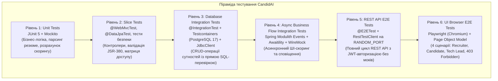
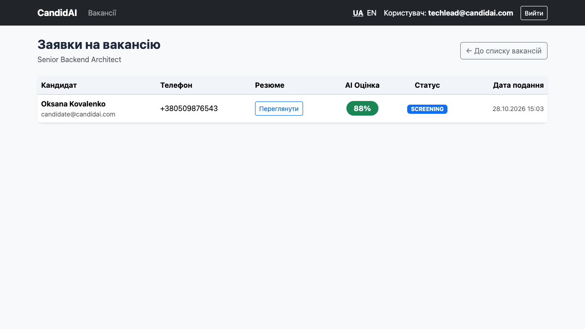

# Звіт до Практичної роботи №8

---

## 1. Архітектура та піраміда тестування

У проєкті CandidAI реалізовано 6-рівневу піраміду тестування - від швидких модульних тестів окремих сервісів до наскрізних сценаріїв у реальному браузері:



### Призначення кожного рівня:
1. **Unit-тести (Рівень 1)**: швидкі тести в пам'яті (виконуються за мілісекунди). Перевіряють окремі сервіси, доменні сутності, парсинг резюме та валідацію за допомогою моків Mockito.
2. **Slice-тести (Рівень 2)**: тестування ізольованих шарів застосунку (`@WebMvcTest` для HTTP-маршрутів, Bean Validation JSR-380 і правил безпеки та `@DataJpaTest` із Testcontainers PostgreSQL 17 для репозиторіїв).
3. **Database Integration Tests (Рівень 3)**: перевірка роботи з реальною базою даних PostgreSQL 17 у Docker-контейнері через Testcontainers (без використання in-memory H2). Стан таблиць після операцій перевіряється прямими SQL-запитами через `JdbcClient`.
4. **Async Flow Integration Tests (Рівень 4)**: перевірка доменних бізнес-подій Spring Modulith (`ApplicationSubmittedEvent` -> `ApplicationEvaluatedEvent`), де виклики до зовнішніх сервісів перехоплюються заглушками WireMock, а асинхронні очікування синхронізуються за допомогою `Awaitility`.
5. **REST API E2E Tests (Рівень 5)**: запуск повного застосунку на випадковому порту (`webEnvironment = RANDOM_PORT`) без моків бізнес-логіки. Перевіряється реальна робота HTTP-ендпоінтів через `RestTestClient`, JWT-автентифікація, коди відповідей та формат помилок RFC 9457 `ProblemDetail`.
6. **UI Browser E2E Tests (Рівень 6)**: тестування серверного інтерфейсу Thymeleaf у реальному headless-браузері Chromium через Microsoft Playwright із застосуванням патерну Page Object Model та семантичних локаторів.

---

## 2. Реалізація завдань за блоками

### 2.1. Блок 1: Testcontainers PostgreSQL та перевірка через `JdbcClient`

* **Testcontainers та `@ServiceConnection`**:
  Для всіх інтеграційних і репозиторних тестів налаштовано єдиний контейнер `postgres:17-alpine` у `TestcontainersConfiguration`. Завдяки механізму Spring Boot `@ServiceConnection` параметри підключення (`url`, `username`, `password`) передаються у контекст автоматично без ручного `@DynamicPropertySource`.

* **Спільний контекст через мета-анотацію `@IntegrationTest`**:
  Щоб не перезапускати Spring-контекст і не піднімати окремий Docker-контейнер на кожен клас, створено композитну анотацію:
  ```java
  @Target(ElementType.TYPE)
  @Retention(RetentionPolicy.RUNTIME)
  @Documented
  @SpringBootTest(webEnvironment = SpringBootTest.WebEnvironment.MOCK)
  @AutoConfigureMockMvc
  @Import({TestcontainersConfiguration.class, ExternalServicesStubConfiguration.class})
  @Sql(scripts = "/sql/reset-data.sql", executionPhase = Sql.ExecutionPhase.AFTER_TEST_METHOD)
  public @interface IntegrationTest {
  }
  ```
  Усі 10 інтеграційних тестових класів спільно використовують один кешований контекст Spring і один контейнер PostgreSQL 17, а скрипт `reset-data.sql` відновлює початковий стан таблиць після кожного тестового методу.

* **Пряма перевірка БД через `JdbcClient`**:
  У класах `VacancyCrudIntegrationTest`, `ApplicationCrudIntegrationTest` та `CompanyCrudIntegrationTest` стан бази після HTTP-запитів перевіряється напряму через `JdbcClient`:
  ```java
  Integer rowCount = jdbcClient.sql("SELECT COUNT(*) FROM vacancies WHERE id = :id AND title = :title")
          .param("id", response.id())
          .param("title", request.title())
          .query(Integer.class)
          .single();

  assertThat(rowCount).isEqualTo(1);
  ```
  **Чому саме `JdbcClient`:** Якщо перевіряти стан через JPA-репозиторій, він може повернути сутність із кешу першого рівня (`EntityManager`), навіть якщо зміни ще не були скинуті у БД або транзакція мала неочікувану поведінку. `JdbcClient` виконує незалежний SQL-запит до PostgreSQL і підтверджує фактичну наявність змін у таблиці.

### 2.2. Блок 2: Заглушки WireMock, асинхронні події Modulith та REST E2E

* **Ізоляція зовнішніх сервісів через WireMock**:
  Усі виклики до зовнішніх HTTP API перехоплюються локальним сервером WireMock на динамічному порту (`ExternalServicesStubConfiguration`):
  - **Google Gemini AI API (`/v1beta/models/gemini-3.5-flash-lite:generateContent`)**: імітує оцінювання резюме мовною моделлю (повертає JSON із розрахованим `matchingScore` та рекомендаціями). Окремо протестовано обробку збою зовнішнього сервісу (HTTP 500).
  - **Telegram Bot API (`/bot.../sendMessage`)**: емулює відправку сповіщень рекрутерам та кандидатам без звернення до зовнішніх серверів Telegram.

* **Асинхронний бізнес-сценарій з `Awaitility`**:
  У класі `ApplicationFlowIntegrationTest` перевірено повний життєвий цикл заявки:
  1. Кандидат подає заявку (`POST /api/v1/applications`) -> початковий статус у базі `APPLIED`.
  2. Публікується подія Spring Modulith `ApplicationSubmittedEvent`.
  3. Слухач `@ApplicationModuleListener` асинхронно звертається до Gemini AI через WireMock.
  4. За успішного скорингу статус заявки змінюється на `SCREENING` (з оцінкою `matching_score = 88`), а у Telegram надсилається сповіщення. За низького балу статус переходить у `REJECTED`. У разі збою API (HTTP 500) заявка безпечно залишається у статусі `APPLIED`.

  Оскільки обробка відбувається у фоновому потоці, замість `Thread.sleep()` використано `Awaitility`, яка опитує фактичний стан таблиці `applications` через `JdbcClient` та верифікує HTTP-виклики у WireMock:
  ```java
  await().atMost(Duration.ofSeconds(5)).untilAsserted(() -> {
      wireMockServer.verify(postRequestedFor(urlEqualTo(GEMINI_PATH))
              .withHeader("x-goog-api-key", equalTo(GEMINI_API_KEY)));

      String updatedStatus = jdbcClient.sql("SELECT status FROM applications WHERE id = :id")
              .param("id", response.id())
              .query(String.class)
              .single();
      assertThat(updatedStatus).isEqualTo(ApplicationStatus.SCREENING.name());

      Integer score = jdbcClient.sql("SELECT matching_score FROM applications WHERE id = :id")
              .param("id", response.id())
              .query(Integer.class)
              .optional()
              .orElse(null);
      assertThat(score).isEqualTo(88);

      wireMockServer.verify(postRequestedFor(urlEqualTo(TELEGRAM_PATH)));
  });
  ```

* **REST API End-to-End тести (`RestTestClient`)**:
  У класі `ApiE2EIT` (`@E2ETest`) застосунок піднімається на реальному випадковому порту (`RANDOM_PORT`) без моків бізнес-шару. Через `RestTestClient` перевірено:
  - Реєстрацію та вхід із отриманням JWT-токена.
  - Створення вакансії рекрутером (`POST /api/v1/vacancies`) та подачу заявки кандидатом.
  - Розмежування прав доступу: спроба кандидата створити вакансію повертає `403 Forbidden`.
  - Захист ендпоінтів від неавтентифікованих запитів (`401 Unauthorized`).
  - Запобігання повторному відгуку на ту саму вакансію (`409 Conflict` у форматі `ProblemDetail`).
  - М'яке видалення вакансії адміністратором (`204 No Content` із перевіркою `deleted = true` у БД через `JdbcClient`).

### 2.3. Блок 3: Браузерні тести Playwright, Page Object Model та поділ завдань у Gradle

* **Браузерні E2E тести на Playwright**:
  Клас `ThymeleafUiE2EIT` також позначений анотацією `@E2ETest`, завдяки чому розділяє спільний контекст `RANDOM_PORT`, PostgreSQL 17 та WireMock із `ApiE2EIT`. Тести виконуються у headless-браузері Chromium; перед кожним методом створюється ізольований `BrowserContext` з налаштованим `baseURL` та українською локаллю (`uk-UA`).

* **Патерн Page Object Model та семантичні локатори**:
  Уся взаємодія зі сторінками інкапсульована в окремих Page Object класах на базі семантичних локаторів Playwright (`getByRole`, `getByLabel`) та auto-waiting перевірок `PlaywrightAssertions.assertThat(...)`:
  - `LoginPage` - сторінка входу `/login`.
  - `VacancyListPage` - реєстр вакансій `/vacancies`, дії у рядках таблиці та вихід із системи.
  - `CreateVacancyPage` - форма створення вакансії `/vacancies/new`.
  - `ApplyVacancyPage` - форма подання відгуку `/vacancies/{id}/apply`.
  - `ApplicationsListPage` - таблиця заявок кандидатів `/vacancies/{id}/applications`.

* **4 наскрізні сценарії (`ThymeleafUiE2EIT`)**:
  1. **Сценарій рекрутера**: вхід під `recruiter@candidai.com`, заповнення форми створення вакансії, перевірка Post-Redirect-Get, банера успіху та відображення вакансії у таблиці.
  2. **Сценарій кандидата**: вхід під `candidate@candidai.com`, вибір відкритої вакансії, заповнення форми заявки з контактними даними та посиланням на резюме.
  3. **Сценарій тімліда**: після завершення асинхронного ШІ-скринінгу резюме вхід під `techlead@candidai.com`, перехід до заявок на вакансію та перевірка відображення кандидата зі статусом `SCREENING` і AI-оцінкою `88%`.
  4. **Перевірка прав доступу (403 Forbidden)**: перевірка відсутності кнопки створення вакансії для ролі кандидата та блокування прямого переходу на `/vacancies/new` сторінкою «Доступ заборонено».

* **Діагностика падінь (`AfterTestExecutionCallback`)**:
  Базовий клас `BrowserTestSupport` реєструє JUnit 5 розширення `AfterTestExecutionCallback`, яке спрацьовує до закриття `BrowserContext` у `@AfterEach`. У разі падіння тесту автоматично зберігаються повноекранний знімок (`*-failure.png`) та архів трасування Playwright (`*-trace.zip`) у директорію `build/reports/playwright/` (також додану до артефактів CI).

* **Розділення швидких та повільних тестів у Gradle**:
  - `./gradlew test` запускає Unit, Slice та `@IntegrationTest` тести (виключаючи `*E2EIT`).
  - `./gradlew e2eTest` окремо запускає наскрізні тести `*E2EIT` (`ApiE2EIT` та `ThymeleafUiE2EIT`).
  - `./gradlew check` послідовно виконує Checkstyle, `test`, `e2eTest` і формує зведений звіт `jacocoTestReport` на основі обох наборів даних (`test.exec` + `e2eTest.exec`).

---

## 3. Статистика тестів та покриття коду

Результати повного прогону перевірок (`./gradlew clean check`):

| Рівень / Категорія тестів | Класи | Кількість тестів | Час виконання | Статус |
|---|---|---|---|---|
| **Unit & Slice Tests** (`Mockito`, `@WebMvcTest`, `@DataJpaTest`) | 68 класів | 540 тестів | *(у складі `:test`, 35.24 с)* | **Успішно (100%)** |
| **Security, Web & Context Integration Tests** (`@IntegrationTest`) | 6 класів | 35 тестів | *(у складі `:test`)* | **Успішно (100%)** |
| **Database CRUD Integration Tests** (`*CrudIntegrationTest`) | 3 класи | 17 тестів | *(у складі `:test`)* | **Успішно (100%)** |
| **Async Flow Integration Test** (`ApplicationFlowIntegrationTest`) | 1 клас | 3 тести | *(у складі `:test`)* | **Успішно (100%)** |
| **REST API E2E Tests** (`ApiE2EIT`, `:e2eTest`) | 1 клас | 5 тестів | 1.05 с | **Успішно (100%)** |
| **Browser UI Playwright E2E Tests** (`ThymeleafUiE2EIT`, `:e2eTest`) | 1 клас | 3 тести (4 сценарії) | 17.84 с | **Успішно (100%)** |
| **РАЗОМ (основний застосунок `:test` + `:e2eTest`)** | **80 класів** | **603 тести** | **55.90 с** | **0 помилок** |

> Додатково у підпроєкті `candidai-spring-boot-starter:test` виконується ще **2 класи (10 тестів)** автоконфігурації стартера (100% успішно).

### Покриття коду (JaCoCo Code Coverage):
Дані зведеного звіту `build/reports/jacoco/test/jacocoTestReport.xml` (`test.exec` + `e2eTest.exec`):

| Метрика | Покрито / Всього | Відсоток покриття | Оцінка |
|---|---|---|---|
| **Instructions (Інструкції байт-коду)** | 9 115 / 9 624 | **94.7%** | Відмінно |
| **Lines (Рядки коду)** | 1 969 / 2 088 | **94.3%** | Відмінно |
| **Classes (Класи)** | 152 / 155 | **98.1%** | Відмінно |
| **Methods (Методи)** | 454 / 470 | **96.6%** | Відмінно |
| **Branches (Розгалуження)** | 482 / 635 | **75.9%** | Добре |

---

## 4. Результати виконання та звіти

### 4.1. Консольний вивід збірки (`./gradlew clean check`)
```text
> Task :candidai-spring-boot-starter:test
> Task :candidai-spring-boot-starter:check
> Task :checkstyleMain
> Task :checkstyleTest
> Task :test
> Task :e2eTest
> Task :jacocoTestReport
> Task :check

BUILD SUCCESSFUL in 1m 7s
19 actionable tasks: 19 executed
```

### 4.2. Знімки звітів виконання тестів та браузерного прогону

#### 1. Звіт модульних та інтеграційних тестів (`:test` - 78 класів, 595 тестів, 100% успішно)
*Файл звіту: `build/reports/tests/test/index.html`*


---

#### 2. Звіт End-to-End тестів (`:e2eTest` - REST API та Playwright, 8 тестів, 100% успішно)
*Файл звіту: `build/reports/tests/e2eTest/index.html`*


---

#### 3. Зведений звіт покриття коду JaCoCo (94.7% інструкцій)
*Файл звіту: `build/reports/jacoco/test/html/index.html`*


---

#### 4. Знімок екрана браузерного E2E-тесту Playwright (Chromium)
*Перегляд тімлідом списку заявок після асинхронного ШІ-скринінгу резюме через WireMock (статус `SCREENING`, AI-оцінка `88%`):*


---

## 5. Підсумок

1. Усі інтеграційні та репозиторні тести переведено на **Testcontainers (`postgres:17-alpine`)** із `@ServiceConnection` без використання in-memory H2; мета-анотація `@IntegrationTest` забезпечує спільний контекст для всіх 10 класів інтеграційних тестів.
2. Стан бази даних після операцій перевіряється прямими SQL-запитами через **`JdbcClient`** в обхід кешу першого рівня JPA.
3. Зовнішні HTTP API (Google Gemini та Telegram) ізольовано через **WireMock** із перевіркою як успішних відповідей, так і обробки помилок `HTTP 500`.
4. Асинхронний конвеєр обробки заявок Spring Modulith протестовано за допомогою **Awaitility** без фіксованих затримок `Thread.sleep()`.
5. Реалізовано наскрізні REST API тести через **`RestTestClient`** на `RANDOM_PORT` та браузерні UI-тести **Playwright** за патерном **Page Object Model** на семантичних локаторах (`getByRole`, `getByLabel`) зі збереженням скріншотів і trace-архівів при збоях.
6. У Gradle розділено швидкі тести (`test`) та E2E-рівень (`e2eTest`) зі зведеним покриттям JaCoCo **94.7%** під час виконання `./gradlew check`.
