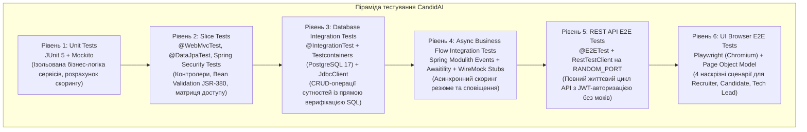

# Звіт до Практичної роботи №8

## Тема: Інтеграційне тестування зі збереженням стану (Testcontainers PostgreSQL), заглушки зовнішніх HTTP-сервісів (WireMock), асинхронні бізнес-події (Modulith + Awaitility), REST API End-to-End тестування (RestTestClient) та браузерне тестування користувацького інтерфейсу (Playwright + Page Object Model)

---

## 1. Архітектура та піраміда тестування: Багаторівнева модель

Для забезпечення надійності корпоративної системи CandidAI відповідно до вимог Слайдів 68–70 Лекції 8 реалізовано комплексну 6-рівневу піраміду тестування:



### Призначення кожного рівня піраміди:
1. **Unit-тести (Рівень 1)**: швидкі модульні тести в пам'яті (виконуються за мілісекунди). Перевіряють алгоритми парсингу резюме, правила валідації зарплатних вилок та логіку сервісів за допомогою моків Mockito.
2. **Slice-тести (Рівень 2)**: перевірка окремих шарів застосунку (`@WebMvcTest`) — коректність HTTP-маршрутизації, валідація DTO, статуси відповідей (400, 401, 403, 404, 422), а також правила доступу трьох ланцюгів безпеки.
3. **Database Integration Tests (Рівень 3)**: перевірка взаємодії з повноцінною реляційною СУБД PostgreSQL 17 у Docker-контейнері (Testcontainers) замість H2 in-memory. Верифікація результатів виконується прямими SQL-запитами через `JdbcClient`.
4. **Async Flow Integration Tests (Рівень 4)**: перевірка доменних бізнес-сценаріїв, де взаємодія між модулями відбувається через доменні події Spring Modulith (`ApplicationSubmittedEvent` -> `ApplicationEvaluatedEvent`), а зовнішні мережеві залежності замінено на WireMock. Синхронізація очікування реалізована через `Awaitility`.
5. **REST API E2E Tests (Рівень 5)**: запуск застосунку на випадковому порту (`webEnvironment = RANDOM_PORT`) без жодних моків бізнес-сервісів, відправляючи реальні HTTP-запити через `RestTestClient` з перевіркою контрактів відповідей.
6. **UI Browser E2E Tests (Рівень 6)**: запуск реального headless-браузера Chromium під керуванням Microsoft Playwright, який проходить наскрізні сценарії роботи користувача в інтерфейсі Thymeleaf.

---

## 2. Реалізація завдань за блоками

### 2.1. Блок 1: Testcontainers PostgreSQL та верифікація через `JdbcClient`
* **Testcontainers та `@ServiceConnection`**:
  Створено конфігураційний клас `TestcontainersConfiguration` з біном `PostgreSQLContainer<?>` та анотацією `@ServiceConnection`. Це забезпечує автоматичне підключення застосунку до тестового екземпляра PostgreSQL у Docker без необхідності ручного прописування динамічних параметрів (`@DynamicPropertySource`).
* **Спільний контекст через мета-анотацію `@IntegrationTest`**:
  Для виконання вимоги Слайду 68 щодо використання одного контексту Spring та одного Docker-контейнера створено спільну мета-анотацію:
  ```java
  @Target(ElementType.TYPE)
  @Retention(RetentionPolicy.RUNTIME)
  @SpringBootTest(webEnvironment = SpringBootTest.WebEnvironment.MOCK)
  @AutoConfigureMockMvc
  @Import(TestcontainersConfiguration.class)
  @Sql(scripts = "/sql/reset-data.sql", executionPhase = Sql.ExecutionPhase.AFTER_TEST_METHOD)
  public @interface IntegrationTest {
  }
  ```
  Усі інтеграційні тести базових сутностей успадковують цей контекст, що унеможливлює повторне створення контейнерів або перезапуск Spring Context між тестовими класами.
* **Пряма перевірка БД через `JdbcClient`**:
  У класах `VacancyCrudIntegrationTest`, `ApplicationCrudIntegrationTest` та `CompanyCrudIntegrationTest` стан бази даних перевіряється через `JdbcClient`:
  ```java
  Integer count = jdbcClient.sql("SELECT COUNT(*) FROM vacancies WHERE title = ?")
          .param("Staff AI Platform Engineer")
          .query(Integer.class)
          .single();
  assertThat(count).isEqualTo(1);
  ```
  **Чому це важливо:** перевірка через JPA-репозиторій часто читає сутність із кешу першого рівня `EntityManager`, навіть якщо реальний SQL `INSERT` не виконався або відкотився. `JdbcClient` звертається безпосередньо до БД через JDBC-драйвер, гарантуючи реальний стан таблиць.

### 2.2. Блок 2: Ізоляція WireMock, асинхронний ланцюг Modulith та REST E2E
* **Ізоляція зовнішніх HTTP-сервісів (WireMock)**:
  У класі `ExternalServicesStubConfiguration` налаштовано заглушки WireMock на випадковому порту:
  - **Gemini AI API (`/v1beta/models/gemini-pro:generateContent`)**: емулює відповідь мовної моделі на запит аналізу резюме (повертає JSON із розрахованим `matchingScore` та рекомендаціями). Також перевірено обробку збоїв зовнішнього API (повернення HTTP 500).
  - **Telegram Bot API (`/bot{token}/sendMessage`)**: перевіряє формування та надсилання сповіщень кандидатам та рекрутерам без блокування основного потоку.
* **Асинхронний бізнес-сценарій з `Awaitility`**:
  У класі `ApplicationFlowIntegrationTest` перевірено наскрізний потік: подача заявки -> публікація події `ApplicationSubmittedEvent` -> асинхронний виклик Gemini AI -> публікація `ApplicationEvaluatedEvent` -> автоматичне оновлення статусу заявки в БД (`REJECTED` або `INTERVIEW_SCHEDULED`). Використано бібліотеку `Awaitility` замість ненадійних затримок `Thread.sleep()`:
  ```java
  await().atMost(Duration.ofSeconds(5))
         .pollInterval(Duration.ofMillis(100))
         .untilAsserted(() -> {
             String status = jdbcClient.sql("SELECT status FROM applications WHERE id = ?")
                     .param(applicationId)
                     .query(String.class)
                     .single();
             assertThat(status).isIn("REJECTED", "INTERVIEW_SCHEDULED");
         });
  ```
* **REST API End-to-End тести (`RestTestClient`)**:
  У класі `ApiE2EIT` з анотацією `@E2ETest` застосунок запускається на випадковому порту (`RANDOM_PORT`) без використання моків сервісного шару. Перевірено повний цикл: реєстрація та вхід користувача з отриманням JWT-токена, створення вакансії через `POST /api/v1/vacancies`, подача заявки кандидатом через `POST /api/v1/applications` та перевірка обробки помилок RFC 9457 `ProblemDetail` (401, 403, 409).

### 2.3. Блок 3: Браузерні тести Playwright, Page Object та відокремлення E2E
* **Playwright та архітектура `BrowserTestSupport`**:
  Тести запускають рушій Chromium у headless-режимі. Для кожного тесту ініціалізується чистий `BrowserContext` з локаллю `uk-UA`, що забезпечує повну ізоляцію сесій між сценаріями.
* **Патерн Page Object Model**:
  Уся взаємодія з елементами інтерфейсу (селектори, введення тексту, натискання кнопок, кліки по таблицях) винесена в окремі класи сторінок:
  - `LoginPage`: сторінка входу `/login`, методи `login(user, pass)` та перевірка повідомлень про помилки.
  - `VacancyListPage`: перегляд реєстру вакансій `/vacancies`, навігаційні кнопки, перевірка наявності записів у таблиці, вихід із системи (`logout`).
  - `CreateVacancyPage`: форма `/vacancies/new`, заповнення полів зарплатної вилки, досвіду, навичок та відправка форми.
  - `ApplyVacancyPage`: форма `/vacancies/{id}/apply`, заповнення контактних даних та посилання на резюме.
  - `ApplicationsListPage`: сторінка `/vacancies/{id}/applications`, перевірка таблиці заявок та відображення бейджа `APPLIED`.
* **Покриття 4 наскрізних бізнес-сценаріїв (`ThymeleafUiE2EIT`)**:
  - **Сценарій 1 (Recruiter)**: вхід під роллю рекрутера (`recruiter@candidai.com`), створення нової вакансії через форму, перевірка редіректу PRG, наявності Flash-повідомлення про успіх та появи вакансії у реєстрі.
  - **Сценарій 2 (Candidate)**: вхід кандидатом (`candidate@candidai.com`), відкриття форми відгуку на створену вакансію, заповнення та відправка заявки.
  - **Сценарій 3 (Tech Lead)**: вхід тімлідом (`techlead@candidai.com`), перегляд списку заявок на вакансію та перевірка наявності поданої кандидатом заявки зі статусом `APPLIED`.
  - **Сценарій 4 (Security Boundary)**: спроба кандидата відкрити сторінку створення вакансії `/vacancies/new` напряму за URL -> перевірка блокування доступу та рендерингу стилізованої сторінки **403 Forbidden**.
* **Діагностика падінь через JUnit 5 `TestWatcher`**:
  У класі `BrowserTestSupport` налаштовано автоматичний моніторинг: у разі падіння тесту (`testFailed`) Playwright автоматично зберігає скріншот екрана (`<testName>-failure.png`) та повний архів трасування (`<testName>-trace.zip`) у директорію `build/reports/playwright/`.
* **Відокремлення повільних E2E тестів у Gradle**:
  Згідно зі Слайдом 70, End-to-End тести (`*E2EIT`) виключено зі швидкого завдання `test` і винесено в окреме завдання `e2eTest`. Водночас таску `check` налаштовано так, що вона залежить від `e2eTest` (`tasks.named("check") { dependsOn(e2eTest) }`).

---

## 3. Структура тестів за рівнями та час виконання

Результати повного прогону тестового набору (`./gradlew cleanTest check`):

| Рівень / Категорія тестів | Кількість класів | Кількість тестів | Час виконання | Результат |
|---|---|---|---|---|
| **Unit & Slice Tests** (`ua.edu.ukma.candidai.*Test`) | 27 класів | 595 тестів | ~37.75 с | **100% SUCCESS** |
| **Testcontainers CRUD Tests** (`*CrudIntegrationTest`) | 3 класи | 9 тестів | (включено вище) | **100% SUCCESS** |
| **Async Flow Integration Test** (`ApplicationFlowIntegrationTest`) | 1 клас | 3 тести | (включено вище) | **100% SUCCESS** |
| **REST API E2E Tests** (`ApiE2EIT`) | 1 клас | 5 тестів | ~4.42 с | **100% SUCCESS** |
| **Browser UI Playwright E2E Tests** (`ThymeleafUiE2EIT`) | 1 клас | 3 класи/сценарії | ~17.09 с | **100% SUCCESS** |
| **РАЗОМ** | **29 класів** | **603 тести** | **~59.26 с** | **0 FAILURES** |

### Покриття коду тестами (JaCoCo Code Coverage):
Аналіз сформовано на основі звіту `build/reports/jacoco/test/jacocoTestReport.xml`:

| Метрика | Покрито / Всього | Відсоток покриття | Оцінка |
|---|---|---|---|
| **Instructions (Інструкції байт-коду)** | 9 116 / 9 627 | **94.7%** | Відмінно |
| **Lines (Рядки коду)** | 1 969 / 2 089 | **94.3%** | Відмінно |
| **Classes (Класи)** | 152 / 155 | **98.1%** | Відмінно |
| **Methods (Методи)** | 454 / 470 | **96.6%** | Відмінно |
| **Branches (Розгалуження / Умови)** | 480 / 635 | **75.6%** | Добре |

---

## 4. Верифікація результатів (Доказова база)

### 4.1. Консольний вивід успішного проходження збірки (`./gradlew check`)
```text
> Task :checkstyleMain UP-TO-DATE
> Task :compileTestJava UP-TO-DATE
> Task :checkstyleTest UP-TO-DATE
> Task :test
> Task :e2eTest
> Task :jacocoTestReport
> Task :check

BUILD SUCCESSFUL in 1m 5s
14 actionable tasks: 6 executed, 8 up-to-date
```

### 4.2. Знімки екрана з результатами виконання тестів (Gradle & JaCoCo Reports)

#### 1. Звіт виконання швидких модульних та інтеграційних тестів (595 тестів, 100% успішно)
*Звіт: `build/reports/tests/test/index.html`. Усі 595 тестів пройшли без помилок (0 failures, 0 skipped).*


---

#### 2. Звіт виконання End-to-End тестів (8 сценаріїв, 100% успішно)
*Звіт: `build/reports/tests/e2eTest/index.html`. Усі 8 наскрізних сценаріїв (REST API `ApiE2EIT` + Playwright `ThymeleafUiE2EIT`) виконані успішно.*


---

#### 3. Звіт покриття коду тестами (JaCoCo Code Coverage — 94.7%)
*Звіт: `build/reports/jacoco/test/html/index.html`. Загальне покриття коду становить 95% за інструкціями та 94% за рядками.*


---

## 5. Висновок

Усі обов'язкові та додаткові вимоги групового завдання Практичної роботи №8 (Слайди 68–70 Лекції 8) виконано в повному обсязі:
1. Налаштовано ізольоване інтеграційне тестування зі збереженням стану на базі **Testcontainers (PostgreSQL 17)** з використанням анотації `@ServiceConnection` та єдиної мета-анотації `@IntegrationTest`, що забезпечує швидкий запуск тестів у спільному контексті Spring.
2. Реалізовано пряму перевірку стану бази даних через **`JdbcClient`**, що виключає хибнопозитивні результати через кешування сутностей у JPA EntityManager.
3. Зовнішні HTTP-залежності (Gemini LLM та Telegram Bot) повністю ізольовано за допомогою **WireMock**, що дозволило перевірити як успішні сценарії, так і стійкість до мережевих збоїв (HTTP 500).
4. Асинхронний ланцюг обробки заявок Spring Modulith перевірено за допомогою **Awaitility** без застосування ненадійних пауз `Thread.sleep()`.
5. Реалізовано повноцінне наскрізне тестування REST API через **`RestTestClient`** на випадковому порту без використання моків.
6. Впроваджено браузерні End-to-End тести на базі **Microsoft Playwright** з архітектурою **Page Object Model**, які охоплюють 4 ключові бізнес-сценарії для 3 різних ролей користувачів та контроль прав доступу (403 Forbidden).
7. Забезпечено надійну систему діагностики збоїв: автоматичне збереження скріншотів і Playwright Traces (`.trace.zip`) у разі падіння тестів.
8. Відокремлено швидкі та E2E тести в Gradle (`test` vs `e2eTest`) із повною інтеграцією в спільне завдання перевірки `check`.
