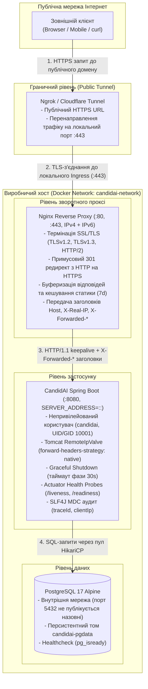
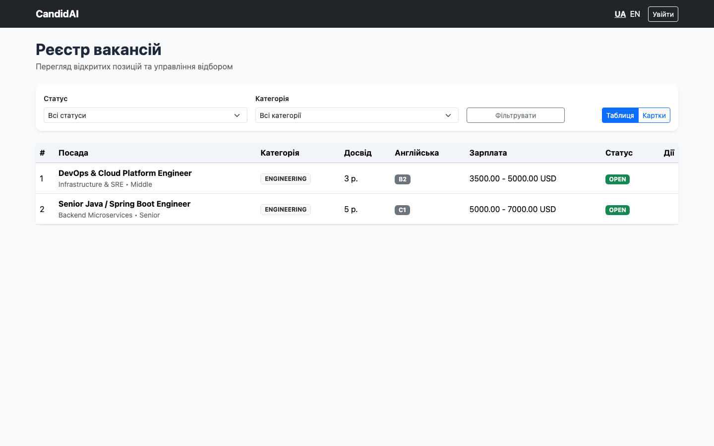
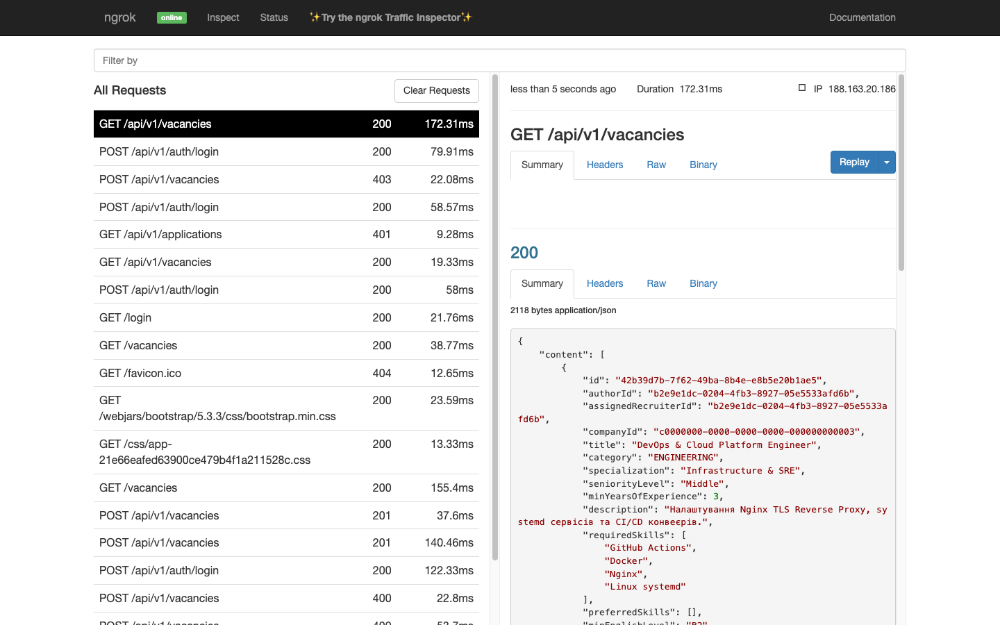

# Звіт до Практичної роботи №9

---

## 1. Архітектура розгортання та топологія мережі

У проєкті CandidAI побудовано багаторівневу інфраструктуру виробничого розгортання з мережевою ізоляцією сервісів, термінацією TLS на рівні зворотного проксі, наскрізною передачею контексту клієнта через `X-Forwarded-*` заголовки та контрольованим завершенням процесів (`graceful shutdown`).



### Призначення рівнів інфраструктури:
1. **Граничний рівень (Ngrok / Cloudflare Tunnel)**: формує публічну HTTPS-точку входу з валідним сертифікатом без необхідності виділеної публічної IP-адреси та перенаправляє трафік на локальний порт `443` зворотного проксі.
2. **Зворотний проксі (Nginx)**: виконує термінацію TLS (`TLSv1.2` / `TLSv1.3`, `HTTP/2`), 301-редирект із порту `80` на `443`, буферизацію відповідей бекенду (`proxy_buffering on`), кешування статичних ресурсів у браузері та передачу заголовків походження запиту (`Host`, `X-Real-IP`, `X-Forwarded-For`, `X-Forwarded-Proto`, `X-Forwarded-Port`).
3. **Рівень застосунку (Spring Boot)**: працює у контейнері від імені системного користувача `candidai` (`10001:10001`), слухає на Dual-Stack інтерфейсі (`SERVER_ADDRESS=::`), відновлює схему, порт та IP клієнта через вбудований Tomcat `RemoteIpValve` з перевіркою довірених підмереж `internal-proxies`, підтримує зонди готовності та безпечне завершення активних HTTP-запитів.
4. **Рівень даних (PostgreSQL 17)**: ізольований у внутрішній bridge-мережі `candidai-network` без прокидання порту `5432` на хост-машину, зі збереженням стану в іменованому томі `candidai-pgdata`.

---

## 2. Реалізація конфігурації за блоками

### 2.1. Блок 1: Багатоетапна контейнеризація (`Dockerfile`) та керування процесом (`systemd`)

#### Multi-stage `Dockerfile`
Для відокремлення інструментів компіляції від робочого середовища реалізовано двохетапну збірку. Перший етап (`builder` на базі `eclipse-temurin:25-jdk-noble`) завантажує залежності Gradle окремим кешованим шаром і збирає виконуваний `bootJar`. Другий етап (`runner` на базі `eclipse-temurin:25-jre-noble`) містить лише JRE, утиліту `curl` для перевірки стану та зібраний артефакт, завдяки чому розмір фінального образу становить `~668 МБ` (`203 МБ` у стисненому вигляді) порівняно з `>1.1 ГБ` у середовищі збірки з JDK та кешем Gradle:

```dockerfile
FROM eclipse-temurin:25-jdk-noble AS builder

WORKDIR /workspace

COPY gradlew settings.gradle.kts build.gradle.kts ./
COPY gradle ./gradle
COPY candidai-spring-boot-starter/build.gradle.kts ./candidai-spring-boot-starter/build.gradle.kts

RUN sed -i 's/\r$//' gradlew \
    && chmod +x gradlew \
    && ./gradlew dependencies --no-daemon

COPY config ./config
COPY candidai-spring-boot-starter/src ./candidai-spring-boot-starter/src
COPY src ./src

RUN ./gradlew bootJar -x test -x e2eTest -x checkstyleMain -x checkstyleTest --no-daemon \
    && cp build/libs/CandidAI-*.jar /workspace/candidai.jar

FROM eclipse-temurin:25-jre-noble AS runner

ARG APP_UID=10001
ARG APP_GID=10001

RUN apt-get update \
    && apt-get install -y --no-install-recommends curl \
    && rm -rf /var/lib/apt/lists/* \
    && groupadd --gid "${APP_GID}" candidai \
    && useradd --uid "${APP_UID}" --gid "${APP_GID}" --no-create-home --shell /usr/sbin/nologin candidai \
    && mkdir -p /app/logs /app/uploads/resumes \
    && chown -R candidai:candidai /app/logs /app/uploads

WORKDIR /app

COPY --from=builder /workspace/candidai.jar /app/candidai.jar

USER candidai:candidai

EXPOSE 8080

ENV PORT=8080 \
    SPRING_PROFILES_ACTIVE=prod \
    JAVA_TOOL_OPTIONS="-XX:+UseContainerSupport -XX:MaxRAMPercentage=75.0 -XX:+ExitOnOutOfMemoryError -Djava.security.egd=file:/dev/./urandom"

HEALTHCHECK --interval=15s --timeout=5s --start-period=40s --retries=3 \
    CMD curl -fsS "http://127.0.0.1:${PORT:-8080}/actuator/health/readiness" || exit 1

ENTRYPOINT ["java", "--enable-preview", "-jar", "/app/candidai.jar"]
```

Ключові параметри контейнера:
- Запуск від непривілейованого користувача `candidai:candidai` (`10001:10001`) без домашньої директорії та інтерактивної оболонки (`/usr/sbin/nologin`).
- `ENTRYPOINT` у exec-формі передає `PID 1` безпосередньо процесу `java`, тому сигнал `SIGTERM` від Docker доходить до `SpringApplicationShutdownHook` без проміжного `/bin/sh`.
- Прапорці `-XX:+UseContainerSupport -XX:MaxRAMPercentage=75.0 -XX:+ExitOnOutOfMemoryError` обмежують Java Heap до 75% ліміту пам'яті cgroups, залишаючи запас під Metaspace, стеки потоків і нативні буфери.
- У `.dockerignore` виключено `.git`, `.env`, `build/`, `.gradle/`, `docs/`, тестові скрипти та сертифікати, що запобігає потраплянню локальних секретів у контекст збірки.

#### Сервісний юніт `systemd` (`deploy/systemd/candidai.service`)
Для класичного розгортання на віртуальній машині Linux підготовлено конфігурацію `systemd` з ізоляцією файлової системи та узгодженим таймаутом зупинки:

```ini
[Unit]
Description=CandidAI Smart HR & AI Screening Service
Documentation=https://github.com/humaNukr/CandidAI
After=network-online.target postgresql.service
Wants=network-online.target

[Service]
Type=simple
User=candidai
Group=candidai
WorkingDirectory=/opt/candidai
EnvironmentFile=/etc/candidai/candidai.env
ExecStart=/usr/bin/java --enable-preview -XX:MaxRAMPercentage=75.0 -XX:+ExitOnOutOfMemoryError -jar /opt/candidai/candidai.jar
SuccessExitStatus=143
TimeoutStopSec=35
Restart=always
RestartSec=10
NoNewPrivileges=true
ProtectSystem=full
ProtectHome=true
PrivateTmp=true
ReadWritePaths=-/opt/candidai/logs -/opt/candidai/uploads

[Install]
WantedBy=multi-user.target
```

- `SuccessExitStatus=143` дозволяє `systemd` трактувати штатний вихід JVM за сигналом `SIGTERM` (`128 + 15 = 143`) як успішне завершення.
- `TimeoutStopSec=35` перевищує `spring.lifecycle.timeout-per-shutdown-phase=30s`, даючи застосунку час завершити активні запити перед примусовим `SIGKILL`.
- Директиви `NoNewPrivileges=true`, `ProtectSystem=full`, `ProtectHome=true`, `PrivateTmp=true` та `ReadWritePaths` обмежують запис лише каталогами логів і завантажених резюме.

---

### 2.2. Блок 2: Оркестрація (`compose.prod.yaml`) та зворотний проксі Nginx

#### Оркестрація сервісів у `compose.prod.yaml`
Стек об'єднує базу даних `candidai-db`, бекенд `candidai-app` та проксі `candidai-nginx` із послідовним запуском за станом `service_healthy`:

```yaml
name: candidai-prod

services:
  candidai-db:
    image: postgres:17-alpine
    container_name: candidai-db
    restart: unless-stopped
    stop_grace_period: 30s
    environment:
      POSTGRES_DB: ${POSTGRES_DB:-candidai}
      POSTGRES_USER: ${POSTGRES_USER:-candidai_user}
      POSTGRES_PASSWORD: ${POSTGRES_PASSWORD:?POSTGRES_PASSWORD must be set in .env}
    volumes:
      - candidai-pgdata:/var/lib/postgresql/data
    networks:
      - candidai-network
    healthcheck:
      test: ["CMD-SHELL", "pg_isready -U $${POSTGRES_USER:-candidai_user} -d $${POSTGRES_DB:-candidai}"]
      interval: 10s
      timeout: 5s
      retries: 5
      start_period: 10s

  candidai-app:
    build:
      context: .
      dockerfile: Dockerfile
    image: candidai:latest
    container_name: candidai-app
    restart: unless-stopped
    stop_grace_period: 35s
    depends_on:
      candidai-db:
        condition: service_healthy
    environment:
      SPRING_PROFILES_ACTIVE: ${SPRING_PROFILES_ACTIVE:-prod}
      PORT: 8080
      SERVER_ADDRESS: "${SERVER_ADDRESS:-::}"
      DB_URL: jdbc:postgresql://candidai-db:5432/${POSTGRES_DB:-candidai}
      DB_USERNAME: ${POSTGRES_USER:-candidai_user}
      DB_PASSWORD: ${POSTGRES_PASSWORD:?POSTGRES_PASSWORD must be set in .env}
      JWT_SECRET: ${JWT_SECRET:?JWT_SECRET must be set in .env}
      COOKIE_SECURE: ${COOKIE_SECURE:-true}
      CANDIDAI_SECURITY_SEED_DATA_ENABLED: ${SEED_DATA_ENABLED:-true}
    ports:
      - "127.0.0.1:${APP_HOST_PORT:-8080}:8080"
    volumes:
      - candidai-uploads:/app/uploads
      - candidai-logs:/app/logs
    networks:
      - candidai-network
    healthcheck:
      test: ["CMD-SHELL", "curl -fsS http://127.0.0.1:$${PORT:-8080}/actuator/health/readiness || exit 1"]
      interval: 15s
      timeout: 5s
      retries: 3
      start_period: 40s

  candidai-nginx:
    image: nginx:1.27-alpine
    container_name: candidai-nginx
    restart: unless-stopped
    depends_on:
      candidai-app:
        condition: service_healthy
    ports:
      - "${NGINX_HTTP_PORT:-80}:80"
      - "${NGINX_HTTPS_PORT:-443}:443"
    volumes:
      - ./deploy/nginx/candidai.conf:/etc/nginx/conf.d/default.conf:ro
      - ./deploy/nginx/ensure-ssl.sh:/docker-entrypoint.d/05-ensure-ssl.sh:ro
      - ./deploy/nginx/ssl:/etc/nginx/ssl
    networks:
      - candidai-network
    healthcheck:
      test: ["CMD-SHELL", "curl -fsSk https://127.0.0.1/actuator/health/readiness || exit 1"]
      interval: 15s
      timeout: 5s
      retries: 3
      start_period: 10s
```

Приватні ключі та сертифікати виключено з Git через `.gitignore` (`*.key`, `*.crt`, `*.pem`, `*.p12`). Якщо на момент старту контейнера `candidai-nginx` у змонтованій директорії `/etc/nginx/ssl` ще немає сертифіката (наприклад, на чистій машині після `git clone`), entrypoint-скрипт `deploy/nginx/ensure-ssl.sh` автоматично генерує локальну пару `RSA 2048` із SAN для `localhost`, `candidai.local` та `127.0.0.1`.

#### Конфігурація Nginx (`deploy/nginx/candidai.conf`)

```nginx
upstream spring_backend {
    server candidai-app:8080;
    keepalive 32;
}

server {
    listen 80;
    listen [::]:80;
    server_name localhost candidai.local;

    return 301 https://$host$request_uri;
}

server {
    listen 443 ssl;
    listen [::]:443 ssl;
    server_name localhost candidai.local;

    http2 on;
    client_max_body_size 15m;

    ssl_certificate /etc/nginx/ssl/candidai.crt;
    ssl_certificate_key /etc/nginx/ssl/candidai.key;
    ssl_protocols TLSv1.2 TLSv1.3;
    ssl_ciphers HIGH:!aNULL:!MD5;
    ssl_prefer_server_ciphers on;
    ssl_session_cache shared:SSL:10m;
    ssl_session_timeout 1d;
    ssl_session_tickets off;

    proxy_buffering on;
    proxy_buffer_size 8k;
    proxy_buffers 8 8k;
    proxy_busy_buffers_size 16k;

    location / {
        proxy_pass http://spring_backend;
        proxy_http_version 1.1;

        proxy_set_header Connection "";
        proxy_set_header Host $host;
        proxy_set_header X-Real-IP $remote_addr;
        proxy_set_header X-Forwarded-For $proxy_add_x_forwarded_for;
        proxy_set_header X-Forwarded-Proto $scheme;
        proxy_set_header X-Forwarded-Port $server_port;

        proxy_connect_timeout 10s;
        proxy_read_timeout 60s;
        proxy_send_timeout 60s;
    }

    location ~* \.(css|js|png|jpg|jpeg|gif|ico|svg|woff|woff2|ttf|eot)$ {
        proxy_pass http://spring_backend;
        proxy_http_version 1.1;

        proxy_set_header Connection "";
        proxy_set_header Host $host;
        proxy_set_header X-Real-IP $remote_addr;
        proxy_set_header X-Forwarded-For $proxy_add_x_forwarded_for;
        proxy_set_header X-Forwarded-Proto $scheme;
        proxy_set_header X-Forwarded-Port $server_port;

        proxy_hide_header Cache-Control;
        proxy_hide_header Pragma;
        proxy_hide_header Expires;

        expires 7d;
        add_header Cache-Control "public, no-transform";
    }
}
```

- Для обох портів (`80` та `443`) увімкнено прослуховування IPv4 та IPv6 (`listen [::]:443 ssl`).
- Блок `proxy_buffering on` дозволяє Nginx швидко зчитати відповідь від Spring Boot у власні буфери та вивільнити потік бекенду, поки повільний клієнт у мобільній мережі завантажує дані.
- Для статичних ресурсів (`css`, `js`, зображень, шрифтів), версіонованих хешем Spring Resource Chain (`app-21e66eafed63900ce479b4f1a211528c.css`), приховуються стандартні заголовки `no-cache` від Spring Security та виставляється `expires 7d` і `Cache-Control: public, no-transform`.

---

### 2.3. Блок 3: Обробка `X-Forwarded-*`, Dual-Stack та Graceful Shutdown у Spring Boot

У `src/main/resources/application.yaml` та `src/main/resources/application-prod.yaml` налаштовано обробку проксі-заголовків на рівні рушія Tomcat (`RemoteIpValve`), куки сесії, прив'язку до Dual-Stack адреси `::` та зонди Actuator:

```yaml
# application.yaml
server:
  port: ${PORT:8080}
  shutdown: graceful
  forward-headers-strategy: native
  tomcat:
    remoteip:
      internal-proxies: "10\\.\\d{1,3}\\.\\d{1,3}\\.\\d{1,3}|192\\.168\\.\\d{1,3}\\.\\d{1,3}|172\\.(1[6-9]|2\\d|3[0-1])\\.\\d{1,3}\\.\\d{1,3}|127\\.0\\.0\\.1|::1"
  servlet:
    session:
      timeout: 30m
      cookie:
        name: CANDIDAI_SESSION_ID
        http-only: true
        secure: ${COOKIE_SECURE:false}
        same-site: lax

spring:
  lifecycle:
    timeout-per-shutdown-phase: 30s

management:
  endpoints:
    web:
      exposure:
        include: health
  endpoint:
    health:
      probes:
        enabled: true
      show-details: never
```

```yaml
# application-prod.yaml
server:
  address: "${SERVER_ADDRESS:::}"
  servlet:
    session:
      cookie:
        secure: ${COOKIE_SECURE:true}
```

- **Захист від підміни IP (IP Spoofing)**: регулярний вираз `server.tomcat.remoteip.internal-proxies` дозволяє перезаписувати `remoteAddr`, `scheme` та `serverPort` лише тоді, коли TCP-з'єднання надійшло з loopback (`127.0.0.1`, `::1`) або приватних мереж RFC 1918 (`10.0.0.0/8`, `172.16.0.0/12`, `192.168.0.0/16`), де розташований контейнер `candidai-nginx`.
- **Коректна генерація зовнішніх URL та Secure-кук**: завдяки `forward-headers-strategy: native` Spring бачить схему `https` і домен публічного хоста, тому заголовки `Location` при `201 Created`, редиректи Spring Security та прапорець `Secure` у `CANDIDAI_SESSION_ID` працюють без даунгрейду на `http://`.
- **Dual-Stack прив'язка**: значення `server.address: "::"` дозволяє JVM приймати з'єднання як по IPv6, так і по IPv4 на рівні сокета ОС.

---

### 2.4. Блок 4: Публічний тунель, логування реального IP та автоматизовані тести

1. **Скрипти публічного доступу (`deploy/tunnel/`)**:
   - Підготовлено конфігурації `deploy/tunnel/ngrok.yml` та `deploy/tunnel/cloudflared.yml` (з підтримкою підключення до локального самопідписаного TLS-сокета `:443`), а також скрипт запуску `deploy/tunnel/run-tunnel.sh`, який піднімає тунель, отримує публічну HTTPS-адресу та коректно зупиняє процес при виході (`trap cleanup EXIT INT TERM`).
2. **Аудит реальної IP-адреси клієнта в MDC**:
   - Фільтр `TraceIdFilter` (`@Order(Ordered.HIGHEST_PRECEDENCE)`) витягує `request.getRemoteAddr()` вже після обробки `RemoteIpValve`, записує `traceId` та `clientIp` у SLF4J MDC і додає заголовок відповіді `X-Trace-Id`.
   - У `logback-spring.xml` налаштовано вивід обох полів у кожному записі консольного та ротаційного файлового журналів:
     `%d{yyyy-MM-dd HH:mm:ss.SSS} [%thread] [%X{traceId:-NO_TRACE}] [%X{clientIp:-NO_IP}] %-5level %logger{36} - %maskedMsg%n`.
3. **Інтеграційне та E2E покриття конфігурації розгортання**:
   - `DeploymentLifecycleAndHealthIntegrationTest` перевіряє параметри `server.shutdown=graceful`, `timeout-per-shutdown-phase=30s`, `forward-headers-strategy=native`, білий список регулярного виразу `internal-proxies` (довіра до приватних підмереж і відхилення публічних IP), параметри профілю `prod` (`server.address=::`, `cookie.secure=true`), доступність `/actuator/health/liveness` і `/actuator/health/readiness` та закритість чутливого ендпоінту `/actuator/env`.
   - `ApiE2EIT.forwardedHeaders_onEmbeddedTomcat_shouldRewriteGeneratedLocationUrlToHttps` піднімає справжній вбудований сервер Tomcat на випадковому порту та перевіряє, що при передачі `X-Forwarded-Proto: https` і `X-Forwarded-Port: 443` заголовок відповіді `Location` при створенні вакансії формується зі схемою `https://` без внутрішнього порту контейнера (`https://localhost/api/v1/vacancies/{id}`).

---

## 3. Результати практичної верифікації

### 3.1. Стан виробничого Docker Compose стека
Усі три сервіси стека `compose.prod.yaml` успішно запущені та перебувають у стані `healthy`, при цьому порт PostgreSQL ізольований всередині мережі Docker, порт бекенду прив'язаний лише до `127.0.0.1:8080`, а вхідний трафік приймає `candidai-nginx` на портах `80` і `443` (IPv4 та IPv6):

```text
$ docker compose --env-file .env.example -f compose.prod.yaml ps

NAME             IMAGE                COMMAND                  SERVICE          CREATED              STATUS                        PORTS
candidai-app     candidai:latest      "java --enable-previ…"   candidai-app     About a minute ago   Up 56 seconds (healthy)       127.0.0.1:8080->8080/tcp
candidai-db      postgres:17-alpine   "docker-entrypoint.s…"   candidai-db      About a minute ago   Up About a minute (healthy)   5432/tcp
candidai-nginx   nginx:1.27-alpine    "/docker-entrypoint.…"   candidai-nginx   About a minute ago   Up 40 seconds (healthy)       0.0.0.0:80->80/tcp, [::]:80->80/tcp, 0.0.0.0:443->443/tcp, [::]:443->443/tcp
```

### 3.2. Перевірка зовнішнього доступу через публічний HTTPS-тунель (`test-external-access.sh`)
Трафік із публічного домену Ngrok (`https://sprout-rentable-purely.ngrok-free.dev`) проходив повним маршрутом `Ngrok Edge -> Nginx (:443 TLS) -> CandidAI (:8080) -> PostgreSQL 17`. Скрипт автоматизованої верифікації перевірив публічні сторінки Thymeleaf, CSRF-токен форми входу, видачу JWT-токена, авторизовані виклики REST API та розмежування прав доступу (`401` / `403`):

```text
$ ./deploy/scripts/test-external-access.sh https://sprout-rentable-purely.ngrok-free.dev

======================================================================
   CandidAI External Network Access Verification                      
======================================================================
Target URL: https://sprout-rentable-purely.ngrok-free.dev
Started at: 2026-11-04T20:29:09Z

Test 1: Public Web UI (Thymeleaf Vacancies Catalog)... ✓ PASS [HTTP 200, 268ms]
Test 2: Session Web UI (Login Form & CSRF Token)... ✓ PASS [HTTP 200, 236ms]
Test 3: REST API Authentication (JWT Token Generation)... ✓ PASS [HTTP 200, JWT token acquired]
Test 4: Authorized REST API Call with JWT Bearer... ✓ PASS [HTTP 200, 241ms]
Test 5: Security Boundary (Unauthorized Request rejection)... ✓ PASS [HTTP 401, 219ms]
Test 6: Role-Based Access Control (Candidate denied creating vacancy)... ✓ PASS [HTTP 403, 234ms]

======================================================================
                           TEST RESULTS SUMMARY                       
======================================================================
Total Executed: 6
Passed:         6
Failed:         0

✓ ALL EXTERNAL NETWORK ACCESS TESTS PASSED SUCCESSFULLY!
```

Додатково під час створення вакансій через публічний тунель перевірено роботу `RemoteIpValve`: заголовок `Location` у відповіді `201 Created` коректно містить схему `https://` та зовнішній домен тунелю замість внутрішньої адреси контейнера:

```text
HTTP/2 201 
location: https://sprout-rentable-purely.ngrok-free.dev/api/v1/vacancies/2fb61d01-1309-4090-8610-0fea5212041d
```

### 3.3. Перевірка Graceful Shutdown під навантаженням (`test-graceful-shutdown.sh`)
Під час активного повільного HTTP-запиту процесу застосунку було надіслано сигнал `SIGTERM` (`kill -15`). Нові вхідні з'єднання були одразу відхилені сервером Tomcat, тоді як поточний запит штатно дочитав відповідь зі статусом `HTTP 200 OK` до завершення роботи JVM:

```text
$ ./deploy/scripts/test-graceful-shutdown.sh 82018 8080

======================================================================
       CandidAI Graceful Shutdown Verification Test                   
======================================================================
Target PID:  82018
Target Port: 8080
Process CMD: /usr/bin/java --enable-preview -jar build/libs/CandidAI-0.0.1-SNAPSHOT.jar...

[PHASE 1] Pre-shutdown Health Check...
✓ Application is healthy and accepting traffic (HTTP 200).

[PHASE 2] Initiating In-Flight Request and Sending SIGTERM (Signal 15)...
[SIGNAL] Sending SIGTERM (kill -15 82018)...

[PHASE 3] Verifying new connections are rejected post-SIGTERM...
✓ New connections successfully rejected or dropped immediately (Result: REFUSED).

[PHASE 4] Verifying in-flight request completed safely...
✓ In-flight request finished with HTTP 200 OK without connection abort!

[PHASE 5] Awaiting JVM termination...
✓ Process 82018 terminated within 0 seconds.

======================================================================
                   GRACEFUL SHUTDOWN AUDIT RESULTS                    
======================================================================
1. Pre-shutdown active state:         ✓ VERIFIED (HTTP 200)
2. SIGTERM signal handling:           ✓ VERIFIED (Signal 15 sent)
3. Embedded Tomcat connection stop:   ✓ VERIFIED (New requests rejected)
4. In-flight request completion:      ✓ VERIFIED (HTTP 200 without 502)
5. Clean process termination:         ✓ VERIFIED (Clean exit within grace period)

✓ ALL GRACEFUL SHUTDOWN CRITERIA MET SUCCESSFULLY!
```

Відповідні записи життєвого циклу Tomcat у журналі Spring Boot під час обробки `SIGTERM`:

```text
2026-11-04 22:30:45.695 [SpringApplicationShutdownHook] [NO_TRACE] [NO_IP] INFO  o.s.boot.tomcat.GracefulShutdown - Commencing graceful shutdown. Waiting for active requests to complete
2026-11-04 22:30:45.697 [tomcat-shutdown] [NO_TRACE] [NO_IP] INFO  o.s.boot.tomcat.GracefulShutdown - Graceful shutdown complete
```

### 3.4. Журнал застосунку з реальною IP-адресою зовнішнього клієнта
У логах контейнера `candidai-app` під час проходження тестів через Ngrok та Nginx зафіксовано реальну зовнішню IP-адресу клієнта (`188.163.20.186`) та наскрізний `traceId` у кожному запиті (замість внутрішньої Docker-адреси проксі `172.x.x.x`):

```text
2026-11-04 20:25:40.632 [tomcat-handler-14] [5adcaf2a-d8c7-4425-8b49-7af4a49153e1] [188.163.20.186] INFO  u.e.u.c.common.logging.TraceIdFilter - Processing HTTP request [GET /vacancies] from IP [188.163.20.186] (traceId=5adcaf2a-d8c7-4425-8b49-7af4a49153e1)
2026-11-04 20:25:41.603 [tomcat-handler-15] [7a71981f-d103-4009-b81c-bb7f138bebe3] [188.163.20.186] INFO  u.e.u.c.common.logging.TraceIdFilter - Processing HTTP request [GET /login] from IP [188.163.20.186] (traceId=7a71981f-d103-4009-b81c-bb7f138bebe3)
2026-11-04 20:25:41.938 [tomcat-handler-16] [6cd79c5b-785e-4983-9bfc-723feaaeacb4] [188.163.20.186] INFO  u.e.u.c.common.logging.TraceIdFilter - Processing HTTP request [POST /api/v1/auth/login] from IP [188.163.20.186] (traceId=6cd79c5b-785e-4983-9bfc-723feaaeacb4)
2026-11-04 20:25:42.501 [tomcat-handler-17] [4baba218-9773-4aa5-90f2-627732af61e4] [188.163.20.186] INFO  u.e.u.c.common.logging.TraceIdFilter - Processing HTTP request [GET /api/v1/vacancies] from IP [188.163.20.186] (traceId=4baba218-9773-4aa5-90f2-627732af61e4)
2026-11-04 20:25:42.885 [tomcat-handler-18] [e27ff234-8613-4216-80c6-2fa03febf43e] [188.163.20.186] INFO  u.e.u.c.common.logging.TraceIdFilter - Processing HTTP request [GET /api/v1/applications] from IP [188.163.20.186] (traceId=e27ff234-8613-4216-80c6-2fa03febf43e)
2026-11-04 20:25:43.453 [tomcat-handler-20] [730bf0ff-6d30-44cd-b4f1-76661a7539bf] [188.163.20.186] INFO  u.e.u.c.common.logging.TraceIdFilter - Processing HTTP request [POST /api/v1/vacancies] from IP [188.163.20.186] (traceId=730bf0ff-6d30-44cd-b4f1-76661a7539bf)
```

### 3.5. Візуальне підтвердження роботи через публічний тунель

1. **Каталог вакансій CandidAI, відкритий через публічну HTTPS-адресу тунелю (`https://sprout-rentable-purely.ngrok-free.dev/vacancies`)**:
   

2. **Панель інспектора трафіку Ngrok з історією зовнішніх запитів (`IP 188.163.20.186`), завантаженням кешованої статики та JSON-відповіддю REST API**:
   

---

## 4. Висновки

1. **Безпечна контейнеризація та ізоляція сервісу**: застосунок упаковано у двохетапний Docker-образ на базі JRE 25 з окремим кешованим шаром залежностей Gradle, запуском від непривілейованого користувача `10001:10001` та контейнерними лімітами пам'яті JVM; для серверного розгортання підготовлено hardened-юніт `systemd`.
2. **Захищений мережевий периметр**: за допомогою `compose.prod.yaml` та `Nginx` реалізовано ізоляцію бази даних у внутрішній мережі, примусовий перехід на HTTPS (`TLSv1.2` / `TLSv1.3`, `HTTP/2`), буферизацію відповідей і клієнтське кешування версіонованої статики без зберігання приватних SSL-ключів у Git-репозиторії.
3. **Прозорість роботи за проксі**: налаштування `forward-headers-strategy: native` разом із обмеженням `internal-proxies` забезпечує захист від підміни заголовків, правильну побудову зовнішніх HTTPS-посилань і фіксацію реального `clientIp` у логах через MDC.
4. **Контрольована зупинка без втрати трафіку**: узгодження таймаутів завершення між Spring Boot (`30s`), Docker Compose (`stop_grace_period: 35s`) та `systemd` (`TimeoutStopSec=35`) гарантує коректне обслуговування активних запитів під час перезапуску або оновлення сервісу.
