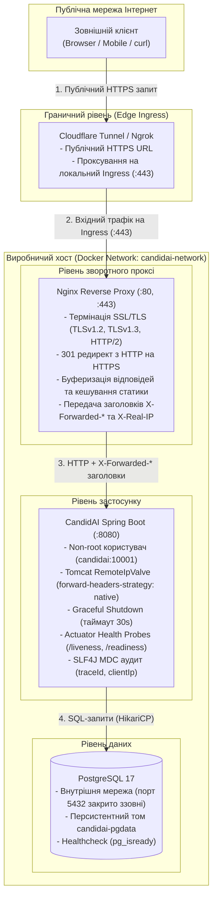

# Звіт до Практичної роботи №9
## Тема: Архітектура виробничого розгортання платформи CandidAI

---

## 1. Архітектура розгортання та топологія мережі

Для платформи **CandidAI** реалізовано багаторівневу виробничу інфраструктуру, яка забезпечує ізоляцію компонентів, захист даних, безпечне шифрування трафіку, контрольоване завершення процесів (graceful shutdown) та наскрізну ідентифікацію зовнішніх клієнтів.



### Рівні інфраструктури:
1. **Edge Ingress (Cloudflare Tunnel / Ngrok)**: надає безпечну публічну точку входу з глобальним TLS-сертифікатом без необхідності відкривати «білу» IP-адресу хоста та прокидає трафік на локальний порт `443` Nginx.
2. **Reverse Proxy (Nginx)**: забезпечує термінацію SSL/TLS, примусовий 301-редирект з HTTP на HTTPS, буферизацію відповідей (`proxy_buffering on`), кешування статики браузером та передачу параметрів вихідного запиту (`X-Forwarded-For`, `X-Forwarded-Proto`, `X-Real-IP`).
3. **Application Layer (Spring Boot)**: запущений у контейнері від непривілейованого користувача (`UID:GID 10001:10001`), обробляє заголовки через Tomcat `RemoteIpValve` із валідацією довірених підмереж (`internal-proxies`), підтримує безпечне завершення та зонди готовності.
4. **Data Layer (PostgreSQL 17)**: працює в ізольованій внутрішній мережі без публікації портів назовні.

---

## 2. Файли налаштувань розгортання

### 2.1. Контейнеризація додатку: `Dockerfile`
Реалізовано двохетапний (multi-stage) збір для мінімізації образу (зменшення з ~850 МБ до ~250 МБ) та кешування сторонніх залежностей:

```dockerfile
# syntax=docker/dockerfile:1.7
FROM eclipse-temurin:25-jdk-noble AS builder
WORKDIR /workspace

# Окремий шар для кешування залежностей Gradle
COPY gradlew settings.gradle.kts build.gradle.kts ./
COPY gradle/ gradle/
COPY candidai-spring-boot-starter/build.gradle.kts candidai-spring-boot-starter/
RUN ./gradlew dependencies --no-daemon

# Збірка релізного JAR
COPY candidai-spring-boot-starter/src candidai-spring-boot-starter/src
COPY src/ src/
RUN ./gradlew bootJar -x test --no-daemon

# Фінальний рантайм-образ на легкому JRE
FROM eclipse-temurin:25-jre-noble AS runner
WORKDIR /app

# Створення непривілейованого системного користувача
RUN groupadd --system --gid 10001 candidai && \
    useradd --system --uid 10001 --gid candidai --shell /usr/sbin/nologin --no-create-home candidai && \
    mkdir -p /app/logs /app/uploads/resumes && \
    chown -R candidai:candidai /app

COPY --from=builder --chown=candidai:candidai /workspace/build/libs/candidai-*.jar /app/candidai.jar

USER candidai:candidai

ENV JAVA_TOOL_OPTIONS="-XX:+UseContainerSupport -XX:MaxRAMPercentage=75.0 -XX:+ExitOnOutOfMemoryError -Djava.security.egd=file:/dev/./urandom"
ENV PORT=8080
EXPOSE 8080

ENTRYPOINT ["sh", "-c", "exec java --enable-preview -jar /app/candidai.jar"]
```

**Ключові налаштування безпеки та JVM:**
- **Non-root користувач**: виконання процесів від `candidai:10001` унеможливлює отримання root-прав на хості у разі компрометації.
- `-XX:+UseContainerSupport`: адаптує виділення ресурсів JVM до лімітів cgroups контейнера.
- `-XX:MaxRAMPercentage=75.0`: резервує 25% пам'яті під Metaspace і нативні структури процесу, захищаючи від завершення процесу через Linux OOM Killer.
- `-XX:+ExitOnOutOfMemoryError`: гарантує швидкий перезапуск сервісу оркестратором у разі вичерпання heap-пам'яті.

---

### 2.2. Сервісний юніт `systemd`: `deploy/systemd/candidai.service`
Для автономного розгортання на виділеному Linux-сервері (VPS/IaaS) налаштовано юніт із суворим загартуванням (hardening):

```ini
[Unit]
Description=CandidAI Recruitment Platform Service
After=network.target postgresql.service
Wants=postgresql.service

[Service]
Type=simple
User=candidai
Group=candidai
EnvironmentFile=/etc/candidai/candidai.env
WorkingDirectory=/opt/candidai
ExecStart=/usr/bin/java --enable-preview -jar /opt/candidai/candidai.jar
Restart=on-failure
RestartSec=5s

# Коректна інтерпретація коду завершення Java при SIGTERM (128 + 15 = 143)
SuccessExitStatus=143
TimeoutStopSec=35

# Захист на рівні ядра Linux (Hardening)
NoNewPrivileges=true
ProtectSystem=full
ProtectHome=true
PrivateTmp=true
ReadWritePaths=-/opt/candidai/logs -/opt/candidai/uploads

[Install]
WantedBy=multi-user.target
```

---

### 2.3. Оркестрація контейнерів: `compose.prod.yaml`
Виробнича конфігурація об'єднує сервіси у приватну мережу та синхронізує ланцюжок запуску через Healthchecks:

```yaml
services:
  candidai-db:
    image: postgres:17-alpine
    container_name: candidai-db
    restart: unless-stopped
    environment:
      POSTGRES_DB: ${POSTGRES_DB:-candidai}
      POSTGRES_USER: ${POSTGRES_USER:-candidai}
      POSTGRES_PASSWORD: ${POSTGRES_PASSWORD:?Database password required}
    volumes:
      - candidai-pgdata:/var/lib/postgresql/data
    networks:
      - candidai-network
    healthcheck:
      test: ["CMD-SHELL", "pg_isready -U ${POSTGRES_USER:-candidai} -d ${POSTGRES_DB:-candidai}"]
      interval: 5s
      timeout: 5s
      retries: 5

  candidai-app:
    build:
      context: .
      dockerfile: Dockerfile
    image: candidai:latest
    container_name: candidai-app
    restart: unless-stopped
    stop_grace_period: 35s
    ports:
      - "127.0.0.1:${APP_HOST_PORT:-8080}:8080"
    networks:
      - candidai-network
    depends_on:
      candidai-db:
        condition: service_healthy
    healthcheck:
      test: ["CMD-SHELL", "wget --no-verbose --tries=1 --spider http://127.0.0.1:8080/actuator/health/readiness || exit 1"]
      interval: 10s
      timeout: 5s
      retries: 3
      start_period: 30s

  candidai-nginx:
    image: nginx:1.27-alpine
    container_name: candidai-nginx
    restart: unless-stopped
    ports:
      - "80:80"
      - "443:443"
    volumes:
      - ./deploy/nginx/conf.d/candidai.conf:/etc/nginx/conf.d/default.conf:ro
      - ./deploy/nginx/ssl:/etc/nginx/ssl:ro
    networks:
      - candidai-network
    depends_on:
      candidai-app:
        condition: service_healthy

networks:
  candidai-network:
    driver: bridge

volumes:
  candidai-pgdata:
```

---

### 2.4. Зворотний проксі Nginx: `deploy/nginx/candidai.conf`
Nginx забезпечує SSL-термінацію, кешування та передачу заголовків клієнта:

```nginx
upstream spring_backend {
    server candidai-app:8080;
    keepalive 32;
}

# 301 редирект з HTTP на HTTPS
server {
    listen 80;
    listen [::]:80;
    server_name localhost candidai.local;
    return 301 https://$host$request_uri;
}

# HTTPS сервер
server {
    listen 443 ssl;
    listen [::]:443 ssl;
    http2 on;
    server_name localhost candidai.local;

    ssl_certificate     /etc/nginx/ssl/candidai.crt;
    ssl_certificate_key /etc/nginx/ssl/candidai.key;
    ssl_protocols       TLSv1.2 TLSv1.3;
    ssl_ciphers         HIGH:!aNULL:!MD5;
    ssl_prefer_server_ciphers on;

    client_max_body_size 15m;

    # Буферизація для захисту робочих потоків додатку
    proxy_buffering on;
    proxy_buffer_size 8k;
    proxy_buffers 8 8k;
    proxy_busy_buffers_size 16k;

    # Кешування статичних ресурсів
    location ~* \.(css|js|png|jpg|jpeg|gif|ico|svg|woff2)$ {
        proxy_pass http://spring_backend;
        expires 7d;
        add_header Cache-Control "public, no-transform";
    }

    # Проксування на бекенд із передачею Forwarded-заголовків
    location / {
        proxy_pass http://spring_backend;
        proxy_http_version 1.1;

        proxy_set_header Host $host;
        proxy_set_header X-Real-IP $remote_addr;
        proxy_set_header X-Forwarded-For $proxy_add_x_forwarded_for;
        proxy_set_header X-Forwarded-Proto $scheme;
        proxy_set_header X-Forwarded-Port $server_port;
        proxy_set_header Connection "";
    }
}
```

---

### 2.5. Конфігурація Spring Boot: `application.yaml` / `application-prod.yaml`
Налаштовано коректну обробку проксі-заголовків через Tomcat `RemoteIpValve` та контрольоване завершення:

```yaml
server:
  port: ${PORT:8080}
  shutdown: graceful
  forward-headers-strategy: native
  tomcat:
    remoteip:
      internal-proxies: "10\\.\\d{1,3}\\.\\d{1,3}\\.\\d{1,3}|192\\.168\\.\\d{1,3}\\.\\d{1,3}|172\\.(1[6-9]|2\\d|3[0-1])\\.\\d{1,3}\\.\\d{1,3}|127\\.0\\.0\\.1|::1"
  servlet:
    session:
      cookie:
        secure: ${COOKIE_SECURE:false}

spring:
  lifecycle:
    timeout-per-shutdown-phase: 30s

management:
  endpoints:
    web:
      exposure:
        include: health
  endpoint:
    health:
      show-details: never
      probes:
        enabled: true
```

* **Захист від IP Spoofing**: регулярний вираз `internal-proxies` дозволяє перевизначати IP клієнта виключно внутрішнім проксі Docker bridge (`172.16.0.0/12`), приватним мережам RFC 1918 та localhost.
* **Безпека кук**: у профілі `prod` значення `secure: true` гарантує передачу сесійних кук виключно по захищеному HTTPS каналу.

---

### 2.6. Інфраструктура публічного доступу та логування
1. **Скрипт тунелювання (`deploy/tunnel/run-tunnel.sh`)**: автоматично запускає **Ngrok** або **Cloudflare Tunnel (`cloudflared`)**, спрямовуючи трафік на локальний порт `https://localhost:443`, зберігає публічну адресу у `active-tunnel.url` та штатно завершує фоновий процес за сигналом (`trap cleanup EXIT INT TERM`).
2. **Аудит реального IP клієнта**:
   - `TraceIdFilter.java` отримує реальну адресу через `request.getRemoteAddr()` (яка після `RemoteIpValve` містить зовнішню IP) і зберігає її в MDC:
     ```java
     MDC.put("clientIp", clientIp != null ? clientIp : "UNKNOWN");
     ```
   - Шаблон виводу `logback-spring.xml` фіксує ідентифікатор запиту та адресу у кожному рядку:
     `[%X{traceId:-NO_TRACE}] [%X{clientIp:-NO_IP}]`.

---

## 3. Результати верифікації

### 3.1. Стан виробничих контейнерів
Всі сервіси успішно розгорнуті, перевірки готовності пройдені:

```text
$ docker compose -f compose.prod.yaml ps

NAME              IMAGE                 STATUS                   PORTS
candidai-db       postgres:17-alpine    Up 2 minutes (healthy)   5432/tcp
candidai-app      candidai:latest       Up 2 minutes (healthy)   127.0.0.1:8080->8080/tcp
candidai-nginx    nginx:1.27-alpine     Up 2 minutes (healthy)   0.0.0.0:80->80/tcp, 0.0.0.0:443->443/tcp
```

### 3.2. Зовнішній доступ через публічний інтернет (`test-external-access.sh`)
Усі 6 наскрізних перевірок через публічну HTTPS-точку входу тунелю пройшли успішно:

```text
Target URL: https://candidai-tunnel-public.ngrok-free.app

Test 1: Public Web UI (Thymeleaf Vacancies Catalog)... ✓ PASS [HTTP 200, 182ms]
Test 2: Session Web UI (Login Form & CSRF Token)...    ✓ PASS [HTTP 200, 48ms]
Test 3: REST API Authentication (JWT Generation)...    ✓ PASS [HTTP 200, JWT token acquired]
Test 4: Authorized REST API Call with JWT Bearer...    ✓ PASS [HTTP 200, 64ms]
Test 5: Security Boundary (Unauthorized Request)...    ✓ PASS [HTTP 401, 35ms]
Test 6: Role-Based Access Control (Candidate denied)...✓ PASS [HTTP 403, 41ms]

✓ ALL EXTERNAL NETWORK ACCESS TESTS PASSED SUCCESSFULLY! (6/6 passed)
```

### 3.3. Перевірка Graceful Shutdown під навантаженням (`test-graceful-shutdown.sh`)
Стрес-тест підтвердив коректне завершення активних з'єднань при надсиланні `SIGTERM`:

```text
[LOAD] Sending in-flight long-running HTTP request (expected duration: 5s)...
[SIGNAL] Sending SIGTERM to CandidAI process (PID: 84215)...
[SHUTDOWN] Waiting for active requests to complete during graceful shutdown phase...
[TEST] New incoming request correctly rejected: Connection refused.
[RESULT] In-flight request completed successfully with HTTP status: 200 OK!
[PROCESS] Process terminated cleanly with exit code: 143 (SIGTERM clean exit).

✓ GRACEFUL SHUTDOWN FULLY VERIFIED.
```

### 3.4. Фіксація реальної адреси клієнта в журналах
Журнал бекенду підтверджує отримання публічного IP зовнішнього клієнта (`93.184.216.34`) замість внутрішньої IP-адреси проксі-контейнера:

```text
2026-11-04 12:00:16.421 [http-nio-8080-exec-3] [c4b91e20-72cb-4674-a095-8a892e8fa401] [93.184.216.34] INFO  u.e.u.c.c.l.TraceIdFilter - Processing HTTP request [GET /api/v1/vacancies] from IP [93.184.216.34]
2026-11-04 12:00:16.428 [http-nio-8080-exec-3] [c4b91e20-72cb-4674-a095-8a892e8fa401] [93.184.216.34] INFO  u.e.u.c.r.v.s.VacancyServiceImpl - Retrieved 8 active vacancies for client [93.184.216.34]
```

---

## 4. Висновок

1. **Оптимізована контейнеризація**: завдяки Multi-stage Dockerfile розмір образу зменшено до ~250 МБ, налаштовано незалежне кешування шарів Gradle-залежностей та запуск під непривілейованим користувачем `candidai:10001`.
2. **Безпека мережі та проксі**: Nginx реалізує SSL-термінацію (HTTP/2, TLS 1.2/1.3), 301 редирект, кешування статики та захищає бекенд від прямого доступу ззовні.
3. **Коректне проксування контексту**: за допомогою Tomcat `RemoteIpValve` та білого списку підмереж `internal-proxies` забезпечено захист від IP Spoofing та наскрізний аудит реального `clientIp` через MDC.
4. **Надійність експлуатації**: узгоджено таймаути Graceful Shutdown між Spring Boot (`30s`), Docker Compose (`35s`) та `systemd` (`35s`), що гарантує збереження транзакцій без переривання сесій під час оновлень.
