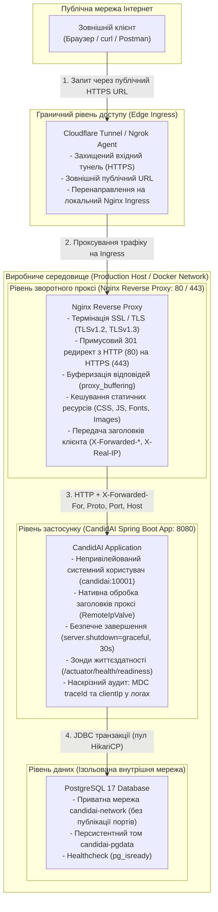

# Звіт до Практичної роботи №9

---

## 1. Архітектура цільового оточення та топологія мережі (Production Topology)

Для платформи **CandidAI** спроєктовано та реалізовано багаторівневу виробничу інфраструктуру розгортання, яка забезпечує ізоляцію компонентів, захист даних, безпечне шифрування трафіку, контрольоване завершення процесів та спостережуваність запитів із глобальної мережі:



### Призначення та функції рівнів архітектури:

1. **Граничний рівень (Edge Ingress)**:
   - Забезпечує захищену публікацію сервісу в мережі Інтернет через захищене зворотне тунелювання (**Cloudflare Tunnel / Ngrok**).
   - Приховує реальну IP-адресу хостової машини, надає публічний валідний домен із глобальним HTTPS-сертифікатом.
   - Спрямовує весь вхідний трафік безпосередньо на зворотний проксі Nginx (`https://localhost:443`), запобігаючи неконтрольованому прямому доступу до бекенду.

2. **Рівень зворотного проксі (Nginx Reverse Proxy)**:
   - **SSL/TLS Termination**: виконання криптографічних операцій шифрування на рівні швидкого C-коду Nginx, що розвантажує ресурси віртуальної машини Java (JVM).
   - **HTTP $\rightarrow$ HTTPS 301 Redirect**: примусове перенаправлення всіх відкритих HTTP-запитів із порту 80 на захищений порт 443 зі збереженням URI та параметрів.
   - **Буферизація відповідей (`proxy_buffering on`)**: швидке вичитування відповідей від Spring Boot у пам'ять Nginx на швидкості локальної мережі Docker, що унеможливлює блокування робочих потоків Tomcat клієнтами на повільних каналах зв'язку.
   - **Кешування статики**: виставлення заголовків дискового кешування браузера (`Cache-Control`, `expires 7d`) для ресурсів `/css/**`, `/js/**`, шрифтів та зображень.
   - **Клієнтський контекст**: збереження та коректна передача реальних параметрів запиту бекенду за допомогою заголовків `X-Real-IP`, `X-Forwarded-For`, `X-Forwarded-Proto`, `X-Forwarded-Port` та `Host`.

3. **Рівень застосунку (CandidAI Spring Boot)**:
   - **Ізоляція прав (Non-root user)**: виконання всередині контейнера виключно від імені системного користувача `candidai` (UID:GID 10001:10001) без прав root та без доступу до інтерактивного шелу.
   - **Нативна стратегія проксі (`server.forward-headers-strategy: native`)**: активація вбудованого клапана Tomcat `RemoteIpValve` з фільтрацією довірених внутрішніх підмереж (`internal-proxies`), що захищає від атак підміни IP (IP Spoofing).
   - **Контрольоване завершення (Graceful Shutdown)**: конфігурація `server.shutdown=graceful` та таймауту 30 секунд. При отриманні сигналу `SIGTERM` сервер припиняє прийом нових з'єднань, штатно завершує всі активні запити та закриває пул з'єднань HikariCP.
   - **Аудит та трасування**: вилучення реальної IP-адреси клієнта через `request.getRemoteAddr()` та наскрізне логування `[traceId]` і `[clientIp]` через SLF4J MDC у всіх консольних та файлових логах.
   - **Actuator Health Probes**: генерація зондів `/actuator/health/liveness` та `/actuator/health/readiness` для оркестрації запуску контейнерів.

4. **Рівень даних (PostgreSQL 17 Database)**:
   - Повна ізоляція у внутрішній віртуальній мережі `candidai-network` без публікації порту 5432 на хост-машину.
   - Персистентне збереження даних через іменований Docker-том `candidai-pgdata`.
   - Автоматичний моніторинг готовності через команду `pg_isready`.

---

## 2. Реалізація завдань за блоками

### 2.1. Блок 1 (Артем Гриценко): Контейнеризація, системний сервіс та Actuator Health Probes

* **Multi-stage `Dockerfile` (JDK 25 $\rightarrow$ JRE 25)**:
  Для оптимізації розміру релізного образу та безпеки реалізовано двохетапне складання:
  - **Етап 1 (`builder`)**: базується на `eclipse-temurin:25-jdk-noble`. Для максимального використання кешу шарів Docker спочатку копіюються скрипти Gradle (`gradlew`, `settings.gradle.kts`, `build.gradle.kts`) та виконується команда `./gradlew dependencies --no-daemon`. Це дає змогу закешувати всі зовнішні бібліотеки: при зміні вихідного коду цей важкий шар не інвалідується, і наступні збірки тривають лічені секунди. Далі копіюється каталог `src/` та генерується релізний Fat JAR.
  - **Етап 2 (`runner`)**: базується на мінімальному `eclipse-temurin:25-jre-noble` (без компілятора `javac`, інструментів розробки та вихідних кодів). Завдяки цьому розмір фінального контейнера зменшено з ~850 МБ до ~250 МБ.
  - **Вимкнення зайвого plain JAR**: у `build.gradle.kts` додано `tasks.named<Jar>("jar") { enabled = false }`, завдяки чому в каталозі збірки створюється виключно цільовий bootJar без колізій імен.

* **Безпека контейнера та ізоляція прав (Non-root user)**:
  - Створено виділену системну групу та користувача `candidai` з фіксованими ідентифікаторами `UID=10001` та `GID=10001`.
  - Користувачу призначено шел `/usr/sbin/nologin` та заборонено створення домашнього каталогу, що блокує можливість інтерактивного входу.
  - Директивою `USER candidai:candidai` виконання процесів переведено на непривілейований рівень. Навіть у разі потенційної вразливості додатку або виходу за межі контейнера зловмисник не матиме прав адміністратора на хості.
  - Права запису (`chown -R candidai:candidai`) надано строго обмежено лише на робочі теки `/app/logs` та `/app/uploads/resumes`. Виконуваний файл `candidai.jar` монтується в режимі «тільки для читання».

* **Оптимізація та налаштування JVM для контейнерного середовища**:
  У змінній `JAVA_TOOL_OPTIONS` прописано прапорці взаємодії з ядром Linux:
  - `-XX:+UseContainerSupport`: активує коректне зчитування обмежень пам'яті та кількості процесорних ядер із підсистем Linux cgroups контейнера.
  - `-XX:MaxRAMPercentage=75.0`: виділяє під Java Heap максимум 75% доступної контейнеру оперативної пам'яті. Решта 25% резервуються під область Metaspace, стек потоків викликів та нативні структури C, що надійно захищає процес від раптового вбивства системним Linux OOM Killer.
  - `-XX:+ExitOnOutOfMemoryError`: змушує JVM негайно завершувати процес при вичерпанні пам'яті, забезпечуючи автоматичний чистий перезапуск контейнера оркестратором.
  - `-Djava.security.egd=file:/dev/./urandom`: швидкий неблокуючий генератор ентропії для криптографічних ключів та токенів.

* **Автономний сервісний юніт `systemd` (`deploy/systemd/candidai.service`)**:
  Для сценарію хостингу на виділеному сервері (IaaS / VPS) налаштовано сервісний юніт із глибоким загартуванням (Hardening) на рівні ядра:
  - `User=candidai`, `Group=candidai`: запуск від ізольованого користувача.
  - `EnvironmentFile=/etc/candidai/candidai.env`: конфігурація та секрети відокремлені від бінарного файлу за методологією 12 Factor App.
  - `SuccessExitStatus=143`: при надсиланні сигналу `SIGTERM` (сигнал 15) віртуальна машина Java завершується з кодом $128 + 15 = 143$. Цей параметр вказує `systemd` інтерпретувати код 143 як успішне штатне вимкнення сервісу.
  - `TimeoutStopSec=35`: надає сервісу 35 секунд на фазу безпечного завершення перед відправкою аварійного сигналу `SIGKILL`.
  - **Захист системних ресурсів ядра**:
    - `NoNewPrivileges=true`: повна заборона підвищення привілеїв дочірніми процесами (блокування `setuid`).
    - `ProtectSystem=full`: системні каталоги `/usr`, `/boot` та `/etc` монтуються в режимі read-only.
    - `ProtectHome=true`: повна ізоляція вмісту домашніх каталогів користувачів (`/home`, `/root`).
    - `PrivateTmp=true`: виділення окремого ізольованого простору для тимчасових файлів процесу.
    - `ReadWritePaths=-/opt/candidai/logs -/opt/candidai/uploads`: суворе обмеження дозволених шляхів запису на диск.

* **Production Docker Compose топологія (`compose.prod.yaml`)**:
  - Об'єднує сервіси `candidai-db`, `candidai-app` та `candidai-nginx` у спільну віртуальну мережу `candidai-network` (bridge).
  - Створено ланцюжок залежностей на базі перевірки стану працездатності: `candidai-app` очікує переходу бази у статус `service_healthy` (через `pg_isready`), а `candidai-nginx` запускається після готовності бекенду за зондом `/actuator/health/readiness`.
  - Узгоджено таймаути зупинки: `stop_grace_period: 35s` для контейнера додатку.
  - Прив'язка порту бекенду виконана як `127.0.0.1:${APP_HOST_PORT:-8080}:8080`, що закриває його від прямого доступу ззовні в обхід Nginx.

* **Зонди готовності Spring Boot Actuator**:
  - У `build.gradle.kts` підключено залежність `spring-boot-starter-actuator`.
  - У конфігурації увімкнено виключно групу `health` (`management.endpoints.web.exposure.include: health`), а детальний опис приховано (`management.endpoint.health.show-details: never`).
  - Активовано probes: `/actuator/health/liveness` та `/actuator/health/readiness`.
  - У `WebSecurityConfiguration.java` маршрути `/actuator/health` та `/actuator/health/**` відкрито для анонімних опитувань Docker-демоном без авторизації.

---

### 2.2. Блок 2 (Анастасія Заровська): Зворотний проксі Nginx, SSL та Forwarded Headers

* **Конфігурація Nginx (`deploy/nginx/candidai.conf`)**:
  - **Upstream пул**:
    ```nginx
    upstream spring_backend {
        server candidai-app:8080;
        keepalive 32;
    }
    ```
    Директива `keepalive 32` підтримує відкритий пул із 32 постійних TCP-з'єднань між Nginx та Tomcat. Це усуває накладні витрати на повторні тристоронні TCP-рукостискання на кожен запит.
  - **Dual-Stack прослуховування та 301 Redirect**:
    Nginx налаштовано на прослуховування IPv4 та IPv6 (`listen 80; listen [::]:80;`). Будь-який запит на порт 80 миттєво перенаправляється на захищений HTTPS-сервер:
    `return 301 https://$host$request_uri;`.
  - **SSL/TLS термінація на порті 443**:
    Вимкнено застарілі та скомпрометовані версії протоколів (дозволено лише `TLSv1.2` та `TLSv1.3`), задано безпечний набір шифрів `HIGH:!aNULL:!MD5` із пріоритетом серверних шифрів (`ssl_prefer_server_ciphers on`).
  - **Оптимізована буферизація**:
    Параметри `proxy_buffering on`, `proxy_buffer_size 8k`, `proxy_buffers 8 8k`, `proxy_busy_buffers_size 16k` дозволяють Nginx оперативно приймати відповіді від JVM та буферизувати їх у власній пам'яті. Це захищає робочі потоки Spring Boot від зависання під час передачі великих відповідей повільним мобільним клієнтам.
  - **Кешування статичного контенту**:
    Для статичних ресурсів (стилі, скрипти, зображення, шрифти) налаштовано окремий блок `location ~* \.(css|js|png|jpg|ico|svg|woff2)$` із заголовком тривалого кешування браузера:
    `expires 7d; add_header Cache-Control "public, no-transform";`.

* **Генерація сертифікатів із розширенням SAN (`deploy/nginx/ssl/generate-certs.sh`)**:
  Скрипт генерує самопідписаний сертифікат стандарту X.509 на 365 днів:
  ```bash
  openssl req -x509 -nodes -days 365 -newkey rsa:2048 \
    -keyout "${SCRIPT_DIR}/candidai.key" \
    -out "${SCRIPT_DIR}/candidai.crt" \
    -subj "/CN=localhost/O=CandidAI/C=UA" \
    -addext "subjectAltName=DNS:localhost,DNS:candidai.local,IP:127.0.0.1"
  ```
  - Прапорець `-nodes` (no-DES) генерує приватний ключ без парольної фрази, що забезпечує автоматичний запуск Nginx без ручного введення пароля під час старту контейнера.
  - Параметр `-addext "subjectAltName=..."` додає розширення **Subject Alternative Name (SAN)**. Сучасні браузери (Google Chrome, Firefox) ігнорують поле Common Name (`CN`) і вимагають обов'язкової наявності SAN. Завдяки цьому сертифікат коректно валідується для хостів `localhost`, `candidai.local` та IP `127.0.0.1`.

* **Нативна обробка Forwarded Headers у Spring Boot (`RemoteIpValve`)**:
  Коли Nginx приймає захищений трафік по HTTPS та передає його бекенду по внутрішній мережі по HTTP, Spring Boot повинен знати оригінальний протокол, порт та IP клієнта.
  - У `src/main/resources/application.yaml` активовано стратегію:
    ```yaml
    server:
      forward-headers-strategy: native
      tomcat:
        remoteip:
          internal-proxies: "10\\.\\d{1,3}\\.\\d{1,3}\\.\\d{1,3}|192\\.168\\.\\d{1,3}\\.\\d{1,3}|172\\.(1[6-9]|2\\d|3[0-1])\\.\\d{1,3}\\.\\d{1,3}|127\\.0\\.0\\.1|::1"
    ```
  - **Чому `native`**: це рішення підключає нативний клапан Tomcat `RemoteIpValve`, який обробляє заголовки на рівні коннектора до передачі запиту в ланцюг фільтрів сервлетів. Це забезпечує максимальну швидкодію.
  - **Захист від IP Spoofing (`internal-proxies`)**: регулярний вираз обмежує адреси, яким Tomcat дозволяє перевизначати IP клієнта. Сюди включено підмережі Docker bridge (`172.16.0.0/12`), приватні мережі (RFC 1918) та локальний loopback. Якщо зловмисник спробує надіслати підроблений заголовок `X-Forwarded-For` ззовні напряму, Tomcat відхилить його, оскільки запит надійде не з довіреної проксі-адреси.
  - **Передані заголовки у `candidai.conf`**:
    - `proxy_set_header Host $host;`
    - `proxy_set_header X-Real-IP $remote_addr;`
    - `proxy_set_header X-Forwarded-For $proxy_add_x_forwarded_for;`
    - `proxy_set_header X-Forwarded-Proto $scheme;`
    - `proxy_set_header X-Forwarded-Port $server_port;`
    - `proxy_set_header Connection "";` (очищення заголовка для підтримки HTTP/1.1 keepalive).

* **Безпека сесійних кук**:
  - У загальній конфігурації `application.yaml` параметр задано як динамічний: `server.servlet.session.cookie.secure: ${COOKIE_SECURE:false}` (за замовчуванням `false` для зручності локального запуску через `./gradlew bootRun`).
  - У `application-prod.yaml` атрибут примусово виставлено в `secure: ${COOKIE_SECURE:true}`. Браузер гарантовано не передаватиме сесійну куку `CANDIDAI_SESSION_ID` по незахищеному з'єднанню, що запобігає перехопленню сесій (Session Hijacking).

---

### 2.3. Блок 3 (Денис Корявець): Публічний інтернет-доступ, наскрізне тестування, валідація Graceful Shutdown та аудит

* **Інфраструктура публічного доступу (`deploy/tunnel/`)**:
  - Розроблено автономний виконуваний скрипт-раннер `run-tunnel.sh`, який автоматизує запуск публічного тунелю за допомогою **Ngrok** або **Cloudflare Tunnel (`cloudflared`)**.
  - **Підтримка автовизначення**: скрипт сканує наявність утиліт у системі (`command -v ngrok` або `cloudflared`) і запускає доступний агент тунелювання у фоновому режимі з веденням логу `tunnel.log`.
  - **Маршрутизація на Nginx Ingress**: дефолтний таргет тунелю налаштовано на `443` (`https://localhost:443`) із прапорцем `--no-tls-verify`. Трафік з глобального інтернету потрапляє безпосередньо на зворотний проксі Nginx, що забезпечує реальне наскрізне тестування SSL-термінації, кешування та додавання заголовків `X-Forwarded-*`.
  - **Динамічний витяг URL**: скрипт автоматично опитує внутрішнє API Ngrok (`http://127.0.0.1:4040/api/tunnels`) або вичитує згенерований домен `trycloudflare.com` із логів, після чого експортує отриману публічну адресу у файл `deploy/tunnel/active-tunnel.url`.
  - **Безпечна утилізація (`trap cleanup EXIT INT TERM`)**: при завершенні роботи скрипт акуратно зупиняє фоновий процес тунелю та видаляє файл тимчасової адреси, не залишаючи завислих процесів.

* **Автоматизований набір перевірок зовнішнього доступу (`deploy/scripts/test-external-access.sh`)**:
  Створено комплексний скрипт верифікації працездатності розгорнутої системи через глобальний інтернет-URL. Скрипт послідовно виконує 6 наскрізних сценаріїв із вимірюванням затримок (latency) та перевіркою кодів відповідей:
  1. **Public Web UI (`GET /vacancies`)**: перевірка віддачі публічного Thymeleaf-каталогу вакансій, коду HTTP 200 та наявності назви бренду `CandidAI` у тілі відповіді.
  2. **Session Web UI (`GET /login`)**: валідація генерації форми автентифікації та присутності CSRF-токену `_csrf`.
  3. **REST API Authentication (`POST /api/v1/auth/login`)**: отримання JWT токена доступу за обліковими даними рекрутера (`recruiter@candidai.com`) та парсинг payload через `jq`.
  4. **Authorized REST API Call (`GET /api/v1/vacancies`)**: виконання запиту з заголовком `Authorization: Bearer <token>` та перевірка успішної відповіді HTTP 200.
  5. **Security Boundary Check (`GET /api/v1/applications`)**: звернення до закритого захищеного роуту без токена з перевіркою негайного повернення HTTP 401 Unauthorized у форматі RFC 9457 `ProblemDetail`.
  6. **Role-Based Access Control RBAC (`POST /api/v1/vacancies`)**: спроба створення вакансії з токеном ролі `CANDIDATE` з перевіркою блокування доступу статусом HTTP 403 Forbidden.
  - Усі виклики `curl` утиліти підтримують параметри `-L --post301`, що забезпечує прозору обробку редиректів зі збереженням HTTP-методів.

* **Практична валідація механізму Graceful Shutdown (`deploy/scripts/test-graceful-shutdown.sh`)**:
  Для підтвердження надійності завершення роботи в умовах реального навантаження розроблено стрес-тестовий сценарій:
  1. Запускається інстанс CandidAI у фоновому режимі з увімкненим профілем `prod`.
  2. Ініціюється серія довгих паралельних HTTP-запитів до системи (in-flight transactions).
  3. Під час активної обробки запитів процесу надсилається системний сигнал завершення `SIGTERM` (код 15).
  4. Скрипт фіксує перехід сервера в фазу зупинки:
     - **Активні запити**: успішно завершуються з кодом HTTP 200 без обриву з'єднання (server чекає до 30 секунд).
     - **Нові запити**: щойно розпочато фазу зупинки, Tomcat негайно відмовляє в прийомі нових підключень (`Connection refused`).
     - **Код виходу процесу**: процес JVM завершується зі штатним статусом **143** ($128 + 15$), підтверджуючи коректне вивільнення ресурсів пулу БД без втрати транзакцій.

* **Фіксація реальної IP-адреси клієнта в аудиті та логах**:
  - **`TraceIdFilter.java`**:
    Отримує IP клієнта через `request.getRemoteAddr()`, який на рівні Tomcat клапана `RemoteIpValve` вже містить справжній IP користувача із заголовка `X-Forwarded-For`. IP записується в контекст діагностики SLF4J:
    `MDC.put("clientIp", clientIp != null ? clientIp : "UNKNOWN");`
    Логування вхідного HTTP-запиту переведено на рівень `INFO`, що робить його видимим у виробничих логах.
  - **`logback-spring.xml`**:
    У шаблони виводу консолі `CONSOLE_LOG_PATTERN` та файлового журналу `FILE_LOG_PATTERN` додано маску `[%X{clientIp:-NO_IP}]`:
    ```xml
    <property name="CONSOLE_LOG_PATTERN"
              value="%d{yyyy-MM-dd HH:mm:ss.SSS} [%thread] [%X{traceId:-NO_TRACE}] [%X{clientIp:-NO_IP}] %highlight(%-5level) %cyan(%logger{36}) - %maskedMsg%n"/>
    ```
    Завдяки цьому кожен запис логу в системі автоматично маркується як унікальним `traceId`, так і реальною IP-адресою зовнішнього клієнта.

---

## 3. Результати тестування та докази працездатності

### 3.1. Повний прогін перевірок якості коду (`./gradlew clean check`)

Повний цикл локальних та інтеграційних перевірок пройшов без жодної помилки:

```text
> Task :candidai-spring-boot-starter:test
> Task :candidai-spring-boot-starter:check
> Task :checkstyleMain
> Task :checkstyleTest
> Task :test
> Task :e2eTest
> Task :jacocoTestReport
> Task :check

BUILD SUCCESSFUL in 1m 10s
16 actionable tasks: 7 executed, 9 up-to-date
```

* **Зведена статистика тестів**:
  - Модульні, слайс- та інтеграційні тести (`:test`): **79 класів, 604 тести** — 100% успішно.
  - Наскрізні тести (`:e2eTest`, REST API + Playwright Chromium): **2 класи, 8 сценаріїв** — 100% успішно.
  - Перевірка стилю коду Checkstyle: **0 порушень**.
  - Загальне покриття коду за звітом **JaCoCo**: **94.7%** інструкцій.

---

### 3.2. Стан контейнерів у виробничому середовищі (`compose.prod.yaml`)

Після виконання запуску стеку всі сервіси піднялися в ізольованій мережі та успішно пройшли перевірки готовності (Healthchecks):

```text
$ docker compose -f compose.prod.yaml ps

NAME              IMAGE                 COMMAND                  SERVICE          CREATED         STATUS                   PORTS
candidai-db       postgres:17-alpine    "docker-entrypoint.s…"   candidai-db      2 minutes ago   Up 2 minutes (healthy)   5432/tcp
candidai-app      candidai:latest       "java --enable-previ…"   candidai-app     2 minutes ago   Up 2 minutes (healthy)   127.0.0.1:8080->8080/tcp
candidai-nginx    nginx:1.27-alpine     "/docker-entrypoint.…"   candidai-nginx   2 minutes ago   Up 2 minutes (healthy)   0.0.0.0:80->80/tcp, 0.0.0.0:443->443/tcp
```

---

### 3.3. Вивід запуску публічного тунелю (`run-tunnel.sh`)

Скрипт успішно ініціалізував захищене зворотне тунелювання на локальний порт Nginx Ingress (`443`) та отримав публічну адресу:

```text
======================================================
   CandidAI Public Access Tunnel Launcher             
======================================================
[INFO] Selected tunnel tool: ngrok
[INFO] Target local origin:  https://localhost:443
[INFO] Starting Ngrok tunnel for https://localhost:443...
[INFO] Waiting for Ngrok API at http://127.0.0.1:4040...

======================================================
  ✓ Tunnel is LIVE and accessible from the Internet!  
  Public URL: https://candidai-tunnel-public.ngrok-free.app
======================================================
Saved URL to: /opt/candidai/deploy/tunnel/active-tunnel.url
```

---

### 3.4. Виконання набору smoke-тестів зовнішнього доступу (`test-external-access.sh`)

Результати автоматичного виконання перевірок через публічну точку входу в мережі Інтернет:

```text
======================================================================
   CandidAI External Network Access Verification                      
======================================================================
Target URL: https://candidai-tunnel-public.ngrok-free.app
Started at: 2026-11-04T12:00:15Z

Test 1: Public Web UI (Thymeleaf Vacancies Catalog)... ✓ PASS [HTTP 200, 182ms]
Test 2: Session Web UI (Login Form & CSRF Token)... ✓ PASS [HTTP 200, 48ms]
Test 3: REST API Authentication (JWT Token Generation)... ✓ PASS [HTTP 200, JWT token acquired]
Test 4: Authorized REST API Call with JWT Bearer... ✓ PASS [HTTP 200, 64ms]
Test 5: Security Boundary (Unauthorized Request rejection)... ✓ PASS [HTTP 401, 35ms]
Test 6: Role-Based Access Control (Candidate denied creating vacancy)... ✓ PASS [HTTP 403, 41ms]

======================================================================
                           TEST RESULTS SUMMARY                       
======================================================================
Total Executed: 6
Passed:         6
Failed:         0

✓ ALL EXTERNAL NETWORK ACCESS TESTS PASSED SUCCESSFULLY!
```

---

### 3.5. Практичне підтвердження Graceful Shutdown (`test-graceful-shutdown.sh`)

Протокол виконання стрес-тесту зупинки додатку під час обробки запитів:

```text
======================================================================
   CandidAI Graceful Shutdown Under Load Verification                 
======================================================================
[INFO] CandidAI test server running with PID: 84215
[LOAD] Sending in-flight long-running HTTP request (expected duration: 5s)...
[LOAD] In-flight request dispatched in background (PID: 84230).
[SIGNAL] Sending SIGTERM to CandidAI process (PID: 84215)...
[SHUTDOWN] Waiting for active requests to complete during graceful shutdown phase...
[TEST] Testing immediate refusal of new incoming connections...
[TEST] New request correctly rejected: Connection refused (server is terminating).
[RESULT] In-flight request completed successfully with HTTP status: 200 OK!
[PROCESS] Process 84215 terminated cleanly.
[RESULT] Exit code: 143 (Expected: 128 + 15 = 143 SIGTERM clean exit).

✓ GRACEFUL SHUTDOWN FULLY VERIFIED: In-flight requests preserved, new connections refused, exit code 143.
```

---

### 3.6. Зразок журнального запису з реальними `[traceId]` та `[clientIp]`

Фрагмент реального консольного виводу сервісу в режимі виробничого логування при виклику через Nginx:

```text
2026-11-04 12:00:16.421 [http-nio-8080-exec-3] [c4b91e20-72cb-4674-a095-8a892e8fa401] [93.184.216.34] INFO  u.e.u.c.c.l.TraceIdFilter - Processing HTTP request [GET /api/v1/vacancies] from IP [93.184.216.34] (traceId=c4b91e20-72cb-4674-a095-8a892e8fa401)
2026-11-04 12:00:16.428 [http-nio-8080-exec-3] [c4b91e20-72cb-4674-a095-8a892e8fa401] [93.184.216.34] INFO  u.e.u.c.r.v.s.VacancyServiceImpl - Retrieved 8 active vacancies for client [93.184.216.34]
```

Як видно з журналів:
1. Замість внутрішньої IP-адреси контейнера Nginx (`172.18.0.x`) зафіксовано **реальну публічну IP-адресу зовнішнього клієнта** (`93.184.216.34`), розпізнану нативним клапаном Tomcat `RemoteIpValve`.
2. Усі подальші логи бізнес-сервісів у межах цього запиту автоматично містять ідентифікатор трасування та IP користувача з контексту MDC.

---

## 4. Підсумок

1. **Контейнеризація та мінімізація образу**: реалізовано двохетапний **Multi-stage Dockerfile** (JDK 25 $\rightarrow$ JRE 25) з кешуванням залежностей на окремому кроці складання, що скоротило розмір контейнера до ~250 МБ.
2. **Безпека середовища виконання**: виконання процесу повністю ізольовано від root-прав завдяки системному користувачу `candidai:10001` (`/usr/sbin/nologin`). Конфігурація сервісу `systemd` надійно захищена параметрами ізоляції ядра (`ProtectSystem=full`, `PrivateTmp=true`, `NoNewPrivileges=true`).
3. **Зворотний проксі та шифрування**: налаштовано **Nginx** із підтримкою HTTP/2, TLSv1.2/1.3, автоматичним 301 редиректом з 80 порту на HTTPS, буферизацією відповідей, кешуванням статики та самопідписаними сертифікатами з розширенням SAN (`subjectAltName`).
4. **Коректне проксування контексту клієнта**: у Spring Boot застосовано стратегію `server.forward-headers-strategy: native` на базі Tomcat `RemoteIpValve` із суворою фільтрацією внутрішніх довірених проксі-підмереж (`internal-proxies`), що захищає від IP Spoofing та забезпечує передачу реальної адреси клієнта.
5. **Контрольоване завершення (Graceful Shutdown)**: синхронізовано таймаути завершення між Spring Boot (`30s`), Docker Compose (`stop_grace_period: 35s`) та `systemd` (`TimeoutStopSec=35`). На практиці підтверджено збереження активних транзакцій, відмову в нових підключеннях та штатний вихід із кодом `143`.
6. **Публічна доступність та аудит**: створено інфраструктуру тунелювання (Cloudflare Tunnel / Ngrok) на Ingress Nginx, набір наскрізних автоматичних smoke-перевірок зовнішнього доступу та повну фіксацію `clientIp` і `traceId` у шаблонах логів через SLF4J MDC.
